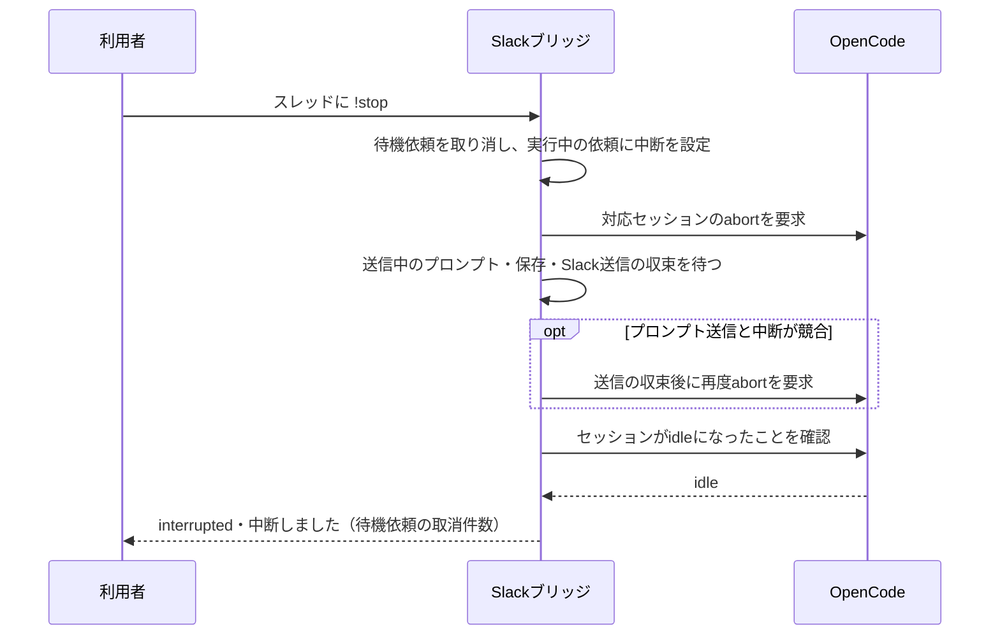
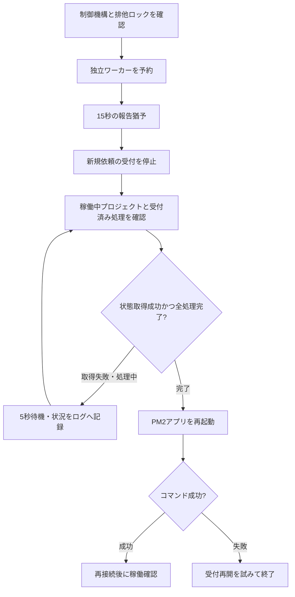

# OpenCode Slack 連携

Slack のチャンネルごとに専用の OpenCode プロセスを割り当て、スレッドごとに会話を継続する。PM2 アプリ `seijinbu-opencode-slack` がブリッジと子プロセスを管理する。

## プロジェクト

| プロジェクト | チャンネルID | 作業ディレクトリ | API ポート | セッション対応表 |
| --- | --- | --- | --- | --- |
| seijinbu | `C0AK19DK9RR` | `/home/pm/workspace/seijinbu` | 4096 | `sessions.json` |
| hiromeru | `C0CM2FSB0SW` | `/home/pm/workspace/hiromeru` | 4097 | `sessions-hiromeru.json` |
| butler | `C0CLTFN8K6K` | `/home/pm/workspace` | 4098 | `sessions-butler.json` |
| professor-jk | `C0CN3CZEJU8` | `/home/pm/workspace/professor-jk` | 4099 | `sessions-professor-jk.json` |

`projects.mjs` を接続設定の正本とする。`HIROMERU_SLACK_CHANNEL_ID`、`BUTLER_SLACK_CHANNEL_ID`、`PROFESSOR_JK_SLACK_CHANNEL_ID` で接続先を上書きできる。Butler と professor-jk は環境変数を空文字にすると起動対象から除外する。Slack アプリは対象チャンネルへの参加が必要となる。

ブリッジは所有者専用の `secrets.env` から Slack トークンと OpenCode API パスワードを取得する。ファイルの権限は `600` とする。OpenCode API はループバックにバインドし、Slack トークンは子プロセスの環境から除去する。

## 依頼とセッション

指定メンバー `U095BV5RSTF` のメンションと、対応セッションのあるスレッド内の返信を受け付ける。同じスレッドの依頼は順番に実行し、異なるスレッドは並行して処理する。

| 操作 | 動作 |
| --- | --- |
| `!p` / `!plan` | `plan` で実行 |
| `!b` / `!build` | `build` で実行 |
| エージェント指定省略 | `plan` で実行 |
| `!s` / `!skill` | スキル一覧・選択モーダルを表示 |
| `!s-<skill-name>` | 指定スキルを読み込んで実行 |
| `!stop` | 同じスレッドの実行を中断し、待機中の依頼を取り消す |
| 承認・質問ボタン | 対応するチャンネル・スレッド・セッションを検証して応答 |

セッション対応表と受信済みメッセージはプロジェクトごとに保存する。回答は添付の生成・アップロードと最終投稿までを依頼の処理範囲とする。

### 障害からの復旧

| 障害 | 復旧方法 |
| --- | --- |
| Slack APIの一時的な通信・HTTPエラー | SDKで最大3回再試行する |
| 最終回答の通信障害・HTTP 5xx・レート制限 | 上限60秒の指数バックオフと揺らぎで再試行する。レート制限の待機指示を優先する。`!stop`で中断できる |
| 認証不備・不正な投稿などの恒久エラー | 失敗を通知する。未送信の最終回答は保存し、設定修正後のブリッジ再起動で再開する |
| ブリッジの再起動 | 保存した待機依頼・送信済みプロンプトの監視・最終回答の未送信部分を復元する |
| プロンプト送信の受付が不明 | 保存したメッセージIDで元の処理を監視する。プロンプトの自動再送を禁止する |
| OpenCode子プロセスの終了・起動失敗 | 対象プロジェクトだけを、上限30秒の指数バックオフで再起動する。他プロジェクトとSlack接続は維持する |

最終回答は投稿ごとのUUIDと送信位置を保存する。再試行時は同じ`client_msg_id`を使用し、応答確認済みの部分は再送対象から除外する。Slackで受信済みでも応答と保存が完了する前に接続やプロセスが失われた場合、重複投稿の可能性は残る。

OpenCodeの異常終了で中断したエージェント処理は、保存済みの結果を確認する。業務操作を含むプロンプトの自動再実行を禁止する。復旧中のプロジェクトの新しい依頼は起動完了を待ち、`!stop`で待機を取り消せる。

## スレッドの中断

`!stop` 単独の投稿を中断コマンドとして扱う。通常の依頼と同じメンバー・チャンネルの認可を適用し、通常キューを経由せず処理する。対応セッションのあるスレッド、または依頼受付からセッション作成までのスレッド内ではメンションを省略できる。



| 状況・対象 | 扱い |
| --- | --- |
| 実行中・待機中の依頼がゼロ | 「実行中の処理はありません」と通知 |
| 中断API・停止確認の失敗 | 成功通知を禁止し、状態確認と `!stop` 再送を案内。待機依頼の取り消しは維持 |
| 重複配送 | メッセージIDで重複処理を防止 |
| 中断操作中に再度 `!stop` | 中断処理を共有し、その間に追加された待機依頼も取り消す |
| 他スレッド・他チャンネル | 中断対象から除外 |
| 会話履歴・実行済みファイル変更 | 保持。中断による巻き戻しは禁止 |
| 中断後の新しい依頼 | 同じセッションで継続。中断処理中はその完了まで待機 |
| 再起動の終了待ち中 | `!stop` を継続受付し、停止確認と通知も再起動の完了待ち対象に含める |

## Butler 固有設定

Butler は `/home/pm/workspace/butler/instructions.md` を各依頼の直前に読み、`prompt_async` の `system` へ渡す。本文への繰り返し追加は禁止する。読み込み失敗と空の指示は依頼を停止し、Slack に通知する。

専用スキルは `/home/pm/workspace/butler/skills` に置き、Butler 用子プロセスの `OPENCODE_CONFIG_CONTENT` の `skills.paths` にだけ追加する。既存の追加設定は維持する。常時指示と専用スキルは `build` / `plan` の双方に適用する。

## 処理完了後の再起動

再起動は `restart-opencode-serve` スキルの付属スクリプトで予約する。

```sh
python3 /home/pm/.config/opencode/skills/restart-opencode-serve/scripts/restart.py
```



15秒は報告のための猶予とし、再起動時刻の保証から除外する。終了待ちの判定には設定ファイル上の将来のポートではなく、稼働中ブリッジが登録したプロジェクトを使用する。

| 確認対象 | 完了条件 |
| --- | --- |
| 受付済み依頼 | キュー内も含め、Slack 投稿・添付送信と状態保存まで完了 |
| OpenCode | 全管理対象の `/session/status` が取得でき、busy・retry がゼロ |
| 承認・質問 | 全管理対象の `/permission`・`/question` が取得でき、保留がゼロ |
| ブリッジ内の応答処理 | 承認・質問への回答と通知更新（失敗時の再試行待ちを含む）、実行中のポーリングが完了 |

全プロジェクトの確認中にブリッジ内の処理が開始・終了した場合は、その確認結果を破棄して再確認する。完了確認後はバックグラウンド処理と遅れて届くモーダル処理の開始を止める。OpenCode API を直接使うクライアントの新規投入は、この受付停止の制御範囲から除外する。

| 状況 | 動作 |
| --- | --- |
| 新しい依頼・スキル実行 | 再起動後の再送を案内。受付済みキューへの追加は禁止 |
| 実行中の質問・承認への回答 | 終了待ち中も処理を継続 |
| 長時間実行・ユーザー回答待ち | 完了まで待機 |
| 状態取得失敗 | 再起動を保留して再確認 |
| 二重予約 | 既存予約の PID とログを案内 |
| 稼働中ブリッジの入れ替わり | 予約時のインスタンスとの相違を検出して中止 |
| PM2 コマンド失敗 | 同じ予約所有者として受付再開を試み、結果をログへ記録 |

ブリッジの制御は所有者専用の `restart-control.sock`、二重予約の防止は `restart.lock` の OS 排他ロックを使用する。ロックはワーカーの生存期間中保持し、ワーカー終了で解放する。再起動ワーカーのログは `/tmp/opencode/logs/opencode-serve-restart-*.log` に保存する。保存先ディレクトリは未作成なら自動作成し、権限を `700` に揃える。ログファイルの権限は `600` とする。

ワーカーの強制終了では受付停止が残る場合がある。対処時は稼働状態とログを確認し、受付再開またはメンテナンスを判断する。予約・PM2 コマンド成功・再接続後の稼働確認を別の状態として扱う。

## 設定反映と検証

### HTTPクライアント（OpenCode・Slack SDK）

OpenCode API・イベント（SSE）接続は `opencode-http.mjs` を通して、Node.js内蔵の
`fetch` を使用する。実行環境は Node.js `26.13.1` 以上を必要とする。
本番は Node.js `26.13.1`／内蔵Undici `8.12.4`。外部Undiciへの直接依存・固定版fetchの注入は行わない。

Slack側は `slack-app.mjs` でBolt標準の内蔵fetchを使用する。
`slack-app.test.mjs` で通常のWeb API・Socket Mode接続用 `apps.connections.open`・
`response_url` 返信の3経路が内蔵fetchを参照し、ローカルHTTPで動作することを検証する。
SDKの推移依存としてUndiciが残る場合もあるが、アプリ側からはimportしない。

Node.js `24.22.2` の内蔵Undici `7.30.1` では、応答の読み取りが一時停止中に相手が接続を閉じると、
`Parser.finish` の `assert(!this.paused)` がソケットイベント内で失敗し、通常のPromiseのcatchを
通らずブリッジが終了する。大きい履歴取得＋`Connection: close` でも起こり得る。
[上流Issue #5360](https://github.com/nodejs/undici/issues/5360) と
[修正 #5474](https://github.com/nodejs/undici/pull/5474) を参照。

`opencode-http.test.mjs` は独立した子プロセス内で応答を未消費にしてFINを受け、
Content-Length・EOF終端の正常完了、途中切断のエラー、タイムアウトを確認する。
接続拒否、SSEの切断・再接続・停止も確認する。本番OpenCode・Slackへの送信や再起動は伴わない。

当時は外部Undiciを固定して回避したが、Node.js更新後に固定処理を解除した。
この試験だけで実障害の解消を断定せず、反映後の稼働・エラーログも確認する。

```sh
node fixtures/http-client-probe.mjs length
```

| 変更 | 反映時点 |
| --- | --- |
| 連携コード・接続先・環境設定 | ブリッジ再起動 |
| Butler の常時指示 | 次の依頼 |
| スキル・OpenCode 設定 | 対象 OpenCode プロセスの再起動 |

制御機構未搭載の旧ブリッジでは、新スクリプトは予約を拒否する。初回反映にはユーザーと合意したメンテナンスが必要となる。状態確認不能時の固定時間による強制再起動への自動フォールバックを禁止する。

次のテストは再起動予約と PM2 実行を伴わず、送信再試行・回答復元・子プロセス分離・キュー・状態取得・制御ソケット・ワーカーの処理順序を検証する。

```sh
node --test /srv/opencode-slack/*.test.mjs
python3 -B /home/pm/.config/opencode/skills/restart-opencode-serve/scripts/test_restart.py
```
