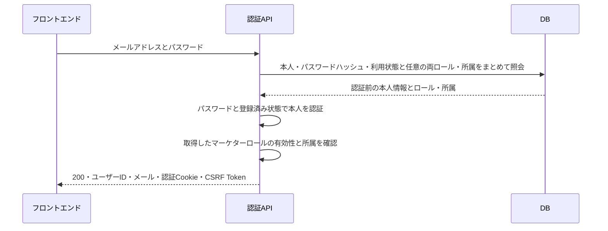
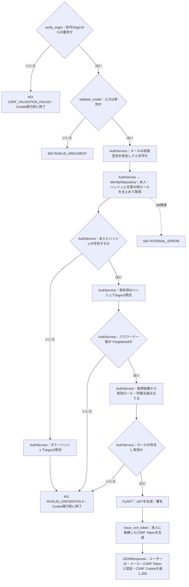
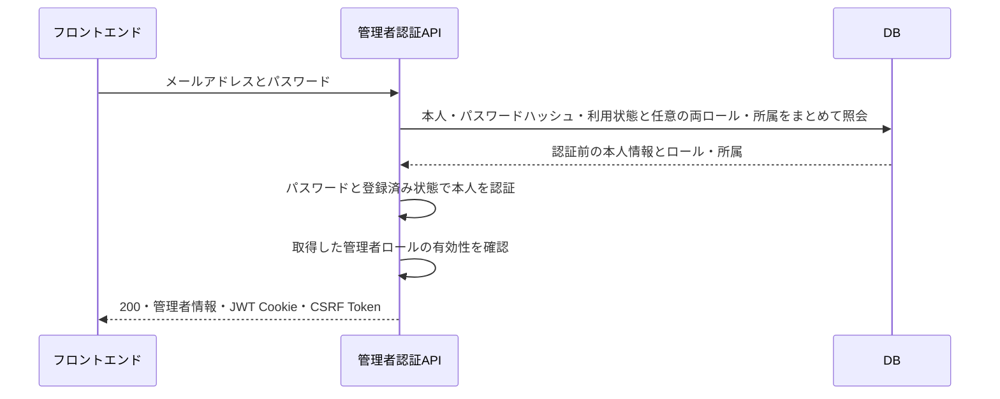
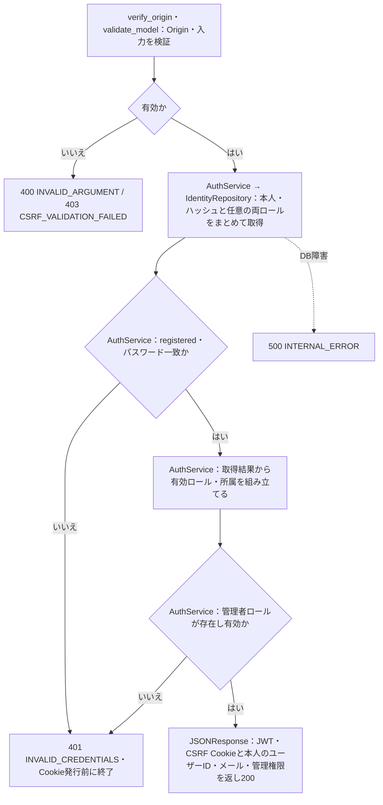
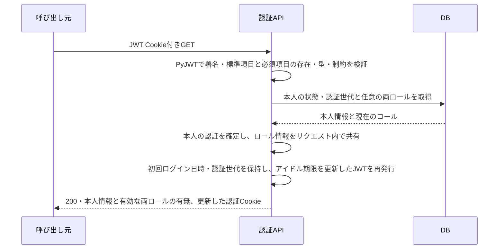
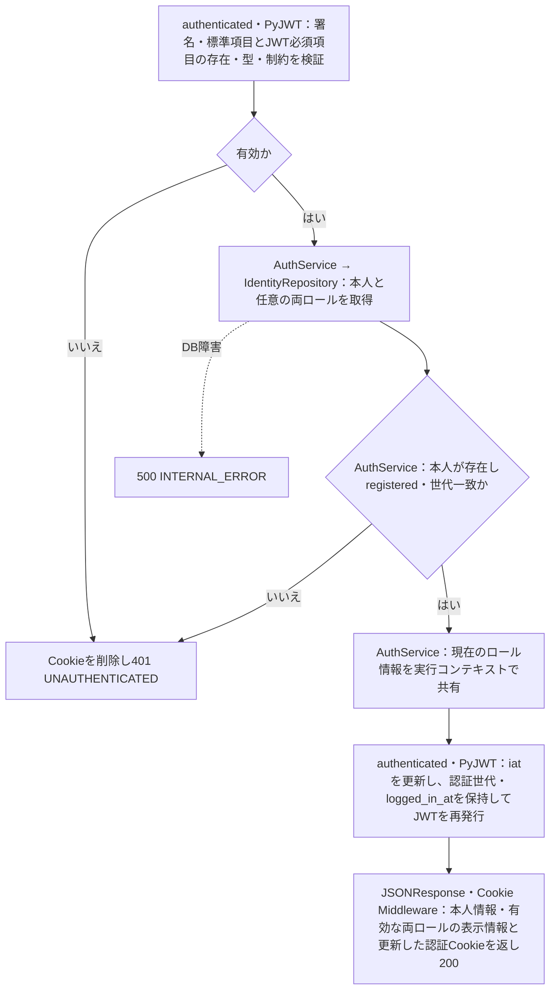
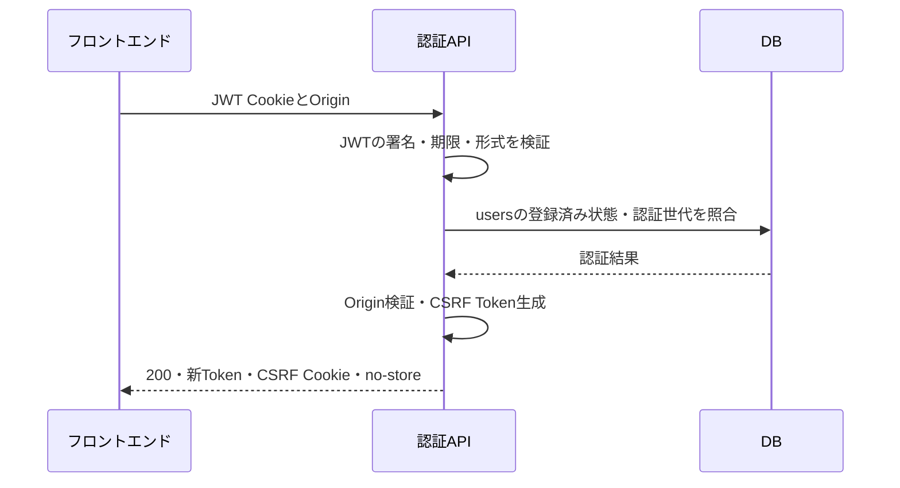
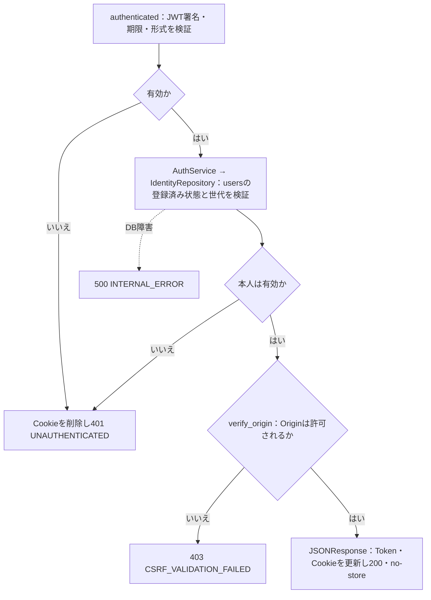
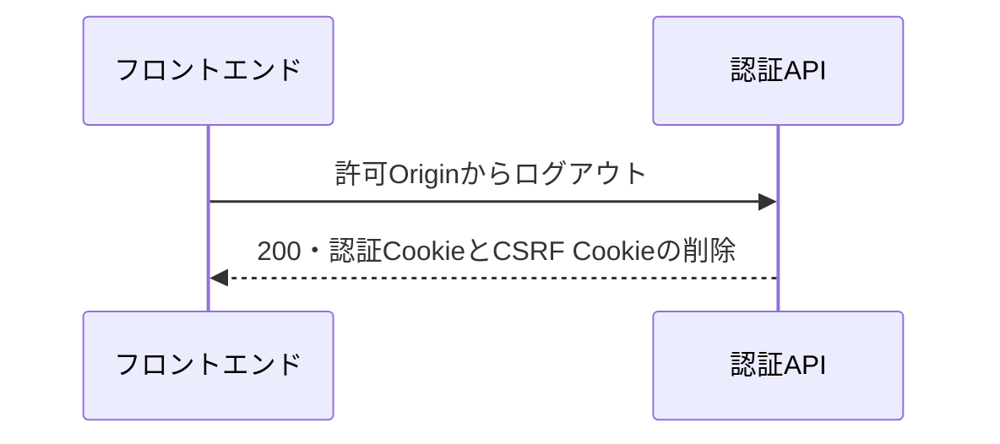
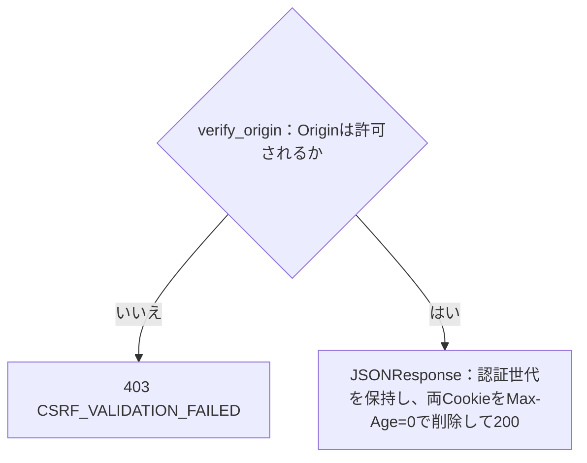

# API設計: 認証

## API一覧

| メソッド | パス | 処理概要 |
| --- | --- | --- |
| POST | [`/api/v1/auth/login`](#post-apiv1authlogin) | マーケターログイン |
| POST | [`/api/v1/admin/auth/login`](#post-apiv1adminauthlogin) | 管理者ログイン |
| GET | [`/api/v1/auth/me`](#get-apiv1authme) | 本人情報と有効ロールの表示情報の取得 |
| POST | [`/api/v1/auth/csrf`](#post-apiv1authcsrf) | CSRF Tokenの再発行 |
| POST | [`/api/v1/auth/logout`](#post-apiv1authlogout) | ログアウト |

## 共通の認証と認可

| 項目 | 定義 |
| --- | --- |
| 本人認証 | `users`を認証主体とする。[認証Cookieの仕様](#返却項目)に従い、ロールの保有は本人認証の条件から除外する |
| 操作者・所有者 | 本人の`users.id`を使用する。作成者・会話・API冪等性記録の本人識別に共通で用いる |
| ロール・所属 | 各要求でDBから任意の両ロールを取得し、有効状態・ロールID・会社IDを要求内で共有する |
| 認可の有効範囲 | API入口の認証・認可結果を処理完了まで使用する。状態・認証世代・ロールの変更は次の要求から反映する |
| 操作対象 | 各Serviceで所有者と用途に必要な権限を確認する。企業向け業務は所属企業との一致も確認する。保存時は、対象APIが定める状態・リンクの有効性・未受付などの条件を再確認する。Sessionの企業所属は共通条件から除外し、runtimeへの認可の委譲を禁止する |
| 権限の根拠 | DBの有効ロールを使用する。レスポンスのID・権限表示を後続の認可の根拠にすることを禁止する |
| 企業・所有者の指定 | 操作者・所有者としての`user_id`と`company_id`のリクエスト指定を禁止する。操作対象ユーザーのIDは、対象APIの定義に従う |
| ブラウザーからの接続 | 同一オリジンのAPIを呼ぶ |
| サーバー側での取得 | ブラウザーのCookieを転送し、同じ認可を適用する |

### CSRFの検証条件

| 操作 | 認証Cookie | 許可Origin／Referer | 署名付きダブルサブミット |
| --- | --- | --- | --- |
| 認証付きGET | 必要 | 不要 | 不要 |
| 認証付き状態変更 | 必要 | 必要 | 必要 |
| 両ログイン・ログアウト・招待受諾 | 不要 | 必要 | 不要 |
| CSRF再発行 | 必要 | 必要 | 不要 |

| 検証項目 | 条件 |
| --- | --- |
| 呼び出し元 | `Origin`を使用し、省略時は`Referer`を使用する |
| 本番の許可先 | `ALLOWED_ORIGINS`と本番ドメイン |
| Previewの許可先 | 当該デプロイのURL |
| ダブルサブミット | 本人の`user_id`に束縛した署名付き`csrf_token` Cookieと`X-CSRF-Token`の一致を確認する |

## POST `/api/v1/auth/login`

### 処理概要

メールアドレスとパスワードでマーケターユーザーを認証し、認証CookieとCSRF Tokenを発行する。

### 関連ユースケース

| ケース名 | 呼び出し条件 | リクエストの内容 | 期待する結果 |
| --- | --- | --- | --- |
| [マーケターユーザーとしてログインする](../../USECASE.md#マーケターユーザーとしてログインする) | ログインフォームを送信する | メールアドレス・パスワード | 200、認証・CSRF Cookieを発行 |

### 認可

| 項目 | 内容 |
| --- | --- |
| 操作可能権限 | 未ログインの利用者 |
| 操作対象の条件 | 登録済みで、有効なマーケターロールを持つ本人。管理者ロールの併有を許容する |

### シーケンス図



### 処理フロー図



### リクエスト

| 場所 | 項目名 | 型 | 必須 | 意味 | 制約 |
| --- | --- | --- | --- | --- | --- |
| Header | OriginまたはReferer | string | 〇 | 呼び出し元 | 許可Originと一致 |
| Body | email | string | 〇 | 認証先 | 前後空白除去・小文字化して照合 |
| Body | password | string | 〇 | 現在のパスワード | 新規設定時の文字種・長さ条件による再検証は対象から除外 |

#### リクエスト例

```http
POST /api/v1/auth/login HTTP/1.1
Origin: https://app.example.com
Content-Type: application/json

{"email":"marketer@example.com","password":"ExamplePassword1!"}
```

### レスポンス

#### HTTPステータスコード

`200 OK`

#### 返却項目

| 項目名 | 型 | 意味 | 制約 |
| --- | --- | --- | --- |
| data.user_id | integer | 認証した本人のユーザーID | 正の整数。users.id |
| data.email | string | 認証したメールアドレス | 正規化済み |
| data.csrf_token | string | 状態変更用Token | `csrf_token` Cookieと同じ値 |
| Set-Cookie | Header | 認証・CSRFのCookie | 下表のCookieを設定する |

| Cookie名 | 内容 | 属性 |
| --- | --- | --- |
| hiromeru_session | 署名付きJWT | HttpOnly; Secure; SameSite=Lax; Path=/ |
| csrf_token | 本人のuser_idに束縛した署名付きToken。JSONと同じ値 | Secure; SameSite=Lax; Path=/。JavaScriptから読み取り可能 |

| JWTの生成・検証設定 | 値 |
| --- | --- |
| ライブラリ | PyJWT 2.15.1。Backendの直接依存 |
| 署名方式 | HS256。検証時もHS256だけを許可 |
| 署名鍵 | AUTH_COOKIE_SECRET |
| 鍵の分離 | 本番とPreviewで分離 |

| 項目（JWTのキー） | 型 | 意味・制約 |
| --- | --- | --- |
| ユーザーID（`sub`） | string | users.idを表す正の整数の文字列 |
| 認証世代（`auth_generation`） | integer | 発行時のusers.auth_generation。0以上 |
| 発行日時（`iat`） | integer | このJWTの発行日時。UTCのUnix秒。JWTの再発行時に更新する |
| ログイン日時（`logged_in_at`） | integer | 初回ログイン日時。UTCのUnix秒。JWTの再発行時も保持する |
| 有効期限（`exp`） | integer | UTCのUnix秒。現在時刻の8時間後とlogged_in_atの7日後のうち早い方 |

JWTへの管理者ID・マーケターID・会社ID・ロール・権限の保存は対象から除外する。

#### レスポンス例

```http
HTTP/1.1 200 OK
Content-Type: application/json
Set-Cookie: hiromeru_session=jwt-session; HttpOnly; Secure; SameSite=Lax; Path=/
Set-Cookie: csrf_token=signed-token; Secure; SameSite=Lax; Path=/

{"success":true,"data":{"user_id":2,"email":"marketer@example.com","csrf_token":"signed-token"},"error":null}
```

### エラー

エラーは[共通レスポンス](../../INTERNAL_API_INDEX.md#共通レスポンス)のJSONで返す。

| HTTPステータス | 返却エラーコード | 発生条件 | 応答内容 |
| --- | --- | --- | --- |
| 400 | INVALID_ARGUMENT | JSON・型・必須項目が不正 | 入力不備を返す |
| 401 | INVALID_CREDENTIALS | メール不明・パスワード不一致・invitedまたはsuspended・マーケターロールなしまたは無効 | 理由を区別しない同一形式・文言。Cookie発行を禁止する |
| 403 | CSRF_VALIDATION_FAILED | Origin検証失敗 | Cookie発行を禁止する |
| 429 | なし | WAFのログイン試行回数制限 | 時間をおいて再試行する案内。アプリのエラー外形は対象外 |
| 500 | INTERNAL_ERROR | 想定外の内部・DBエラー | 内部情報を除いた共通エラー |

## POST `/api/v1/admin/auth/login`

### 処理概要

メールアドレスとパスワードで管理者ユーザーを認証し、認証CookieとCSRF Tokenを発行する。

### 関連ユースケース

| ケース名 | 呼び出し条件 | リクエストの内容 | 期待する結果 |
| --- | --- | --- | --- |
| [管理者ユーザーとしてログインする](../../USECASE.md#管理者ユーザーとしてログインする) | ログインフォームを送信する | メールアドレス・パスワード | 200、認証・CSRF Cookieを発行 |

### 認可

| 項目 | 内容 |
| --- | --- |
| 操作可能権限 | 未ログインの利用者 |
| 操作対象の条件 | 登録済みで、有効な管理者ロールを持つ本人 |
| マーケターロール | 保有・有効状態をログイン可否の条件から除外する |
| 所属企業 | 両ロールが存在する場合は同一企業 |

### シーケンス図



### 処理フロー図



### リクエスト

| 場所 | 項目名 | 型 | 必須 | 意味 | 制約 |
| --- | --- | --- | --- | --- | --- |
| Header | OriginまたはReferer | string | 〇 | 呼び出し元 | 許可Originと一致 |
| Body | email | string | 〇 | 認証先 | 前後空白除去・小文字化して照合 |
| Body | password | string | 〇 | 現在のパスワード | 新規設定時の文字種・長さ条件による再検証は対象から除外 |

#### リクエスト例

```http
POST /api/v1/admin/auth/login HTTP/1.1
Origin: https://app.example.com
Content-Type: application/json

{"email":"admin@example.com","password":"ExamplePassword1!"}
```

### レスポンス

#### HTTPステータスコード

`200 OK`

#### 返却項目

| 項目名 | 型 | 意味 | 制約 |
| --- | --- | --- | --- |
| data.user_id | integer | 本人のユーザーID | 正の整数 |
| data.email | string | 認証したメールアドレス | 正規化済み |
| data.is_admin | boolean | 管理者の区別 | true |
| data.csrf_token | string | 状態変更用Token | Cookieと同じ値 |
| Set-Cookie | Header | 認証・CSRFのCookie | [マーケターログインのCookie契約](#返却項目)と共通 |

#### レスポンス例

```http
HTTP/1.1 200 OK
Content-Type: application/json
Set-Cookie: hiromeru_session=jwt-session; HttpOnly; Secure; SameSite=Lax; Path=/
Set-Cookie: csrf_token=signed-token; Secure; SameSite=Lax; Path=/

{"success":true,"data":{"user_id":2,"email":"admin@example.com","is_admin":true,"csrf_token":"signed-token"},"error":null}
```

### エラー

| HTTPステータス | 返却エラーコード | 発生条件 | 応答内容 |
| --- | --- | --- | --- |
| 400 | INVALID_ARGUMENT | JSON・型・必須項目が不正 | 入力不備を返す |
| 401 | INVALID_CREDENTIALS | メール不明・パスワード不一致・invitedまたはsuspended・管理者ロールなしまたは無効 | 理由を区別しない同一形式・文言。Cookie発行を禁止する |
| 403 | CSRF_VALIDATION_FAILED | Origin検証失敗 | Cookie発行を禁止する |
| 429 | なし | WAFのログイン試行回数制限 | 時間をおいて再試行する案内 |
| 500 | INTERNAL_ERROR | 想定外の内部・DBエラー | 内部情報を除いた共通エラー |

## GET `/api/v1/auth/me`

### 処理概要

認証Cookieから本人を特定し、本人情報と有効な管理者・マーケターロールの有無を返す。

### 関連ユースケース

| ケース名 | 呼び出し条件 | リクエストの内容 | 期待する結果 |
| --- | --- | --- | --- |
| [マーケターユーザーとしてログインする](../../USECASE.md#マーケターユーザーとしてログインする) | マーケターログイン画面でログイン状態を確認する | 認証Cookie、Bodyなし | 200、本人情報と両ロールの表示情報を取得 |
| [管理者ユーザーとしてログインする](../../USECASE.md#管理者ユーザーとしてログインする) | 管理者ログイン画面でログイン状態を確認する | 認証Cookie、Bodyなし | 200、本人情報と両ロールの表示情報を取得 |

### 認可

| 項目 | 内容 |
| --- | --- |
| 操作可能権限 | 認証済みユーザー |
| 操作対象の条件 | JWTのsubで認証した本人のみ。管理者・マーケターロールの保有は条件から除外 |

### シーケンス図



### 処理フロー図



### リクエスト

| 場所 | 項目名 | 型 | 必須 | 意味 | 制約 |
| --- | --- | --- | --- | --- | --- |
| Cookie | hiromeru_session | string | 〇 | 本人認証 | [認証Cookieの仕様](#返却項目)に従う |

#### リクエスト例

```http
GET /api/v1/auth/me HTTP/1.1
Cookie: hiromeru_session=jwt-session
```

### レスポンス

#### HTTPステータスコード

`200 OK`

#### 返却項目

| 項目名 | 型 | 意味 | 制約 |
| --- | --- | --- | --- |
| data.user_id | integer | 本人のユーザーID | 正の整数 |
| data.email | string | 本人のメールアドレス | 正規化済み |
| data.is_admin | boolean | 管理権限の有無 | 本人のadminsが存在しis_enabled=trueのときtrue。それ以外はfalse。表示分岐用 |
| data.is_marketer | boolean | マーケター権限の有無 | 本人のmarketersが存在しis_enabled=trueのときtrue。未保有・無効はfalse。表示分岐用 |

`company_id`・パスワードハッシュ・CSRF Tokenの返却は対象から除外する。

両booleanは取得済みの有効ロールから組み立てる。Frontendはログイン済みの遷移と導線の表示に使用し、後続APIの認可の根拠にすることを禁止する。両方falseでも本人認証は成立する。

| 呼び出し経路 | 認証Cookieの更新 |
| --- | --- |
| Browserの認証付きアクセス | JWTを再発行してアイドル期限だけを延長。絶対期限は初回ログインから7日 |
| Server Component経由 | Set-CookieのBrowserへの転送は対象から除外し、この経路でのBrowserのアイドル期限延長も対象から除外 |

#### レスポンス例

```http
HTTP/1.1 200 OK
Content-Type: application/json

{"success":true,"data":{"user_id":2,"email":"admin@example.com","is_admin":true,"is_marketer":false},"error":null}
```

### エラー

| HTTPステータス | 返却エラーコード | 発生条件 | 応答内容 |
| --- | --- | --- | --- |
| 401 | UNAUTHENTICATED | JWT Cookieなし・JWT不正・期限切れ・本人なし・registered以外・世代不一致 | Cookieを削除し、認証失敗を返す |
| 500 | INTERNAL_ERROR | 想定外の内部・DBエラー | 内部情報を除いた共通エラー |

## POST `/api/v1/auth/csrf`

### 処理概要

認証済みユーザーに束縛したCSRF Tokenを再発行する。

### 関連ユースケース

| ケース名 | 呼び出し条件 | リクエストの内容 | 期待する結果 |
| --- | --- | --- | --- |
| Tokenの復旧 | 認証Cookieは有効だがCSRF Tokenを失った | Bodyなし | 200、新しいTokenとCookie |
| CSRFエラーからの復旧 | 状態変更APIがCSRF検証で拒否された | 同上 | 200、元の操作に使用するToken |
| ロールなしでの復旧 | registeredで有効なJWTを持ち、両ロールを保有しない | 同上 | 200、本人に束縛した新Token |

### 認可

| 項目 | 内容 |
| --- | --- |
| 操作可能権限 | 認証済みユーザー |
| 操作対象の条件 | Cookieで認証した本人。ロール保有は条件から除外 |

### シーケンス図



### 処理フロー図



### リクエスト

| 場所 | 項目名 | 型 | 必須 | 意味 | 制約 |
| --- | --- | --- | --- | --- | --- |
| Cookie | hiromeru_session | string | 〇 | 本人認証 | 有効な認証Cookie |
| Header | OriginまたはReferer | string | 〇 | 呼び出し元 | 許可Originと一致 |

現在のcsrf_token Cookie・X-CSRF-Tokenは検証対象から除外する。

#### リクエスト例

```http
POST /api/v1/auth/csrf HTTP/1.1
Cookie: hiromeru_session=jwt-session
Origin: https://app.example.com
```

### レスポンス

#### HTTPステータスコード

`200 OK`

#### 返却項目

| 項目名 | 型 | 意味 | 制約 |
| --- | --- | --- | --- |
| data.csrf_token | string | 新しい署名付きToken | 本人のuser_idに束縛。CSRF Cookieと同じ値 |
| Set-Cookie | Header | 新しいcsrf_token | 古い値を置換 |
| Cache-Control | Header | キャッシュ制御 | no-store |

#### レスポンス例

```http
HTTP/1.1 200 OK
Content-Type: application/json
Cache-Control: no-store
Set-Cookie: csrf_token=new-signed-token; Secure; SameSite=Lax; Path=/

{"success":true,"data":{"csrf_token":"new-signed-token"},"error":null}
```

### エラー

| HTTPステータス | 返却エラーコード | 発生条件 | 応答内容 |
| --- | --- | --- | --- |
| 401 | UNAUTHENTICATED | JWT Cookieなし・JWT不正・期限切れ・本人なし・registered以外・世代不一致 | Cookieを削除し、認証失敗を返す |
| 403 | CSRF_VALIDATION_FAILED | Origin検証失敗 | Token発行を拒否 |
| 500 | INTERNAL_ERROR | 想定外の内部・DBエラー | 内部情報を除いた共通エラー |

## POST `/api/v1/auth/logout`

### 処理概要

呼び出し元Browserの認証CookieとCSRF Cookieを削除する。

### 関連ユースケース

| ケース名 | 呼び出し条件 | リクエストの内容 | 期待する結果 |
| --- | --- | --- | --- |
| ログアウト | Cookieを持つ | Bodyなし | 200、両Cookieを削除 |
| 未ログインでの呼び出し | Cookieなし | Bodyなし | 同じ200と削除Cookie |

### 認可

| 項目 | 内容 |
| --- | --- |
| 操作可能権限 | 未ログインを含む利用者 |
| 操作対象の条件 | 呼び出し元Browser。Originだけを検証 |

### シーケンス図



### 処理フロー図



### リクエスト

| 場所 | 項目名 | 型 | 必須 | 意味 | 制約 |
| --- | --- | --- | --- | --- | --- |
| Header | OriginまたはReferer | string | 〇 | 呼び出し元 | 許可Originと一致 |

#### リクエスト例

```http
POST /api/v1/auth/logout HTTP/1.1
Origin: https://app.example.com
```

### レスポンス

#### HTTPステータスコード

`200 OK`

#### 返却項目

| 項目名 | 型 | 意味 | 制約 |
| --- | --- | --- | --- |
| data | null | 返却データ | 常にnull |
| Set-Cookie | Header | 認証・CSRFの削除Cookie | Max-Age=0 |

#### レスポンス例

```http
HTTP/1.1 200 OK
Content-Type: application/json
Set-Cookie: hiromeru_session=; Max-Age=0; HttpOnly; Secure; SameSite=Lax; Path=/
Set-Cookie: csrf_token=; Max-Age=0; Secure; SameSite=Lax; Path=/

{"success":true,"data":null,"error":null}
```

### エラー

| HTTPステータス | 返却エラーコード | 発生条件 | 応答内容 |
| --- | --- | --- | --- |
| 403 | CSRF_VALIDATION_FAILED | Origin検証失敗 | ログアウトを拒否 |
