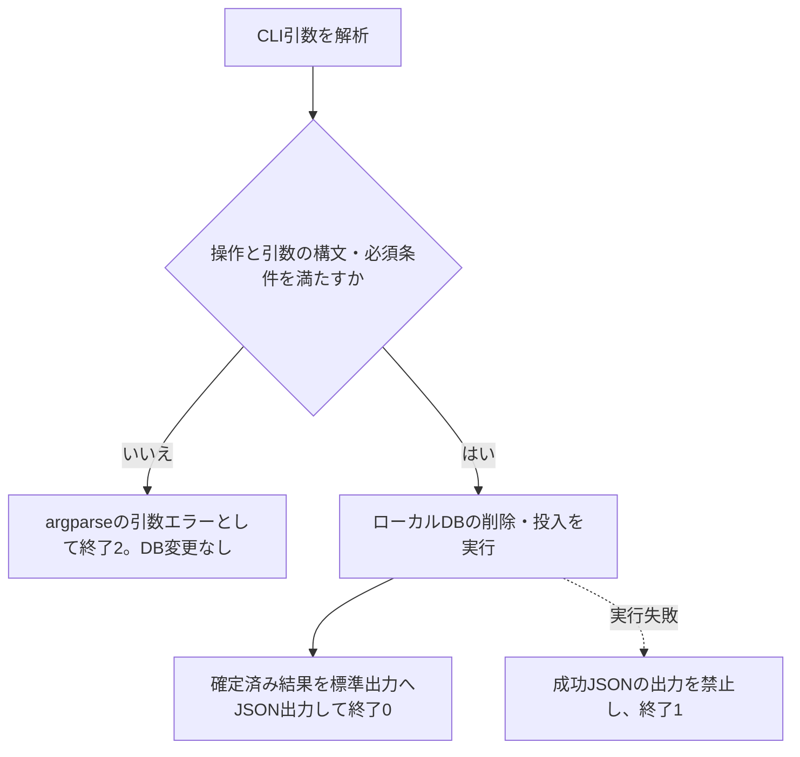
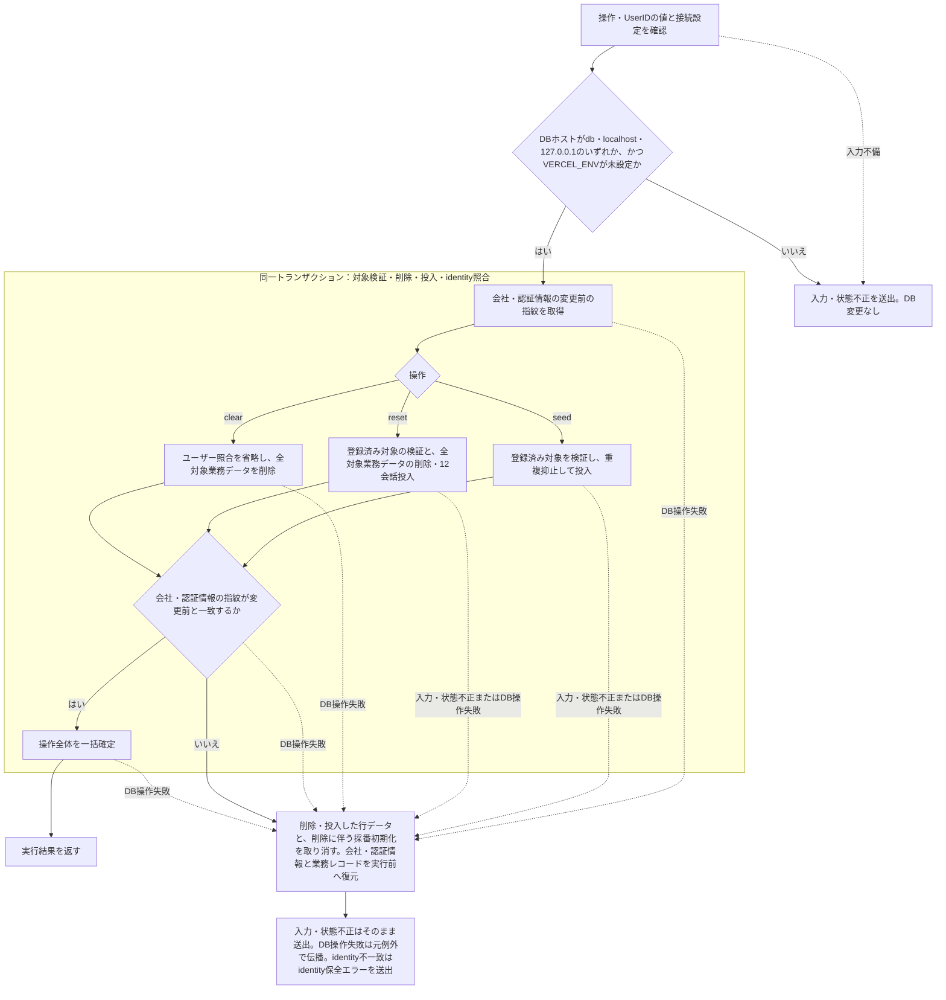
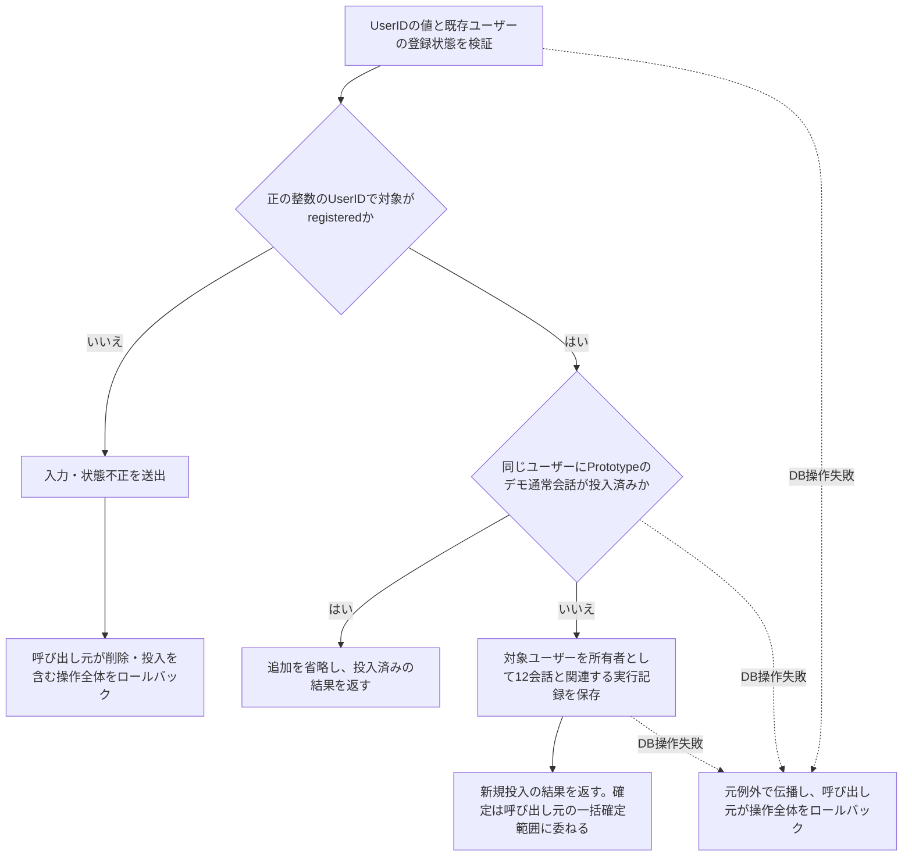

# デモデータ投入CLI

対象モジュール：[backend/scripts/demo_dataset.py](../../../backend/scripts/demo_dataset.py)

## 公開関数一覧

| 関数名 | 処理概要 | 詳細 |
| --- | --- | --- |
| `main` | CLI引数を受け付け、結果をJSONで出力する | [詳細](#main) |
| `run` | ローカルDBの業務データ削除・投入を一括確定する | [詳細](#run) |
| `seed_demo` | 既存ユーザーへPrototypeの12会話を重複抑止して投入する | [詳細](#seed_demo) |

## 責務

ローカルでPrototypeの履歴を確認するため、既存ユーザーを所有者とするデモ会話を用意する。投入先は`users.id`で識別する。会社・ユーザー・ロール・認証情報の作成・変更を禁止する。企業情報を含む他のドメイン機能のデータは削除対象から除外する。

会社・認証情報の同一性（identity）は、`companies`・`users`・`marketers`・`admins`・`invitations`・`emails`の全行の指紋で照合する。

Chat・AskUser・messageを持つ副作用なしの`demo_action`によって、質問の回答待ち・回答済み、確認の承認待ち・承認済み・修正依頼、検索・取得履歴、失敗・中断・処理中の状態を含む12会話を作る。Prototypeに未登録のselectは投入対象から除外する。外部通信・実Taskの起動を禁止する。

## 依存

| 依存先 | 利用目的 |
| --- | --- |
| [設定](../../../backend/core/config.py) | アプリケーションのDB接続先とVercel環境の取得 |
| SQLAlchemy | ユーザーと投入済み会話の照合、削除・投入の一括確定 |
| [DB設計](../DATABASE.dbml) | 所有者と業務データの保存構造 |
| [Prototype定義](../../../backend/agent_definitions/prototype.py)・[TerminalTool](../../../backend/harness/terminal_tools/) | 提示・回答結果の形式と副作用なしのデモ関数 |

## main

### 引数

プロセスのコマンドライン引数を使用する。

| 引数名 | 型 | 意味 | 制約 |
| --- | --- | --- | --- |
| `action` | `str` | 実行する操作 | `seed`・`reset`・`clear`のいずれか。必須 |
| `--user-id` | `int` | 投入先のUserID | 正の整数。`seed`・`reset`で必須、既定値なし。`clear`では省略可能で、指定値はユーザー選択・照合の対象外 |

### 処理フロー図

### 戻り値・終了

| 型 | 意味 | 制約 |
| --- | --- | --- |
| `None` | CLIの正常完了 | 標準出力は[実行結果](#実行結果)のJSON |

| 終了コード | 条件 | DB状態 |
| --- | --- | --- |
| `0` | 投入・削除の成功、または投入済みによる追加の省略 | 操作結果を確定 |
| `2` | 操作名不正、`seed`・`reset`のUserID欠落、整数以外や0以下のUserIDなどのCLI引数不備 | 操作対象の行データは変更前を保持 |
| `1` | 既存ユーザーなし、`registered`以外、ローカルDB条件の不成立、DBエラーなどの実行失敗 | 操作対象の行データは変更前を保持 |

## run

### 引数

| 引数名 | 型 | 意味 | 制約 |
| --- | --- | --- | --- |
| `action` | `str` | 実行する操作 | `seed`・`reset`・`clear`のいずれか |
| `user_id` | `int \| None` | 投入先のUserID | `seed`・`reset`で正の整数が必須。`clear`では省略可能で、ユーザー照合は対象外 |

| 操作 | 変更範囲 |
| --- | --- |
| `seed` | 指定ユーザーへ12会話を投入。同ユーザーの投入済みデモ会話がある場合は追加を省略 |
| `reset` | 全ユーザーの削除対象業務データを空にし、指定ユーザーへ12会話を投入 |
| `clear` | 全ユーザーの削除対象業務データを空にする。投入先の選択・照合は対象外 |

削除対象は、接続先DBに存在する次のテーブルとする。削除時は対象テーブルの採番も初期化する。

| 業務データ | テーブル |
| --- | --- |
| 会話・実行記録 | `agent_sessions`、`agent_turns`、`agent_items`、`llm_calls`、`tool_executions` |
| 会話の関連記録 | `api_idempotency_requests`、`security_events` |
| 施策・投稿・計測 | `campaigns`、`campaign_embeddings`、`posts`、`post_embeddings`、`post_tracking_links`、`post_metrics` |
| 記憶と関連 | `agent_memories`、`memory_campaigns`、`memory_posts` |

### 処理フロー図

### 戻り値

| 型 | 意味 | 制約 |
| --- | --- | --- |
| `DemoResult` | 確定済みの操作結果 | 下表の属性を持つTypedDict。各属性の有無は操作・投入結果に従う |

#### 実行結果

| DemoResultの属性 | 型 | 意味・条件 |
| --- | --- | --- |
| `created` | `bool` | `seed`・`reset`のみ。12会話の新規投入は`true`、投入済みによる省略は`false` |
| `user_id` | `int` | `seed`・`reset`の投入先`users.id`。`clear`の結果から除外 |
| `sessions` | `dict[str, int]` | `created=true`の場合の会話ラベルと作成したSession IDの対応。12件 |
| `message` | `str` | `created=false`の場合の投入済みと`reset`による入れ替えの案内 |
| `removed` | `dict[str, int]` | `clear`・`reset`のみ。削除対象テーブル名と削除前の行数の対応 |
| `identity_preserved` | `bool` | 常に`true`。会社・認証情報が実行前と一致 |

### 例外

| 例外 | 論理名 | 例外コード | 発生条件 | メッセージ |
| --- | --- | --- | --- | --- |
| `ValueError` | 入力・状態不正 | — | 操作が`seed`・`reset`・`clear`以外 | 操作が不正である旨 |
| `ValueError` | 入力・状態不正 | — | `seed`・`reset`でUserIDが欠落 | 正の整数のUserIDが必要である旨 |
| `ValueError` | 入力・状態不正 | — | `seed`・`reset`でUserIDが正の整数以外 | 正の整数のUserIDが必要である旨 |
| `ValueError` | 入力・状態不正 | — | DBホストがローカルDB条件に不一致 | ローカル開発DB専用のコマンドです。 |
| `ValueError` | 入力・状態不正 | — | Vercel環境が設定済み | ローカル開発DB専用のコマンドです。 |
| `ValueError` | 入力・状態不正 | — | `seed`・`reset`で対象ユーザーが存在しない | 登録済みの投入先ユーザーが必要である旨 |
| `ValueError` | 入力・状態不正 | — | `seed`・`reset`で対象ユーザーが`registered`以外 | 登録済みの投入先ユーザーが必要である旨 |
| `SQLAlchemyError` | DB操作失敗 | — | DBの照合・削除・投入・確定でエラー | 元の例外のメッセージ |
| `RuntimeError` | identity保全エラー | — | 会社・認証情報の指紋が実行前と不一致 | 会社・認証情報が変化したため、全変更を取り消します。 |

## seed_demo

### 引数

| 引数名 | 型 | 意味 | 制約 |
| --- | --- | --- | --- |
| `db` | `Session` | 投入に使用するDBセッション | `run`の一括確定範囲に参加する |
| `user_id` | `int` | 会話所有者のUserID | `users.id`を表す正の整数。既存ユーザーの`status=registered`が条件 |

ロールの保有・有効状態は投入条件から除外する。ロールなし、管理者・マーケターのロールあり、無効ロールありのいずれも同じ正常対象とする。`invited`・`suspended`は拒否する。

### 処理フロー図

### 戻り値

| 型 | 意味 | 制約 |
| --- | --- | --- |
| `DemoResult` | 投入結果 | [実行結果](#実行結果)の`created`・`user_id`と、作成時の`sessions`または省略時の`message`。`removed`・`identity_preserved`は`run`で付与 |

### 例外

| 例外 | 論理名 | 例外コード | 発生条件 | メッセージ |
| --- | --- | --- | --- | --- |
| `ValueError` | 入力・状態不正 | — | UserIDが正の整数以外 | 正の整数のUserIDが必要である旨 |
| `ValueError` | 入力・状態不正 | — | 対象ユーザーが存在しない | 登録済みの投入先ユーザーが必要である旨 |
| `ValueError` | 入力・状態不正 | — | 対象ユーザーが`registered`以外 | 登録済みの投入先ユーザーが必要である旨 |
| `SQLAlchemyError` | DB操作失敗 | — | 対象・投入済み会話の照合、または会話保存でエラー | 元の例外のメッセージ |
