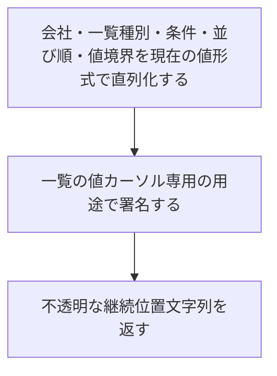
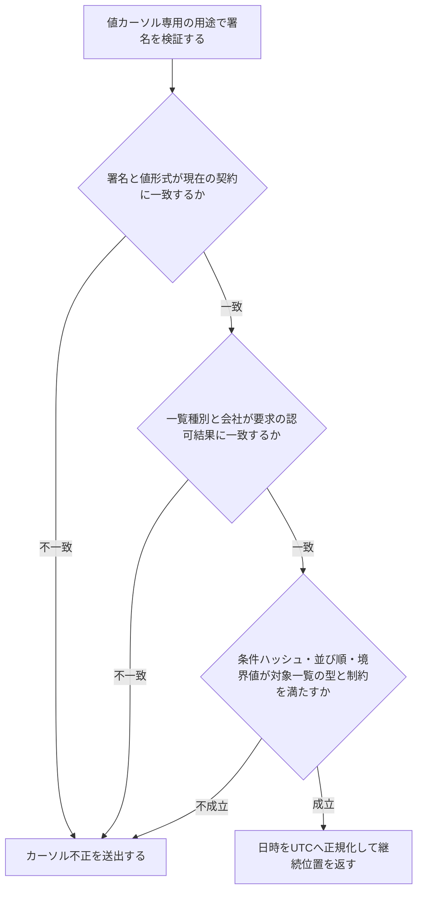

# 一覧の値カーソル

## 公開関数一覧

| 関数名 | 処理概要 | 詳細 |
| --- | --- | --- |
| `issue_list_cursor` | 会社・条件・取得境界を署名した継続位置を発行する | [詳細](#issue_list_cursor) |
| `read_list_cursor` | 継続位置の署名・一覧種別・会社・境界型を照合する | [詳細](#read_list_cursor) |

## 責務

[投稿一覧](../features/posts/API.md)と[計測一覧](../features/metrics/API.md)の取得境界を、DBへの保存を伴わずに次の要求へ引き継ぐ。カーソルの会社はServiceが有効ロールから決めた会社と照合し、認可の根拠としての使用を禁止する。

## 依存

| 依存先 | 利用目的 |
| --- | --- |
| [署名処理](../../../backend/core/security.py) | 一覧の継続位置を他用途の署名から分離して保護する |
| [AppError](../../../backend/core/errors.py) | 利用できない継続位置を入力不備として伝える |

## 受け渡す値

取得境界は変更不能な値として保持する。日時はタイムゾーン付きUTCとし、整数へのboolean・小数・文字列の暗黙変換を禁止する。

| ListCursorの属性 | 型 | 意味・制約 |
| --- | --- | --- |
| `resource` | `Literal["posts", "metrics"]` | 対象一覧 |
| `company_id` | `int` | 発行時に認可した会社。正の整数 |
| `filter_hash` | `str` | Serviceが正規化した取得条件のSHA-256。64文字の16進数 |
| `position` | `PostPosition \| MetricsPosition` | 直前に返却した末尾行の値。resourceに対応する型 |
| `sort` | `Literal["published_at", "x_pv_count"] \| None` | postsでは必須。metricsは`None` |
| `order` | `Literal["asc", "desc"] \| None` | postsでは必須。metricsは`None` |

| PostPositionの属性 | 型 | 意味・制約 |
| --- | --- | --- |
| `post_id` | `int` | 直前返却行の投稿ID。正の整数 |
| `published_at` | `datetime` | 直前返却行の公開日時 |
| `x_pv_count` | `int \| None` | completedのPVは非負整数、pending・failedは`None` |

| MetricsPositionの属性 | 型 | 意味・制約 |
| --- | --- | --- |
| `campaign_id` | `int` | 直前返却行の施策ID。正の整数 |
| `x_pv_count` | `int` | 直前返却行の集計PV。非負整数 |

## issue_list_cursor

### 処理フロー図

### 引数

| 引数名 | 型 | 意味 | 制約 |
| --- | --- | --- | --- |
| `secret` | `str` | 署名鍵 | 要求に対応するサーバー設定の鍵 |
| `cursor` | `ListCursor` | 発行する継続位置 | Serviceが検証・正規化済みの条件と、実際に返却した末尾行の値 |

### 戻り値

| 型 | 意味 | 制約 |
| --- | --- | --- |
| `str` | 署名付き値カーソル | 本人への束縛・有効期限・保存先IDを持たない。同じ会社の必要権限を持つ別ユーザーも利用できる |

### 例外

なし。

## read_list_cursor

### 処理フロー図

### 引数

| 引数名 | 型 | 意味 | 制約 |
| --- | --- | --- | --- |
| `secret` | `str` | 検証鍵 | 要求に対応するサーバー設定の鍵 |
| `resource` | `Literal["posts", "metrics"]` | 要求先の一覧 | Serviceが決定する |
| `company_id` | `int` | 今回の参照会社 | Serviceが今回の有効ロールから決めた正の整数 |
| `token` | `str` | クライアントが返した継続位置 | 空文字・旧Snapshot形式は入力不備 |

### 戻り値

| 型 | 意味 | 制約 |
| --- | --- | --- |
| `ListCursor` | 署名と構造を確認した継続位置 | 条件ハッシュと今回の取得条件の一致はServiceが照合する。境界元レコードの存在・現在値の再取得を条件から除外する |

### 例外

| 例外 | 論理名 | 例外コード | 発生条件 | メッセージ |
| --- | --- | --- | --- | --- |
| `AppError` | カーソル不正 | `INVALID_ARGUMENT` | 専用用途の署名が成立しない | cursor が正しくありません。 |
| `AppError` | カーソル不正 | `INVALID_ARGUMENT` | 現在の値形式と一致しない | cursor が正しくありません。 |
| `AppError` | カーソル不正 | `INVALID_ARGUMENT` | 一覧種別が要求先と異なる | cursor が正しくありません。 |
| `AppError` | カーソル不正 | `INVALID_ARGUMENT` | 会社が今回の参照会社と異なる | cursor が正しくありません。 |
| `AppError` | カーソル不正 | `INVALID_ARGUMENT` | 条件ハッシュがSHA-256の形式と一致しない | cursor が正しくありません。 |
| `AppError` | カーソル不正 | `INVALID_ARGUMENT` | 境界値が対象一覧の型・値制約を満たさない | cursor が正しくありません。 |
| `AppError` | カーソル不正 | `INVALID_ARGUMENT` | 並び順が対象一覧の許可値と一致しない | cursor が正しくありません。 |
