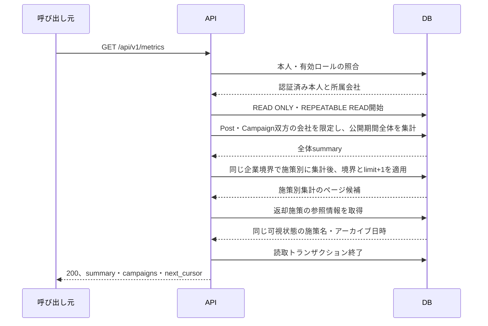
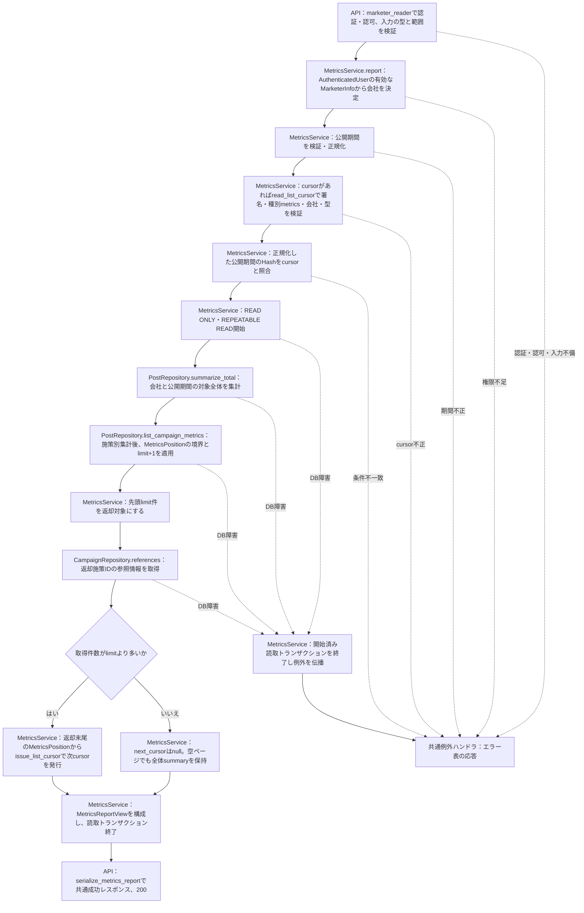

# API設計: 計測結果集計

## API一覧

| メソッド | パス | 処理概要 |
| --- | --- | --- |
| GET | [`/api/v1/metrics`](#get-apiv1metrics) | 自社の公開済み投稿の全体集計と施策別集計を取得する |

## GET `/api/v1/metrics`

### 処理概要

自社の公開成功済み投稿について、公開期間全体の計測サマリーと施策別集計のページを取得する。

### 関連ユースケース

| ケース名 | 呼び出し条件 | リクエストの内容 | 期待する結果 |
| --- | --- | --- | --- |
| 計測結果の閲覧 | 計測画面を開く、または公開期間を変更する | 必要な公開期間と取得件数 | 200、期間全体のsummaryと施策別集計の先頭ページを返す |
| 続きの閲覧 | 次の施策別集計ページを取得する | 同じ公開期間と前回のnext_cursor | 200、その要求で再集計した期間全体のsummaryと境界より後の施策を返す。空ページも正常 |

### 認可

| 項目 | 内容 |
| --- | --- |
| 操作可能権限 | 有効なマーケターロールを持つ認証済みユーザー |
| 操作対象の条件 | MetricsServiceがAuthenticatedUserの有効なMarketerInfoで企業境界を確認し、読取クエリでPostと所属Campaignの双方のcompany_idがMarketerInfo.company_idと一致するものに限定して集計する。作成者による限定は除外し、アーカイブ済み施策も含める |
| 会社・操作者の決定 | 操作者はAuthenticatedUser.user.id、会社はMarketerInfo.company_id。認可に用いる会社・操作者のRequest指定を禁止する |
| 認証の参照先 | [認証API](../auth/API.md#共通の認証と認可)と[AUTH_DEPENDENCIESのmarketer_reader](../../modules/api/AUTH_DEPENDENCIES.md#marketer_reader)。ServiceへAuthenticatedUserを渡す |
| cursorの利用範囲 | 同じ会社の有効なマーケターロールを持つ別ユーザーも利用可能。有効期限は設けず、要求ごとに現在の認証・認可を適用する |

### シーケンス図



### 処理フロー図



取得契約は[MetricsService](modules/METRICS_SERVICE.md)、[PostRepository](../../modules/POST_REPOSITORY.md)、署名付きcursorの契約は[LIST_CURSOR](../../modules/LIST_CURSOR.md)に従う。業務データへの操作は読取に限定し、一覧の保存・冪等性記録・履歴の書込を禁止する。

### リクエスト

必須は、`〇`を必須、`-`を任意として記載する。

| 場所 | 項目名 | 型 | 必須 | 意味 | 制約 |
| --- | --- | --- | --- | --- | --- |
| Header | Cookie | string | 〇 | 本人認証 | [認証API](../auth/API.md#共通の認証と認可)に従う |
| Query | published_from | string | - | 公開期間の開始 | タイムゾーン付きISO 8601日時。指定値以上。両端指定時はpublished_toより前 |
| Query | published_to | string | - | 公開期間の終了 | タイムゾーン付きISO 8601日時。指定値未満 |
| Query | limit | integer | - | 返却する施策の上限件数 | 1〜50、既定20。cursorの条件照合から除外し、ページ間で変更可能 |
| Query | cursor | string | - | 続きの取得境界 | 不透明な署名付き文字列。metrics種別・自社・型・正規化した公開期間のHashが一致するもの。旧一覧cursorは400 |

| 条件 | 集計・取得規則 |
| --- | --- |
| 対象投稿 | Postと所属Campaignの双方のcompany_idが今回の会社と一致し、公開操作がpublish_x_post、結果がsucceededで、公開期間に含まれるもの |
| 公開期間 | published_from以上、published_to未満の半開区間。省略した端は制限を設けず、日時はUTCへ正規化する |
| 全体summary | cursor・limit・返却ページにかかわらず、要求ごとに会社と公開期間の対象全体を集計する |
| 施策別集計 | 施策ごとに集計後、(x_pv_count, campaign_id)降順で境界を適用する。期間内の対象投稿が0件の施策は返却対象から除外する |
| 計測値 | completedのPV・遷移ユーザー数のみ合算する。pending・failedの部分値は合算対象から除外し、それぞれの件数を保持する |
| 論理境界 | MetricsPositionのcampaign_idは正の整数、x_pv_countは非負整数。境界元レコードの再取得を禁止する |
| 読取の整合範囲 | 1要求内はREPEATABLE READでsummary・施策別ページ・施策参照情報を同じ可視状態から読む。ページ間は各要求時点の最新状態を読む |
| ページ間の更新 | 集計値の変化による重複・取りこぼしがあり、全件を一度ずつ取得することは保証対象外 |

#### リクエスト例

```http
GET /api/v1/metrics?published_from=2026-10-01T00%3A00%3A00Z&published_to=2026-11-01T00%3A00%3A00Z&limit=20 HTTP/1.1
Cookie: hiromeru_session=<認証Cookie>
```

### レスポンス

#### HTTPステータスコード

`200 OK`

#### 返却項目

共通形式は[INTERNAL_API_INDEXの共通レスポンス](../../INTERNAL_API_INDEX.md#共通レスポンス)に従う。以下はdata配下の項目。日時はUTCのISO 8601形式とする。

| 項目名 | 型 | 意味 | 制約 |
| --- | --- | --- | --- |
| published_from | string / null | 集計対象公開期間の開始 | 指定値をUTCへ正規化。省略時はnull |
| published_to | string / null | 集計対象公開期間の終了 | 指定値をUTCへ正規化。省略時はnull |
| summary | object | 対象全体の集計 | ページ外・cursor境界外を含む。空ページでも返す |
| summary.post_count | integer | 公開済み投稿数 | 非負整数。completed_count + pending_count + failed_count |
| summary.completed_count | integer | 計測完了数 | 非負整数 |
| summary.pending_count | integer | 計測待ち数 | 非負整数 |
| summary.failed_count | integer | 計測失敗数 | 非負整数 |
| summary.x_pv_count | integer | X表示数合計 | completedのみ合算した非負整数 |
| summary.landing_user_count | integer | 遷移ユーザー数合計 | completedのみ合算した非負整数 |
| summary.landing_rate | number / null | 全体の流入率 | landing_user_count / x_pv_count。丸めず、PVが0ならnull |
| campaigns | array<object> | 施策別集計 | 最大limit件。該当0件は空配列 |
| campaigns[].id | integer | 施策ID | 正の整数 |
| campaigns[].title | string | 施策名 | 対象施策のタイトル |
| campaigns[].archived_at | string / null | アーカイブ日時 | アーカイブ済みの場合に日時、それ以外はnull |
| campaigns[].post_count | integer | 施策内の対象投稿数 | 正の整数。completed_count + pending_count + failed_count |
| campaigns[].completed_count | integer | 施策内の計測完了数 | 非負整数 |
| campaigns[].pending_count | integer | 施策内の計測待ち数 | 非負整数 |
| campaigns[].failed_count | integer | 施策内の計測失敗数 | 非負整数 |
| campaigns[].x_pv_count | integer | 施策内のX表示数合計 | completedのみ合算した非負整数 |
| campaigns[].landing_user_count | integer | 施策内の遷移ユーザー数合計 | completedのみ合算した非負整数 |
| campaigns[].landing_rate | number / null | 施策の流入率 | 施策内のlanding_user_count / x_pv_count。丸めず、PVが0ならnull |
| next_cursor | string / null | 続きの取得用cursor | limit+1件取得できた場合は返却末尾から発行。それ以外はnull |

対象投稿が0件の場合、summaryの全計数を0、landing_rateをnull、campaignsを空配列、next_cursorをnullとする。

#### レスポンス例

```http
HTTP/1.1 200 OK
Content-Type: application/json

{
  "success": true,
  "data": {
    "published_from": "2026-10-01T00:00:00Z",
    "published_to": "2026-11-01T00:00:00Z",
    "summary": {
      "post_count": 3,
      "completed_count": 1,
      "pending_count": 1,
      "failed_count": 1,
      "x_pv_count": 1000,
      "landing_user_count": 50,
      "landing_rate": 0.05
    },
    "campaigns": [
      {
        "id": 12,
        "title": "秋の採用広報",
        "archived_at": null,
        "post_count": 3,
        "completed_count": 1,
        "pending_count": 1,
        "failed_count": 1,
        "x_pv_count": 1000,
        "landing_user_count": 50,
        "landing_rate": 0.05
      }
    ],
    "next_cursor": null
  },
  "error": null
}
```

### エラー

| HTTPステータス | 返却エラーコード | 発生条件 | 応答内容 |
| --- | --- | --- | --- |
| 401 | UNAUTHENTICATED | 認証Cookieの欠落・不正・期限切れ、またはDBで本人照合が成立しない | 共通形式でログインを求める |
| 403 | MARKETER_FORBIDDEN | 有効なMarketerInfoが存在しない | 共通形式でマーケター権限不足を返す |
| 400 | INVALID_ARGUMENT | 引数の型・値・期間が不正、またはcursorの署名・種別・会社・型・公開期間Hashが不一致。旧一覧cursorも含む | 共通形式で入力不備を返す。cursor付き要求で本コードを受けたFrontendはcursorを解除し、同じ条件の先頭ページを1回だけ再取得する |
| 500 | INTERNAL_ERROR | DB障害など想定外の内部処理失敗 | 共通形式で内部エラーを返す |
