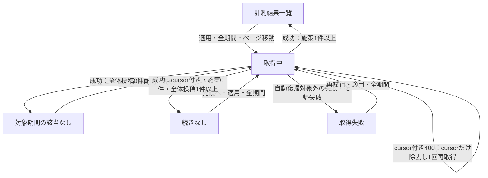

# 画面設計: 計測結果

自社の公開成功済み投稿の全体集計と施策別集計を確認する。取得条件と応答は[API設計](API.md)に従う。

## 画面一覧

| 画面 | 概要 | Storybook |
| --- | --- | --- |
| [計測結果一覧](#画面名-計測結果一覧) | 取得成功し、campaignsが1件以上 | - |
| [対象期間の該当なし](#画面名-対象期間の該当なし) | 取得成功し、summary.post_countが0。cursorの有無を問わず全体0件 | - |
| [続きなし](#画面名-続きなし) | cursor付き取得が成功し、campaignsが0件かつsummary.post_countが1以上 | - |
| [取得中](#画面名-取得中) | 計測結果の応答待ち。cursor解除後の再取得を含む | - |
| [取得失敗](#画面名-取得失敗) | 計測結果取得が失敗し、自動復帰の対象外または復帰も失敗 | - |

## 画面遷移図



## 画面名: 計測結果一覧

### ASCIIモック

```text
+------------------------------------------------------+
| 計測結果                                             |
| 開始日 [        ] 〜 終了日 [        ] [適用] [全期間]|
| 集計期間（日本時間・終了日を含む）                    |
| 全体流入率 | 初週PV合計 | 流入ユーザー合計            |
| 計測済み投稿 / 全投稿数 | 計測状態                    |
| 施策別流入率比較                                     |
| 施策別詳細：施策 | PV | 流入 | 流入率 | 投稿数        |
| [先頭へ]                              [次の20件]     |
+------------------------------------------------------+
```

### 提供操作一覧

| 操作 | API呼び出し | 操作結果 |
| --- | --- | --- |
| 開始日を入力する | - | 入力中の開始日を更新する |
| 終了日を入力する | - | 入力中の終了日を更新する |
| 適用を押す | 〇 | 公開期間を適用し、cursorを除去して先頭から取得する |
| 全期間を押す | 〇 | 公開期間とcursorを解除し、全期間の先頭から取得する |
| 次の20件を押す | 〇 | 公開期間を保持し、応答のnext_cursorで施策ページを置き換え、全体集計も更新する |
| 先頭へを押す | 〇 | cursorだけを除去し、同じ公開期間で先頭から取得して全体集計も更新する |

### 項目定義

| 区分 | 項目 | 概要 |
| --- | --- | --- |
| 集計条件 | 開始日 | 公開日の下限。日本時間のこの日の0時をUTCへ変換し、APIに以上の境界として渡す |
| 集計条件 | 終了日 | 公開日の上限。この日を含み、日本時間の翌日0時をUTCへ変換し、APIに未満の境界として渡す |
| 集計条件 | 集計期間 | 適用中の公開期間。省略した端は制限対象から除外し、両端省略は全期間 |
| 全体集計 | 全体流入率 | summary.landing_rate。百分率で小数点以下2桁まで表示し、nullは「—」 |
| 全体集計 | 初週PV合計 | summary.x_pv_count。completedのX表示数合計 |
| 全体集計 | 流入ユーザー合計 | summary.landing_user_count。completedの遷移ユーザー数合計 |
| 全体集計 | 全投稿数 | summary.post_count。自社の公開期間全体の対象投稿数 |
| 全体集計 | 計測済み投稿 | summary.completed_count |
| 全体集計 | 計測待ち数 | summary.pending_count |
| 全体集計 | 計測失敗数 | summary.failed_count |
| 全体集計 | 集計対象の案内 | 計測待ち・失敗の件数を示し、PV・流入・流入率の集計対象から除外する旨 |
| 施策別集計 | 施策名 | 現在ページに含まれる施策の名前 |
| 施策別集計 | 施策ID | 施策の識別番号 |
| 施策別集計 | アーカイブ状態 | アーカイブ済みの施策であること |
| 施策別集計 | PV | 施策内のcompletedのX表示数合計 |
| 施策別集計 | 流入 | 施策内のcompletedの遷移ユーザー数合計 |
| 施策別集計 | 流入率 | 施策内の流入ユーザー数 / PV。百分率で小数点以下2桁まで表示し、nullは「—」 |
| 施策別集計 | 投稿数 | 施策内の対象投稿数 |
| 施策別集計 | 計測状態 | 施策内の計測済み・待ち・失敗の各件数 |
| 比較 | 施策別流入率比較 | 現在ページの施策を比較する。全施策を一度に表示する比較は対象から除外する |
| ページ移動 | 次の20件 | next_cursorが文字列の場合に表示する |
| ページ移動 | 先頭へ | cursor付きページで表示する |
| 期間操作 | 全期間 | 公開期間を指定した場合に操作可能とする |

summaryはページ内の集計ではなく、会社と公開期間全体を毎API呼び出しで再集計した値を使う。空ページでも同じ応答のsummaryを表示する。施策別集計はPV降順、同値は施策ID降順の最大20件とする。

ページ移動はDBのライブキーセットページングを使い、各API呼び出し時点の最新データを読む。更新によるページ間の重複・取りこぼしがあり、全件の一度ずつの表示は保証対象から除外する。next_cursorは署名・会社・公開期間に束縛された不透明な文字列として扱い、解析・組み立てを禁止する。時間による期限と発行本人への限定は設けず、利用時の認証・認可はAPI設計に従う。

流入率がnullの場合、計測完了数0件なら「計測済みの投稿がありません」、計測完了数1件以上なら「初週PVが0のため流入率を算出できません」とする。現在ページの全施策の流入率がnullの場合も施策別詳細を保持し、比較領域は次の案内とする。

| 条件 | 比較領域の表示 |
| --- | --- |
| ページ内の全施策の計測完了数が0 | 比較できる計測結果がありません |
| ページ内に計測完了数1件以上の施策があり、全施策の流入率がnull | 初週PVが0のため比較できる流入率がありません |

### エラー表示

| エラー種別 | 表示UI | 発生条件 | 表示内容 |
| --- | --- | --- | --- |
| 期間不備 | 終了日欄 | 終了日が開始日より前 | 「終了日は開始日以降の日付を指定してください。」。取得を実行せず入力を保持する |

取得失敗は[取得失敗](#画面名-取得失敗)に従う。

## 画面名: 対象期間の該当なし

### ASCIIモック

```text
+------------------------------------------------------+
| 計測結果                                             |
| 開始日 [        ] 〜 終了日 [        ] [適用] [全期間]|
| 集計期間（日本時間・終了日を含む）                    |
| 全体流入率 — | PV 0 | 流入 0 | 全投稿数 0            |
| 施策別詳細：対象期間の投稿がありません                |
| [先頭へ：cursor付きの場合]                           |
+------------------------------------------------------+
```

### 提供操作一覧

期間入力・適用・全期間の各操作は[計測結果一覧](#画面名-計測結果一覧)と同じとする。

| 操作 | API呼び出し | 操作結果 |
| --- | --- | --- |
| 先頭へを押す | 〇 | cursorだけを除去し、同じ公開期間で先頭から取得する |

### 項目定義

| 区分 | 項目 | 概要 |
| --- | --- | --- |
| 集計条件 | 公開期間 | 適用中の期間を保持する |
| 全体集計 | summary | 全計数0・流入率「—」。計測結果一覧と同じ全体集計領域を使う |
| 空表示 | 対象期間の投稿がありません | 会社と公開期間全体の対象投稿が0件 |
| ページ移動 | 先頭へ | cursor付き取得で全体0件になった場合に表示する |

既存の施策別詳細領域に空表示を出す。期間変更と「全期間」で再取得できる。「次の20件」と施策別比較の値は表示対象から除外する。

### エラー表示

期間不備は[計測結果一覧](#画面名-計測結果一覧)に従う。取得失敗の空表示への置換を禁止する。

## 画面名: 続きなし

### ASCIIモック

```text
+------------------------------------------------------+
| 計測結果                                             |
| 開始日 [        ] 〜 終了日 [        ] [適用] [全期間]|
| 集計期間（日本時間・終了日を含む）                    |
| 全体流入率・PV・流入・投稿数・計測状態                |
| 施策別詳細：続きの施策はありません                    |
| [先頭へ]                                             |
+------------------------------------------------------+
```

### 提供操作一覧

期間入力・適用・全期間の各操作は[計測結果一覧](#画面名-計測結果一覧)と同じとする。

| 操作 | API呼び出し | 操作結果 |
| --- | --- | --- |
| 先頭へを押す | 〇 | cursorだけを除去し、同じ公開期間で先頭から取得して全体集計も更新する |

### 項目定義

| 区分 | 項目 | 概要 |
| --- | --- | --- |
| 集計条件 | 公開期間 | 続き取得時の公開期間を保持する |
| 全体集計 | summary | 空ページと同じ応答で再集計された会社・期間全体の値を保持する |
| 空表示 | 続きの施策はありません | 現在の境界より後に施策が0件。summary.post_countが1以上で「対象期間の投稿がありません」と表示することを禁止する |
| ページ移動 | 先頭へ | 同じ公開期間で最新の先頭を確認する操作 |

既存の施策別詳細領域に正常な空表示を出す。「次の20件」と施策別比較の値は表示対象から除外する。

### エラー表示

期間不備は[計測結果一覧](#画面名-計測結果一覧)に従う。続き0件はエラー対象から除外する。

## 画面名: 取得中

### ASCIIモック

```text
+------------------------------------------------------+
| 計測結果                                             |
| 開始日 [        ] 〜 終了日 [        ]                |
| 計測結果を読み込んでいます                           |
|            全体集計・施策別集計領域                   |
+------------------------------------------------------+
```

### 提供操作一覧

取得中のページ移動は無効とする。

### 項目定義

| 区分 | 項目 | 概要 |
| --- | --- | --- |
| 集計条件 | 公開期間 | 応答待ちの公開期間 |
| 通信状態 | 計測結果を読み込んでいます | 初回取得・期間変更・ページ移動・復帰・再試行の応答待ち。成功空表示の確定は応答成功後とする |

### エラー表示

失敗時は[取得失敗](#画面名-取得失敗)に従う。

## 画面名: 取得失敗

### ASCIIモック

```text
+------------------------------------------------------+
| 計測結果                                             |
| 開始日 [        ] 〜 終了日 [        ] [適用] [全期間]|
| 計測結果を読み込めませんでした。 [再試行]             |
+------------------------------------------------------+
```

### 提供操作一覧

期間入力・適用・全期間の各操作は[計測結果一覧](#画面名-計測結果一覧)と同じとする。

| 操作 | API呼び出し | 操作結果 |
| --- | --- | --- |
| 再試行する | 〇 | 失敗した条件で再取得する。cursor解除後の復帰失敗はcursorなしで再取得する |

### 項目定義

| 区分 | 項目 | 概要 |
| --- | --- | --- |
| 集計条件 | 保持条件 | 失敗した公開期間。復帰後はcursorだけを解除した条件 |
| エラー情報 | 取得エラー | 取得失敗と再試行の案内。施策0件や全体集計0への置換を禁止する |

### エラー表示

初期表示・再読み込みとクライアント操作のいずれも、cursor付き要求が400 `INVALID_ARGUMENT`になった場合はcursorだけを除去し、同じ公開期間の先頭を1回だけ自動再取得する。復帰取得の失敗後に自動再取得を繰り返すことを禁止する。未認証・権限不足はそれぞれの行に従い、それ以外の復帰取得の失敗には復帰失敗行を優先適用する。

| エラー種別 | 表示UI | 発生条件 | 表示内容 |
| --- | --- | --- | --- |
| 継続位置不正 | 計測結果の再取得 | cursor付き要求が400 INVALID_ARGUMENT | cursorだけを除去して同じ公開期間の先頭を1回再取得し、成功した先頭ページを表示する |
| 入力不備 | 計測結果のエラー領域 | cursorなし要求が400 INVALID_ARGUMENT | 期間を確認する案内と再試行 |
| 内部エラー | 計測結果のエラー領域 | 取得が500 INTERNAL_ERROR | 「計測結果を読み込めませんでした。」と再試行 |
| 通信失敗 | 計測結果のエラー領域 | 取得で通信が失敗した | 「計測結果を読み込めませんでした。」と再試行 |
| 復帰失敗 | 計測結果のエラー領域 | cursorなしでの1回の復帰取得が未認証・権限不足以外で失敗した | 「計測結果を読み込めませんでした。」と再試行。保持条件のcursorは解除済み |
| 未認証 | 認証エラーの案内 | 取得が401 UNAUTHENTICATED | ログインを求める |
| 権限不足 | 権限エラーの案内 | 取得が403 MARKETER_FORBIDDEN | マーケター権限が必要な旨 |
