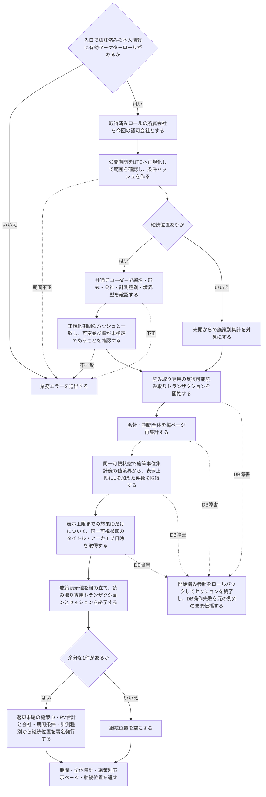

# MetricsService

## 公開メソッド一覧

| メソッド名 | 処理概要 | 詳細 |
| --- | --- | --- |
| `report` | 会社の期間全体の計測集計と施策別集計ページを参照する | [詳細](#report) |

## 責務

マーケターが所属会社の公開済み投稿の成果を、指定期間の全体像と施策ごとの内訳で把握する業務を担う。

## 依存するクラス

| クラス名 | 利用目的 |
| --- | --- |
| [ServiceContext](../../../../../backend/services/context.py) | 計測参照用セッションと署名鍵の供給 |
| [AuthenticatedUser](../../auth/modules/AUTH_SERVICE.md#authenticate) | 要求ごとの本人と有効マーケターロールの所属会社の決定 |
| [PostRepository](../../../modules/POST_REPOSITORY.md) | 期間全体の集計と施策別集計ページの取得 |
| [CampaignRepository](../../../../../backend/repositories/campaigns.py) | 表示ページの施策IDだけに対応するタイトルとアーカイブ日時の取得 |
| [MetricsSummary](../../../../../backend/domain/metrics.py) | 全体と施策別の計測値・率の表現 |
| [ListCursor](../../../modules/LIST_CURSOR.md) | 会社・種別・施策集計値境界を署名で保護した継続位置の読み書き |

## コンストラクタ

### 引数

| 引数名 | 型 | 意味 | 制約 |
| --- | --- | --- | --- |
| `ctx` | `ServiceContext` | 計測参照の依存 | セッションファクトリと署名鍵を提供する |

### 初期化処理

受け取った`ctx`を保持する。

## report

非同期メソッドとし、`auth`以外の引数をキーワード専用とする。

### 処理フロー図

### 引数

| 引数名 | 型 | 意味 | 制約 |
| --- | --- | --- | --- |
| `auth` | `services.auth_service.AuthenticatedUser` | 要求入口で認証済みの本人と任意の有効ロール | `user.id`は正の整数。`marketer`は未保有・無効なら`None`。Serviceは取得済み情報で必要ロールを確認する。DBでの再認証は対象外 |
| `published_from` | `datetime \| None` | 公開日時の下限を含む | タイムゾーン付きUTC。`None`は下限なし |
| `published_to` | `datetime \| None` | 公開日時の上限を除く | タイムゾーン付きUTC。両端指定時は下限より後。`None`は上限なし |
| `limit` | `int` | 施策の表示上限 | HTTP境界で検証済みの1〜50。条件ハッシュの対象から除外し、ページ間変更を許可 |
| `cursor` | `str \| None` | 署名付き値カーソル | `None`は初回。共通契約は[ListCursor](../../../modules/LIST_CURSOR.md)。本人への束縛・有効期限は対象外 |

条件ハッシュの対象は`published_from`・`published_to`とし、日時はUTC表現、省略値は`None`へ正規化する。共通の`read_list_cursor(secret, resource, company_id, token)`と`issue_list_cursor(secret, cursor)`を使用し、`resource`は`metrics`、境界は`MetricsPosition`、`sort`・`order`は`None`とする。

全体集計は`summarize_total`、施策別ページは`list_campaign_metrics`、表示情報は`CampaignRepository.references`を使用する。トランザクションの分離レベル`REPEATABLE READ`と読み取り専用属性はServiceが接続・トランザクションの設定機構で管理する。

### 戻り値

| 型 | 意味 | 制約 |
| --- | --- | --- |
| `MetricsReportView` | 期間全体と施策別内訳の計測レポート | 1応答内の全体集計・明細・施策表示情報は同一可視状態。永続一覧Snapshotの作成・参照・削除とその他の書き込みを禁止する。ページ間更新による重複・取りこぼしの防止は保証対象外 |

| MetricsReportViewの属性 | 型 | 意味・条件 |
| --- | --- | --- |
| `published_from` | `datetime \| None` | 適用した公開日時下限 |
| `published_to` | `datetime \| None` | 適用した公開日時上限 |
| `summary` | `MetricsSummary` | 会社・公開成功・期間を満たす全投稿の集計。ページ境界から独立し、空ページにも返す。対象0件では6計数が0、率が`None` |
| `campaigns` | `list[CampaignMetricsView]` | 最大`limit`件。施策単位集計後のPV合計・施策IDの降順。期間内に対象投稿がある施策だけを含む。PV合計0は値0として扱う。0件は空配列 |
| `next_cursor` | `str \| None` | 後続がある場合は返却末尾行の施策IDとPV合計を境界とする署名付きカーソル。後続なし・空ページでは`None` |

| CampaignMetricsViewの属性 | 型 | 意味・条件 |
| --- | --- | --- |
| `id` | `int` | 表示対象の施策ID |
| `title` | `str` | 同一可視状態で取得した施策名 |
| `archived_at` | `datetime \| None` | 同一可視状態で取得したアーカイブ日時。未アーカイブは`None` |
| `summary` | `MetricsSummary` | 当該施策の会社・公開成功・期間を満たす全投稿の集計 |

| MetricsSummaryの属性 | 型 | 意味・条件 |
| --- | --- | --- |
| `post_count` | `int` | 対象公開成功済み投稿数 |
| `completed_count` | `int` | `completed`の投稿数 |
| `pending_count` | `int` | `pending`の投稿数 |
| `failed_count` | `int` | `failed`の投稿数 |
| `x_pv_count` | `int` | `completed`だけのPV合計。該当値なしは0 |
| `landing_user_count` | `int` | `completed`だけの流入数合計。該当値なしは0 |
| `landing_rate` | `float \| None` | 流入数合計/PV合計。PV合計0では`None`。丸めは対象外 |

### 例外

| 例外 | 論理名 | 例外コード | 発生条件 | メッセージ |
| --- | --- | --- | --- | --- |
| `AppError` | 業務エラー | `MARKETER_FORBIDDEN` | 認証済み本人の`marketer`が`None` | この操作を行う権限がありません。 |
| `AppError` | 業務エラー | `INVALID_ARGUMENT` | 期間下限が上限以上 | published_from・published_to の範囲が正しくありません。 |
| `AppError` | 業務エラー | `INVALID_ARGUMENT` | カーソルの署名が不正 | cursor が正しくありません。 |
| `AppError` | 業務エラー | `INVALID_ARGUMENT` | カーソルの形式が不正（旧Snapshotカーソルを含む） | cursor が正しくありません。 |
| `AppError` | 業務エラー | `INVALID_ARGUMENT` | カーソルの会社が今回の会社と異なる | cursor が正しくありません。 |
| `AppError` | 業務エラー | `INVALID_ARGUMENT` | カーソルの種別が計測以外 | cursor が正しくありません。 |
| `AppError` | 業務エラー | `INVALID_ARGUMENT` | カーソルの境界型が施策集計境界の制約を満たさない | cursor が正しくありません。 |
| `AppError` | 業務エラー | `INVALID_ARGUMENT` | カーソルのsortが`None`以外 | cursor が正しくありません。 |
| `AppError` | 業務エラー | `INVALID_ARGUMENT` | カーソルのorderが`None`以外 | cursor が正しくありません。 |
| `AppError` | 業務エラー | `INVALID_ARGUMENT` | 正規化期間ハッシュがカーソルと異なる | cursor と一覧条件が一致しません。 |
| `SQLAlchemyError` | DB操作失敗 | — | 読み取り専用トランザクションの開始に失敗する | 元の例外のメッセージ |
| `SQLAlchemyError` | DB操作失敗 | — | 全体集計の取得に失敗する | 元の例外のメッセージ |
| `SQLAlchemyError` | DB操作失敗 | — | 施策別集計ページの取得に失敗する | 元の例外のメッセージ |
| `SQLAlchemyError` | DB操作失敗 | — | 表示対象施策の参照情報の取得に失敗する | 元の例外のメッセージ |
