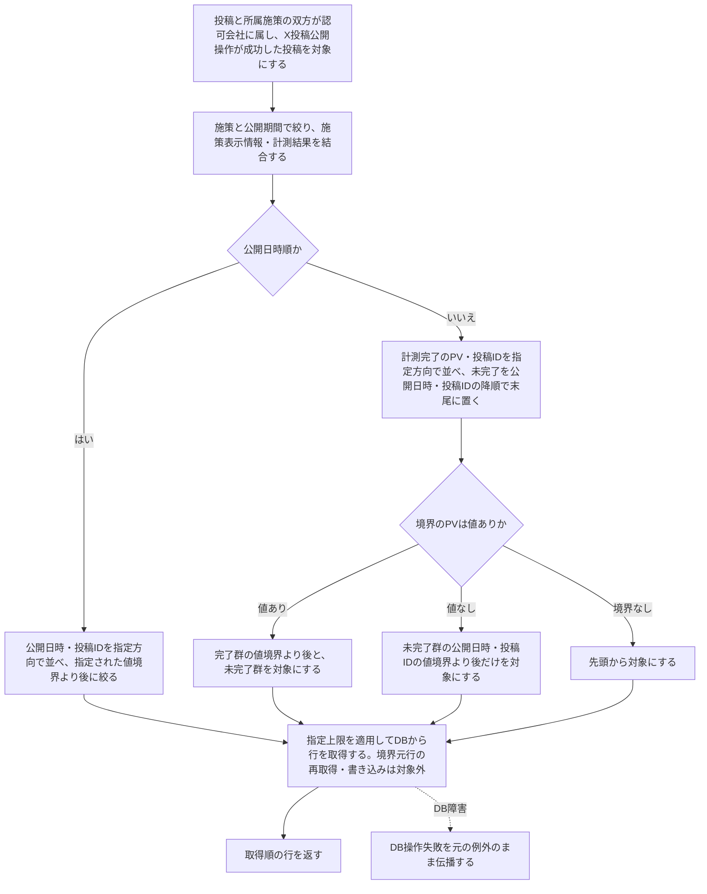
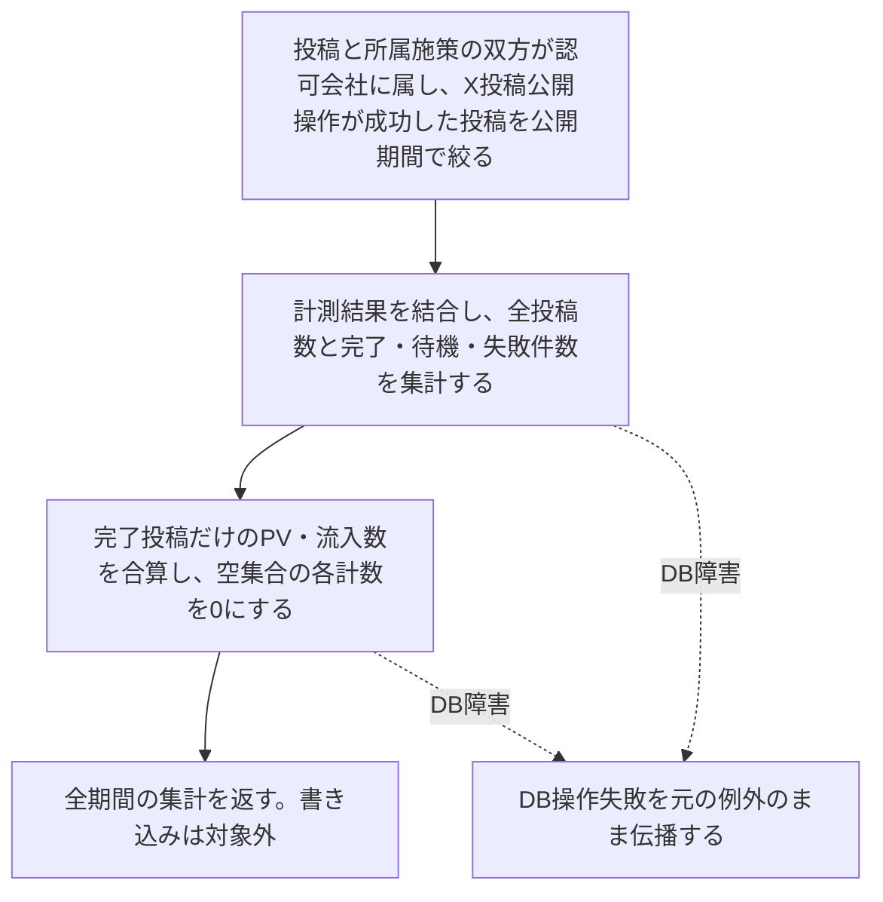
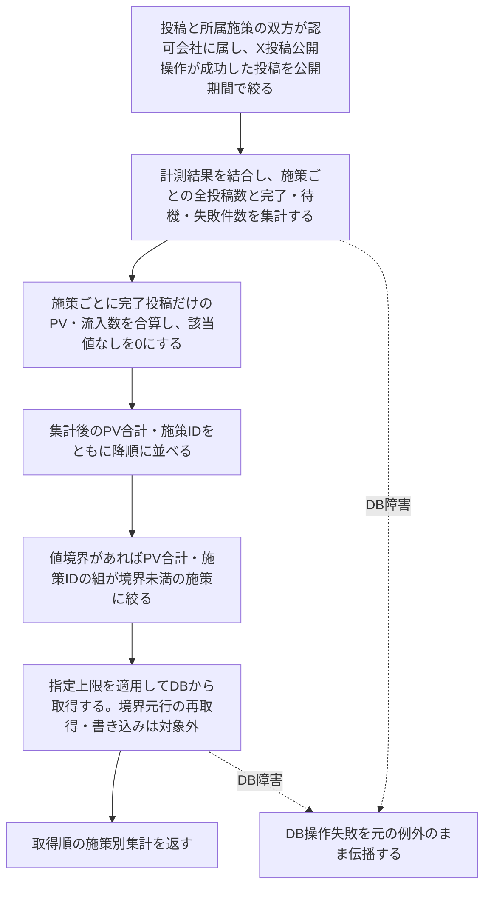

# PostRepository

## 公開メソッド一覧

| メソッド名 | 処理概要 | 詳細 |
| --- | --- | --- |
| `list_posts` | 公開成功済み投稿を値境界でページ取得する | [詳細](#list_posts) |
| `summarize_total` | 対象期間全体の投稿と計測結果を集計する | [詳細](#summarize_total) |
| `list_campaign_metrics` | 施策単位の計測集計を値境界でページ取得する | [詳細](#list_campaign_metrics) |

## 責務

会社の公開成功済み投稿と、その投稿に紐づく計測結果を扱う。投稿の参照範囲と、公開期間に対応する全体・施策別の計測集計を担う。

## 依存するクラス

| クラス名 | 利用目的 |
| --- | --- |
| `AsyncSession` | 公開成功済み投稿と計測結果の参照 |
| [Post・Campaign・PostMetric・ApiIdempotencyRequest](../../../backend/models/) | 投稿の所属会社・公開成功・施策・計測状態の対応付け |
| [MetricsSummary](../../../backend/domain/metrics.py) | 投稿件数・計測状態別件数・計測値合計の表現 |

## コンストラクタ

### 引数

| 引数名 | 型 | 意味 | 制約 |
| --- | --- | --- | --- |
| `session` | `AsyncSession` | 対象要求の参照セッション | 呼び出し元が管理するセッション |

### 初期化処理

受け取った`session`を保持する。

## list_posts

非同期メソッドとし、`list_posts(company_id: int, flt: PostFilter, page: PostPage, limit: int) -> list[PostRow]`とする。

### 処理フロー図

### 引数

| 引数名 | 型 | 意味 | 制約 |
| --- | --- | --- | --- |
| `company_id` | `int` | 参照する会社 | 有効ロールから決めた正の整数 |
| `flt` | `PostFilter` | 投稿の絞り込み条件 | 下表に従う |
| `page` | `PostPage` | 並び順と直前ページの値境界 | 下表に従う |
| `limit` | `int` | DB取得上限 | 必須の正の整数。全件取得用の省略・`None`指定を禁止する。Serviceは表示件数に1を加えた値を渡す |

| PostFilterの属性 | 型 | 意味・制約 |
| --- | --- | --- |
| `campaign_id` | `int \| None` | 施策ID。指定時は正の整数。`None`は認可会社内の全施策 |
| `published_from` | `datetime \| None` | 公開日時の下限を含む。タイムゾーン付きUTC。`None`は下限なし |
| `published_to` | `datetime \| None` | 公開日時の上限を除く。タイムゾーン付きUTC。両端指定時は下限より後。`None`は上限なし |

| PostPageの属性 | 型 | 意味・制約 |
| --- | --- | --- |
| `sort` | `Literal["published_at", "x_pv_count"]` | 公開日時順またはPV順 |
| `order` | `Literal["asc", "desc"]` | 公開日時順では日時・IDの両方に適用。PV順では完了群のPV・IDの両方に適用 |
| `cursor` | `PostPosition \| None` | 直前返却行の値。`None`は初回。現在のDBに境界元行が存在することを条件から除外 |

| PostPositionの属性 | 型 | 意味・制約 |
| --- | --- | --- |
| `post_id` | `int` | 直前返却行の投稿ID。正の整数 |
| `published_at` | `datetime` | 直前返却行の公開日時。タイムゾーン付きUTC |
| `x_pv_count` | `int \| None` | 直前返却行が`completed`なら非負PV。`pending`・`failed`なら`None` |

### 戻り値

| 型 | 意味 | 制約 |
| --- | --- | --- |
| `list[PostRow]` | 当該要求時点の公開成功済み投稿 | 指定上限以内。境界は厳密比較とする。0件は空配列。ページ間更新による重複・取りこぼしの防止は保証対象外 |

| PostRowの属性 | 型 | 意味・条件 |
| --- | --- | --- |
| `post` | `models.Post` | 投稿と所属施策の双方の`company_id`が認可会社に一致し、施策・期間条件と公開操作`publish_x_post`の`succeeded`を満たす投稿。属性はORM定義に従う |
| `campaign_title` | `str` | 当該要求で取得した施策名 |
| `campaign_archived_at` | `datetime \| None` | 施策のアーカイブ日時。未アーカイブは`None` |
| `metric` | `models.PostMetric` | 投稿の計測結果。属性はORM定義に従う |
| `similarity` | `float \| None` | 通常一覧では`None` |

### 例外

| 例外 | 論理名 | 例外コード | 発生条件 | メッセージ |
| --- | --- | --- | --- | --- |
| `SQLAlchemyError` | DB操作失敗 | — | 投稿一覧の取得に失敗する | 元の例外のメッセージ |

## summarize_total

非同期メソッドとし、`summarize_total(company_id: int, *, published_from: datetime | None = None, published_to: datetime | None = None) -> MetricsSummary`とする。

### 処理フロー図

### 引数

| 引数名 | 型 | 意味 | 制約 |
| --- | --- | --- | --- |
| `company_id` | `int` | 集計する会社 | 有効ロールから決めた正の整数 |
| `published_from` | `datetime \| None` | 公開日時の下限を含む | タイムゾーン付きUTC。`None`は下限なし |
| `published_to` | `datetime \| None` | 公開日時の上限を除く | タイムゾーン付きUTC。両端指定時は下限より後。`None`は上限なし |

### 戻り値

| 型 | 意味 | 制約 |
| --- | --- | --- |
| `MetricsSummary` | 会社の指定期間全体の集計 | カーソル境界・表示ページから独立。対象0件では6計数が0、率が`None` |

| MetricsSummaryの属性 | 型 | 意味・条件 |
| --- | --- | --- |
| `post_count` | `int` | 対象公開成功済み投稿数 |
| `completed_count` | `int` | `completed`の投稿数 |
| `pending_count` | `int` | `pending`の投稿数 |
| `failed_count` | `int` | `failed`の投稿数 |
| `x_pv_count` | `int` | `completed`だけのPV合計。該当値なしは0 |
| `landing_user_count` | `int` | `completed`だけの流入数合計。該当値なしは0 |
| `landing_rate` | `float \| None` | 流入数合計/PV合計。PV合計0では`None`。丸めは対象外 |

### 例外

| 例外 | 論理名 | 例外コード | 発生条件 | メッセージ |
| --- | --- | --- | --- | --- |
| `SQLAlchemyError` | DB操作失敗 | — | 全期間の集計に失敗する | 元の例外のメッセージ |

## list_campaign_metrics

非同期メソッドとし、`list_campaign_metrics(company_id: int, *, published_from: datetime | None = None, published_to: datetime | None = None, after: MetricsPosition | None, limit: int) -> list[CampaignMetricsRow]`とする。

### 処理フロー図

### 引数

| 引数名 | 型 | 意味 | 制約 |
| --- | --- | --- | --- |
| `company_id` | `int` | 集計する会社 | 有効ロールから決めた正の整数 |
| `published_from` | `datetime \| None` | 公開日時の下限を含む | タイムゾーン付きUTC。`None`は下限なし |
| `published_to` | `datetime \| None` | 公開日時の上限を除く | タイムゾーン付きUTC。両端指定時は下限より後。`None`は上限なし |
| `after` | `MetricsPosition \| None` | 直前返却施策の集計値境界 | 必須。初回は`None`。現在のDBに境界元施策が存在することを条件から除外 |
| `limit` | `int` | DB取得上限 | 必須の正の整数。Serviceは表示件数に1を加えた値を渡す |

| MetricsPositionの属性 | 型 | 意味・制約 |
| --- | --- | --- |
| `campaign_id` | `int` | 直前返却行の施策ID。正の整数 |
| `x_pv_count` | `int` | 直前返却行のPV合計。非負整数 |

### 戻り値

| 型 | 意味 | 制約 |
| --- | --- | --- |
| `list[CampaignMetricsRow]` | 当該要求時点の施策別集計ページ | 指定上限以内。対象投稿がある施策だけを含む。PV合計0も値0として施策ID降順。0件は空配列。ページ間更新による重複・取りこぼしの防止は保証対象外 |

| CampaignMetricsRowの属性 | 型 | 意味・条件 |
| --- | --- | --- |
| `campaign_id` | `int` | 対象投稿が属する施策ID |
| `summary` | `MetricsSummary` | 当該施策の対象投稿全体の集計。各属性の意味・計測状態の条件は[全体集計の属性表](#summarize_total)に従う |

### 例外

| 例外 | 論理名 | 例外コード | 発生条件 | メッセージ |
| --- | --- | --- | --- | --- |
| `SQLAlchemyError` | DB操作失敗 | — | 施策別集計ページの取得に失敗する | 元の例外のメッセージ |
