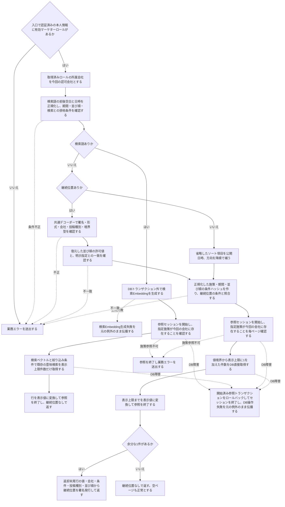

# PostService

## 公開メソッド一覧

| メソッド名 | 処理概要 | 詳細 |
| --- | --- | --- |
| `list` | 会社の公開成功済み投稿を一覧または意味検索で参照する | [詳細](#list) |

## 責務

マーケターが所属会社の公開済み投稿を、施策・公開期間・並び順または検索語で探す業務を担う。

## 依存するクラス

| クラス名 | 利用目的 |
| --- | --- |
| [ServiceContext](../../../../../backend/services/context.py) | 投稿参照用セッション・検索Embedding・署名鍵の供給 |
| [AuthenticatedUser](../../auth/modules/AUTH_SERVICE.md#authenticate) | 要求ごとの本人と有効マーケターロールの所属会社の決定 |
| [PostRepository](../../../modules/POST_REPOSITORY.md) | 投稿のページ取得と、既存`search_posts`による意味検索 |
| [CampaignRepository](../../../../../backend/repositories/campaigns.py) | 指定施策が参照会社に属することの確認 |
| [EmbeddingClient](../../../../../backend/clients/embedding.py) | 検索語に対応する検索ベクトルの生成 |
| [ListCursor](../../../modules/LIST_CURSOR.md) | 会社・種別・値境界を署名で保護した継続位置の読み書き |

## コンストラクタ

### 引数

| 引数名 | 型 | 意味 | 制約 |
| --- | --- | --- | --- |
| `ctx` | `ServiceContext` | 投稿参照の依存 | セッションファクトリ・Embeddingクライアント・署名鍵を提供する |

### 初期化処理

受け取った`ctx`を保持する。

## list

非同期メソッドとし、`auth`以外の引数をキーワード専用とする。

### 処理フロー図

### 引数

| 引数名 | 型 | 意味 | 制約 |
| --- | --- | --- | --- |
| `auth` | `services.auth_service.AuthenticatedUser` | 要求入口で認証済みの本人と任意の有効ロール | `user.id`は正の整数。`marketer`は未保有・無効なら`None`。Serviceは取得済み情報で必要ロールを確認する。DBでの再認証は対象外 |
| `query` | `str \| None` | 意味検索語 | 前後空白除去後1〜1000文字。`None`は通常一覧。指定時は`cursor`・`sort`・`order`と排他 |
| `campaign_id` | `int \| None` | 絞り込む施策 | HTTP境界で検証済みの正の整数。`None`は認可会社内の全施策 |
| `published_from` | `datetime \| None` | 公開日時の下限を含む | タイムゾーン付きUTC。`None`は下限なし |
| `published_to` | `datetime \| None` | 公開日時の上限を除く | タイムゾーン付きUTC。両端指定時は下限より後。`None`は上限なし |
| `sort` | `str \| None` | 通常一覧のソート項目 | `published_at`・`x_pv_count`・`None` |
| `order` | `str \| None` | 通常一覧の方向 | `asc`・`desc`・`None` |
| `limit` | `int` | 表示上限 | HTTP境界で検証済みの1〜50。条件ハッシュの対象から除外し、ページ間変更を許可 |
| `cursor` | `str \| None` | 署名付き値カーソル | `None`は初回。共通契約は[ListCursor](../../../modules/LIST_CURSOR.md)。本人への束縛・有効期限は対象外 |

条件ハッシュの対象は`campaign_id`・`published_from`・`published_to`・確定後の`sort`・`order`とし、日時はUTC表現、省略した絞り込み条件は`None`へ正規化する。共通の`read_list_cursor(secret, resource, company_id, token)`と`issue_list_cursor(secret, cursor)`を使用し、`resource`は`posts`、境界は`PostPosition`とする。

### 戻り値

| 型 | 意味 | 制約 |
| --- | --- | --- |
| `PostListView` | 当該要求で取得した投稿一覧 | 読み取り専用。永続一覧Snapshotの作成・参照・削除とその他の書き込みを禁止する。ページ間更新による重複・取りこぼしの防止は保証対象外 |

| PostListViewの属性 | 型 | 意味・条件 |
| --- | --- | --- |
| `posts` | `list[PostListItemView]` | 最大`limit`件。0件は空配列。通常一覧の並びと境界条件は[投稿ページ取得](../../../modules/POST_REPOSITORY.md#list_posts)に従う。意味検索は既存の類似度順 |
| `next_cursor` | `str \| None` | 後続がある通常一覧では返却末尾の値を持つ署名付きカーソル。後続なし・空ページ・意味検索では`None` |

| PostListItemViewの属性 | 型 | 意味・条件 |
| --- | --- | --- |
| `post_id` | `int` | 公開成功済み投稿ID |
| `campaign_id` | `int` | 投稿が属する施策ID |
| `campaign_title` | `str` | 当該要求で参照した施策名 |
| `campaign_archived_at` | `datetime \| None` | 施策のアーカイブ日時。未アーカイブは`None` |
| `body` | `str` | 公開済み本文 |
| `x_post_id` | `str` | X上の投稿ID |
| `published_at` | `datetime` | 公開日時。タイムゾーン付きUTC |
| `similarity` | `float \| None` | 意味検索時の類似度。通常一覧は`None` |
| `metrics` | `MetricsView` | 当該要求で参照した計測状態と表示値 |

| MetricsViewの属性 | 型 | 意味・条件 |
| --- | --- | --- |
| `status` | `str` | `pending`・`completed`・`failed` |
| `scheduled_at` | `datetime` | 計測予定日時 |
| `measured_at` | `datetime \| None` | `completed`の計測日時。それ以外は`None` |
| `x_pv_count` | `int \| None` | `completed`のPV。それ以外は`None` |
| `landing_user_count` | `int \| None` | `completed`の流入数。それ以外は`None` |

### 例外

| 例外 | 論理名 | 例外コード | 発生条件 | メッセージ |
| --- | --- | --- | --- | --- |
| `AppError` | 業務エラー | `MARKETER_FORBIDDEN` | 認証済み本人の`marketer`が`None` | この操作を行う権限がありません。 |
| `AppError` | 業務エラー | `INVALID_ARGUMENT` | 検索語が正規化後の長さ条件を満たさない | query が正しくありません。 |
| `AppError` | 業務エラー | `INVALID_ARGUMENT` | 検索語とカーソルを併用する | query は cursor・sort・order と同時に指定できません。 |
| `AppError` | 業務エラー | `INVALID_ARGUMENT` | 検索語とsortを併用する | query は cursor・sort・order と同時に指定できません。 |
| `AppError` | 業務エラー | `INVALID_ARGUMENT` | 検索語とorderを併用する | query は cursor・sort・order と同時に指定できません。 |
| `AppError` | 業務エラー | `INVALID_ARGUMENT` | sortが許可値以外 | sort または order が正しくありません。 |
| `AppError` | 業務エラー | `INVALID_ARGUMENT` | orderが許可値以外 | sort または order が正しくありません。 |
| `AppError` | 業務エラー | `INVALID_ARGUMENT` | 期間下限が上限以上 | published_from・published_to の範囲が正しくありません。 |
| `AppError` | 業務エラー | `INVALID_ARGUMENT` | カーソルの署名が不正 | cursor が正しくありません。 |
| `AppError` | 業務エラー | `INVALID_ARGUMENT` | カーソルの形式が不正（旧Snapshotカーソルを含む） | cursor が正しくありません。 |
| `AppError` | 業務エラー | `INVALID_ARGUMENT` | カーソルの会社が今回の会社と異なる | cursor が正しくありません。 |
| `AppError` | 業務エラー | `INVALID_ARGUMENT` | カーソルの種別が投稿以外 | cursor が正しくありません。 |
| `AppError` | 業務エラー | `INVALID_ARGUMENT` | カーソルの境界型が投稿境界の制約を満たさない | cursor が正しくありません。 |
| `AppError` | 業務エラー | `INVALID_ARGUMENT` | カーソルのsortが投稿一覧の許可値以外 | cursor が正しくありません。 |
| `AppError` | 業務エラー | `INVALID_ARGUMENT` | カーソルのorderが投稿一覧の許可値以外 | cursor が正しくありません。 |
| `AppError` | 業務エラー | `INVALID_ARGUMENT` | 明示sortがカーソルと異なる | cursor と異なる sort・order は指定できません。 |
| `AppError` | 業務エラー | `INVALID_ARGUMENT` | 明示orderがカーソルと異なる | cursor と異なる sort・order は指定できません。 |
| `AppError` | 業務エラー | `INVALID_ARGUMENT` | 正規化条件ハッシュがカーソルと異なる | cursor と一覧条件が一致しません。 |
| `AppError` | 業務エラー | `CAMPAIGN_NOT_FOUND` | 指定施策を今回の会社で参照できない | 施策が見つかりません。 |
| `EmbeddingError` | 検索Embedding生成失敗 | — | 既存Embeddingクライアントが検索Embeddingの生成に失敗する | 元の例外のメッセージ |
| `SQLAlchemyError` | DB操作失敗 | — | 参照セッションの開始に失敗する | 元の例外のメッセージ |
| `SQLAlchemyError` | DB操作失敗 | — | 指定施策の取得に失敗する | 元の例外のメッセージ |
| `SQLAlchemyError` | DB操作失敗 | — | 投稿の取得に失敗する | 元の例外のメッセージ |
