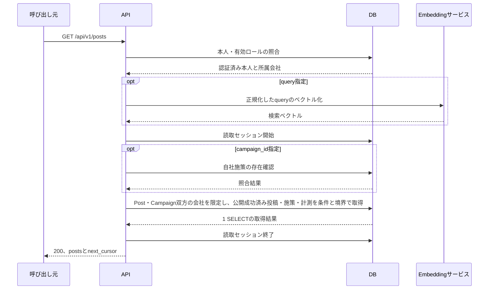
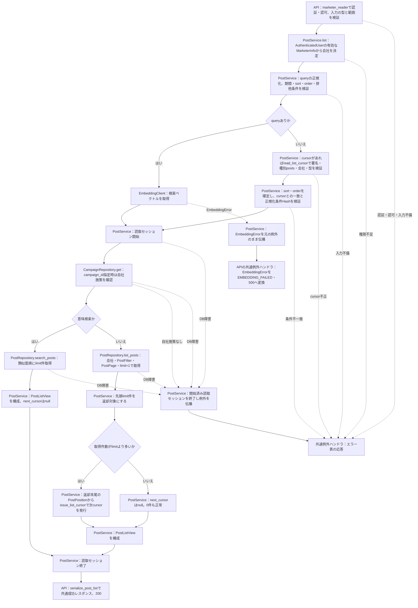

# API設計: 公開済み投稿一覧

## API一覧

| メソッド | パス | 処理概要 |
| --- | --- | --- |
| GET | [`/api/v1/posts`](#get-apiv1posts) | 自社の公開済み投稿を絞り込み・並び替え・意味検索して取得する |

## GET `/api/v1/posts`

### 処理概要

自社の公開成功済み投稿を、指定条件に応じた一覧として取得する。

### 関連ユースケース

| ケース名 | 呼び出し条件 | リクエストの内容 | 期待する結果 |
| --- | --- | --- | --- |
| 公開済み投稿の閲覧 | 一覧を開く、または絞り込み・並び順を変更する | 必要な施策・公開期間・並び順と取得件数 | 200、条件に合う先頭ページと次のcursorを返す |
| 続きの閲覧 | 次ページを取得する | 同じ絞り込み条件と前回のnext_cursor | 200、境界より後の投稿と次のcursorを返す。該当0件も正常 |
| 投稿の意味検索 | 内容に近い投稿を探す | queryと必要な施策・公開期間・取得件数 | 200、類似度順の1ページを返し、next_cursorはnull |

### 認可

| 項目 | 内容 |
| --- | --- |
| 操作可能権限 | 有効なマーケターロールを持つ認証済みユーザー |
| 操作対象の条件 | PostServiceがAuthenticatedUserの有効なMarketerInfoで企業境界を確認し、読取クエリでPostと所属Campaignの双方のcompany_idがMarketerInfo.company_idと一致するものに限定する。作成者による限定は除外し、アーカイブ済み施策の投稿も含める |
| 会社・操作者の決定 | 操作者はAuthenticatedUser.user.id、会社はMarketerInfo.company_id。認可に用いる会社・操作者のRequest指定を禁止する |
| 認証の参照先 | [認証API](../auth/API.md#共通の認証と認可)と[AUTH_DEPENDENCIESのmarketer_reader](../../modules/api/AUTH_DEPENDENCIES.md#marketer_reader)。ServiceへAuthenticatedUserを渡す |
| cursorの利用範囲 | 同じ会社の有効なマーケターロールを持つ別ユーザーも利用可能。有効期限は設けず、要求ごとに現在の認証・認可を適用する |

### シーケンス図



### 処理フロー図



取得契約は[PostService](modules/POST_SERVICE.md)、[PostRepository](../../modules/POST_REPOSITORY.md)、署名付きcursorの契約は[LIST_CURSOR](../../modules/LIST_CURSOR.md)に従う。業務データへの操作は読取に限定し、一覧の保存・冪等性記録・履歴の書込を禁止する。

### リクエスト

必須は、`〇`を必須、`-`を任意として記載する。

| 場所 | 項目名 | 型 | 必須 | 意味 | 制約 |
| --- | --- | --- | --- | --- | --- |
| Header | Cookie | string | 〇 | 本人認証 | [認証API](../auth/API.md#共通の認証と認可)に従う |
| Query | query | string | - | 意味検索の検索語 | 前後の空白を除いて1〜1000文字。cursor・sort・orderとの同時指定を禁止する |
| Query | campaign_id | integer | - | 絞り込む施策 | 正の整数。自社の施策を指定し、アーカイブ済みも許容する |
| Query | published_from | string | - | 公開期間の開始 | タイムゾーン付きISO 8601日時。指定値以上。両端指定時はpublished_toより前 |
| Query | published_to | string | - | 公開期間の終了 | タイムゾーン付きISO 8601日時。指定値未満 |
| Query | sort | string | - | 並び替え項目 | published_at / x_pv_count。初回省略時はpublished_at。cursor指定時の省略はcursor値を復元し、明示値はcursor値と一致させる |
| Query | order | string | - | 並び方向 | asc / desc。初回省略時はdesc。cursor指定時の省略はcursor値を復元し、明示値はcursor値と一致させる |
| Query | limit | integer | - | 返却上限件数 | 1〜50、既定20。cursorの条件照合から除外し、ページ間で変更可能 |
| Query | cursor | string | - | 続きの取得境界 | 不透明な署名付き文字列。posts種別・自社・型・正規化した条件Hashが一致するもの。旧一覧cursorは400 |

| 条件 | 取得規則 |
| --- | --- |
| 対象投稿 | Postと所属Campaignの双方のcompany_idが今回の会社と一致し、公開操作がpublish_x_post、結果がsucceededのPost |
| published_at順 | (published_at, post_id)をどちらも指定方向で比較・整列する |
| x_pv_count順 | completedのPV値ありを先にし、(x_pv_count, post_id)をどちらも指定方向で比較・整列する。pending・failedは常に末尾に置き、末尾群内はpublished_at降順・post_id降順 |
| 意味検索 | 絞り込み対象をコサイン類似度降順、同値はpost_id降順で取得する。1ページで完結する |
| cursorの条件 | campaign_id・公開期間・確定したsort・orderを正規化してHash照合する。日時はUTCに統一する |
| 論理境界 | PostPositionのpost_idは正の整数、published_atはタイムゾーン付き日時、x_pv_countは非負整数またはNone。Noneは未計測群を表す。PostPage.cursorはPostPositionまたはNone |
| 境界の適用 | cursor内の値とIDを使って境界より後を直接取得する。境界元レコードの再取得を禁止する |
| 読取の整合範囲 | 投稿・所属施策・計測は1 SELECTの取得結果を使用し、ページ間は各要求時点の最新状態を読む。更新による重複・取りこぼしがあり、全件を一度ずつ取得することは保証対象外 |

#### リクエスト例

```http
GET /api/v1/posts?campaign_id=12&published_from=2026-10-01T00%3A00%3A00Z&published_to=2026-11-01T00%3A00%3A00Z&sort=published_at&order=desc&limit=20 HTTP/1.1
Cookie: hiromeru_session=<認証Cookie>
```

### レスポンス

#### HTTPステータスコード

`200 OK`

#### 返却項目

共通形式は[INTERNAL_API_INDEXの共通レスポンス](../../INTERNAL_API_INDEX.md#共通レスポンス)に従う。以下はdata配下の項目。日時はUTCのISO 8601形式とする。

| 項目名 | 型 | 意味 | 制約 |
| --- | --- | --- | --- |
| posts | array<object> | 公開済み投稿 | 最大limit件。該当0件は空配列 |
| posts[].post_id | integer | 投稿ID | 正の整数 |
| posts[].campaign_id | integer | 施策ID | 正の整数 |
| posts[].campaign_title | string | 施策名 | 所属施策のタイトル |
| posts[].campaign_archived_at | string / null | 施策のアーカイブ日時 | アーカイブ済みの場合に日時、それ以外はnull |
| posts[].body | string | 投稿本文 | 公開済みの本文 |
| posts[].x_post_id | string | X投稿ID | 公開成功したX投稿の識別子 |
| posts[].published_at | string | 公開日時 | タイムゾーン付き日時 |
| posts[].similarity | number / null | コサイン類似度 | 意味検索時は数値、通常一覧はnull |
| posts[].metrics | object | 投稿の計測結果 | 以下の項目を持つ |
| posts[].metrics.status | string | 計測状態 | pending / completed / failed |
| posts[].metrics.scheduled_at | string | 計測予定日時 | タイムゾーン付き日時 |
| posts[].metrics.measured_at | string / null | 計測完了日時 | completedの場合に日時、pending・failedはnull |
| posts[].metrics.x_pv_count | integer / null | X表示数 | completedの場合に非負整数、pending・failedは部分値を含めnull |
| posts[].metrics.landing_user_count | integer / null | 遷移ユーザー数 | completedの場合に非負整数、pending・failedは部分値を含めnull |
| next_cursor | string / null | 続きの取得用cursor | 通常一覧でlimit+1件取得できた場合は返却末尾から発行。それ以外と意味検索はnull |

#### レスポンス例

```http
HTTP/1.1 200 OK
Content-Type: application/json

{
  "success": true,
  "data": {
    "posts": [
      {
        "post_id": 101,
        "campaign_id": 12,
        "campaign_title": "秋の採用広報",
        "campaign_archived_at": null,
        "body": "開発チームの仕事を紹介します。",
        "x_post_id": "1980000000000000001",
        "published_at": "2026-10-10T09:00:00Z",
        "similarity": null,
        "metrics": {
          "status": "completed",
          "scheduled_at": "2026-10-17T09:00:00Z",
          "measured_at": "2026-10-17T10:00:00Z",
          "x_pv_count": 1000,
          "landing_user_count": 50
        }
      }
    ],
    "next_cursor": null
  },
  "error": null
}
```

### エラー

| HTTPステータス | 返却エラーコード | 発生条件 | 応答内容 |
| --- | --- | --- | --- |
| 401 | UNAUTHENTICATED | 認証Cookieの欠落・不正・期限切れ、またはDBで本人照合が成立しない | 共通形式でログインを求める |
| 403 | MARKETER_FORBIDDEN | 有効なMarketerInfoが存在しない | 共通形式でマーケター権限不足を返す |
| 400 | INVALID_ARGUMENT | 引数の型・値・期間・排他条件が不正、またはcursorの署名・種別・会社・型・条件Hash・sort/orderが不一致。旧一覧cursorも含む | 共通形式で入力不備を返す。cursor付き要求で本コードを受けたFrontendはcursorを解除し、同じ条件の先頭ページを1回だけ再取得する |
| 404 | CAMPAIGN_NOT_FOUND | 指定campaign_idが存在しない、または自社の施策ではない | 共通形式で施策を参照できない旨を返す |
| 500 | EMBEDDING_FAILED | 意味検索の検索語のベクトル化がEmbeddingErrorで失敗 | APIの共通例外ハンドラが、伝播したEmbeddingErrorを本コードへ変換し、共通形式でベクトル化失敗を返す |
| 500 | INTERNAL_ERROR | DB障害など想定外の内部処理失敗 | 共通形式で内部エラーを返す |
