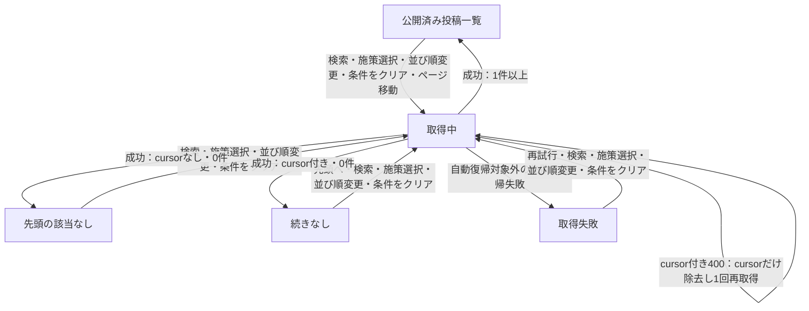

# 画面設計: 公開済み投稿一覧

[画面一覧](../../SCREEN_INDEX.md)の投稿一覧のうち、自社の公開成功済み投稿の取得・表示を対象とする。取得条件と応答は[API設計](API.md)に従う。

## 画面一覧

| 画面 | 概要 | Storybook |
| --- | --- | --- |
| [公開済み投稿一覧](#画面名-公開済み投稿一覧) | 取得成功し、postsが1件以上 | - |
| [先頭の該当なし](#画面名-先頭の該当なし) | cursorなしの取得成功でpostsが0件 | - |
| [続きなし](#画面名-続きなし) | cursor付きの取得成功でpostsが0件 | - |
| [取得中](#画面名-取得中) | 投稿取得の応答待ち。cursor解除後の再取得を含む | - |
| [取得失敗](#画面名-取得失敗) | 投稿取得が失敗し、自動復帰の対象外または復帰も失敗 | - |

## 画面遷移図



## 画面名: 公開済み投稿一覧

### ASCIIモック

```text
+------------------------------------------------------+
| 投稿                                                 |
| 本文検索 [          ] 施策 [       ] 並び順 [       ] |
| [検索] [条件をクリア]                                |
| 詳細条件：公開日の開始 [       ] 終了 [       ]       |
| 投稿・計測状態 | 施策・公開日 | 初週PV | 流入         |
| 投稿本文 …     | 施策名 …     | 1,000  | 50           |
| [先頭へ]                              [次の20件]     |
+------------------------------------------------------+
```

### 提供操作一覧

| 操作 | API呼び出し | 操作結果 |
| --- | --- | --- |
| 検索語を入力する | - | 入力中の検索語を更新する |
| 施策の候補を探す | 〇 | 施策の候補を表示する |
| 施策を選ぶ | 〇 | 選んだ施策を条件にして先頭から取得する |
| 詳細条件を開閉する | - | 公開期間の入力領域を開閉する |
| 公開日の開始を入力する | - | 入力中の開始日を更新する |
| 公開日の終了を入力する | - | 入力中の終了日を更新する |
| 検索を押す | 〇 | 入力条件を適用し、cursorを除去して先頭から取得する |
| 並び順を変更する | 〇 | 選んだ並び順でcursorを除去して先頭から取得する |
| 条件をクリアする | 〇 | 検索語・施策・公開期間・cursorを解除し、新しい順で先頭から取得する |
| 次の20件を押す | 〇 | 適用中の条件を保持し、応答のnext_cursorを渡して次のページへ置き換える |
| 先頭へを押す | 〇 | cursorだけを除去し、同じ条件で先頭から取得する |

### 項目定義

| 区分 | 項目 | 概要 |
| --- | --- | --- |
| 検索条件 | 検索語 | 投稿本文の意味検索に用いる語。前後の空白を除いて最大1000文字。空欄は通常一覧 |
| 検索条件 | 施策 | 対象の自社施策。アーカイブ済みも対象 |
| 検索条件 | 公開日の開始 | 日本時間でこの日の0時以降。APIにはUTCへ変換して渡す |
| 検索条件 | 公開日の終了 | 日本時間でこの日を含む。APIには翌日の0時をUTCへ変換し、未満の境界として渡す |
| 検索条件 | 並び順 | 通常一覧は新しい順・古い順・初週PVの多い順・少ない順。初期値は新しい順。意味検索は関連度順で固定し、sort・order・cursorの送信を禁止する |
| 投稿情報 | 本文 | 公開済みの投稿本文 |
| 投稿情報 | 投稿識別子 | 一覧内の投稿を識別する番号 |
| 投稿情報 | 施策名 | 所属する施策の名前 |
| 投稿情報 | アーカイブ状態 | 所属施策がアーカイブ済みであること |
| 投稿情報 | 公開日 | 日本時間の公開日 |
| 計測情報 | 計測状態 | 計測済み・計測待ち・計測失敗の区別 |
| 計測情報 | 計測予定日 | 計測待ちの投稿の日本時間の計測予定日 |
| 計測情報 | 初週PV | completedのX表示数。pending・failedは「—」とし、0件との混同を禁止する |
| 計測情報 | 流入ユーザー | completedの遷移ユーザー数。pending・failedは「—」 |
| ページ移動 | 次の20件 | 通常一覧でnext_cursorが文字列の場合に表示する |
| ページ移動 | 先頭へ | cursor付きページで表示する |

1ページは最大20件とし、ページ移動はDBのライブキーセットページングを使う。各API呼び出し時点の最新データを取得するため、ページ間の更新で重複・取りこぼしが生じる場合がある。全件の一度ずつの表示は保証対象から除外する。

next_cursorは会社と取得条件に束縛された署名付きの不透明な文字列として扱い、解析・組み立てを禁止する。時間による期限と発行本人への限定は設けず、利用時の認証・認可はAPI設計に従う。

### エラー表示

| エラー種別 | 表示UI | 発生条件 | 表示内容 |
| --- | --- | --- | --- |
| 施策未選択 | 施策欄 | 施策名を入力したまま候補を確定せず適用した | 「候補から施策を選択してください。」。投稿取得を実行せず入力を保持する |
| 期間不備 | 終了日欄 | 終了日が開始日より前 | 「終了日は開始日以降の日付を指定してください。」。投稿取得を実行せず入力を保持する |
| 候補取得失敗 | 施策候補領域 | 施策候補の取得が失敗した | 候補を取得できなかった旨。投稿の成功空ページとの混同を禁止する |

投稿取得失敗は[取得失敗](#画面名-取得失敗)に従う。

## 画面名: 先頭の該当なし

### ASCIIモック

```text
+------------------------------------------------------+
| 投稿                                                 |
| 検索・施策・並び順・公開期間 [検索] [条件をクリア]     |
|              条件に合う投稿がありません              |
+------------------------------------------------------+
```

### 提供操作一覧

[公開済み投稿一覧](#画面名-公開済み投稿一覧)の提供操作のうち、ページ移動以外の全操作を提供する。

### 項目定義

| 区分 | 項目 | 概要 |
| --- | --- | --- |
| 検索条件 | 適用条件 | 公開済み投稿一覧と同じ条件を保持する |
| 空表示 | 条件に合う投稿がありません | 検索語・施策・公開期間のいずれかを指定した先頭取得で該当0件 |
| 空表示 | 公開済みの投稿がありません | 検索語・施策・公開期間をすべて指定しない先頭取得で0件 |

空表示は既存の一覧領域を使い、条件指定時は条件変更と「条件をクリア」で再検索できる。

### エラー表示

条件入力のエラーは[公開済み投稿一覧](#画面名-公開済み投稿一覧)に従う。取得失敗の空表示への置換を禁止する。

## 画面名: 続きなし

### ASCIIモック

```text
+------------------------------------------------------+
| 投稿                                                 |
| 検索・施策・並び順・公開期間 [検索] [条件をクリア]     |
|                 続きの投稿はありません               |
| [先頭へ]                                             |
+------------------------------------------------------+
```

### 提供操作一覧

ページ移動以外の全操作は[公開済み投稿一覧](#画面名-公開済み投稿一覧)と同じとする。

| 操作 | API呼び出し | 操作結果 |
| --- | --- | --- |
| 先頭へを押す | 〇 | cursorだけを除去し、検索語・施策・公開期間・並び順を保持して先頭から取得する |

### 項目定義

| 区分 | 項目 | 概要 |
| --- | --- | --- |
| 検索条件 | 適用条件 | 続き取得時の検索語・施策・公開期間・並び順を保持する |
| 空表示 | 続きの投稿はありません | 現在の境界より後に該当投稿が0件。自社全体の投稿0件を意味する表示への置換を禁止する |
| ページ移動 | 先頭へ | 同じ条件で最新の先頭を確認する操作 |

既存の一覧領域に正常な空表示を出し、「次の20件」は表示対象から除外する。

### エラー表示

条件入力のエラーは[公開済み投稿一覧](#画面名-公開済み投稿一覧)に従う。続き0件はエラー対象から除外する。

## 画面名: 取得中

### ASCIIモック

```text
+------------------------------------------------------+
| 投稿                                                 |
| 検索・施策・並び順・公開期間                          |
| 投稿を読み込んでいます                               |
|                 一覧領域                             |
+------------------------------------------------------+
```

### 提供操作一覧

取得中のページ移動は無効とする。

### 項目定義

| 区分 | 項目 | 概要 |
| --- | --- | --- |
| 検索条件 | 取得条件 | 応答待ちの検索語・施策・公開期間・並び順 |
| 通信状態 | 投稿を読み込んでいます | 初回取得・条件変更・ページ移動・復帰・再試行の応答待ち。成功空表示の確定は応答成功後とする |

### エラー表示

失敗時は[取得失敗](#画面名-取得失敗)に従う。

## 画面名: 取得失敗

### ASCIIモック

```text
+------------------------------------------------------+
| 投稿                                                 |
| 検索・施策・並び順・公開期間 [検索] [条件をクリア]     |
| 投稿を読み込めませんでした。 [再試行]                 |
+------------------------------------------------------+
```

### 提供操作一覧

ページ移動以外の全操作は[公開済み投稿一覧](#画面名-公開済み投稿一覧)と同じとする。

| 操作 | API呼び出し | 操作結果 |
| --- | --- | --- |
| 再試行する | 〇 | 失敗した条件で再取得する。cursor解除後の復帰失敗はcursorなしで再取得する |

### 項目定義

| 区分 | 項目 | 概要 |
| --- | --- | --- |
| 検索条件 | 保持条件 | 失敗した検索語・施策・公開期間・並び順。復帰後はcursorだけを解除した条件 |
| エラー情報 | 取得エラー | 取得失敗と再試行の案内。成功空ページへの置換を禁止する |

### エラー表示

初期表示・再読み込みとクライアント操作のいずれも、cursor付き要求が400 `INVALID_ARGUMENT`になった場合はcursorだけを除去し、同じ条件の先頭を1回だけ自動再取得する。復帰取得の失敗後に自動再取得を繰り返すことを禁止する。未認証・権限不足はそれぞれの行に従い、それ以外の復帰取得の失敗には復帰失敗行を優先適用する。

| エラー種別 | 表示UI | 発生条件 | 表示内容 |
| --- | --- | --- | --- |
| 継続位置不正 | 一覧の再取得 | cursor付き要求が400 INVALID_ARGUMENT | cursorだけを除去して同じ条件の先頭を1回再取得し、成功した先頭ページを表示する |
| 入力不備 | 一覧のエラー領域 | cursorなし要求が400 INVALID_ARGUMENT | 条件を確認する案内と再試行 |
| 施策参照不可 | 一覧のエラー領域 | 投稿取得が404 CAMPAIGN_NOT_FOUND | 指定施策を参照できない旨と条件変更の案内 |
| 意味検索失敗 | 一覧のエラー領域 | 投稿取得が500 EMBEDDING_FAILED | 検索できなかった旨と再試行 |
| 内部エラー | 一覧のエラー領域 | 投稿取得が500 INTERNAL_ERROR | 「投稿を読み込めませんでした。」と再試行 |
| 通信失敗 | 一覧のエラー領域 | 投稿取得で通信が失敗した | 「投稿を読み込めませんでした。」と再試行 |
| 復帰失敗 | 一覧のエラー領域 | cursorなしでの1回の復帰取得が未認証・権限不足以外で失敗した | 「投稿を読み込めませんでした。」と再試行。保持条件のcursorは解除済み |
| 未認証 | 認証エラーの案内 | 投稿取得が401 UNAUTHENTICATED | ログインを求める |
| 権限不足 | 権限エラーの案内 | 投稿取得が403 MARKETER_FORBIDDEN | マーケター権限が必要な旨 |
