# ユースケース設計書

<a id="採用業務の対応範囲"></a>

## ユースケース一覧

### 通常操作

| ユースケース名 | 操作対象ドメイン | 操作者 | 利用目的 |
| --- | --- | --- | --- |
| [企業・管理者ユーザーを初期登録する](#企業管理者ユーザーを初期登録する) | 企業 | superadminユーザー | 企業と最初の管理者ユーザーを登録し、サービスの利用を開始できる状態にする。 |
| [管理者・マーケターユーザーを招待する](#管理者マーケターユーザーを招待する) | ユーザー | 管理者ユーザー | 所属企業の管理業務・マーケティング業務を担う利用者を、必要なロールを選んで招待する。 |
| [管理者・マーケターユーザーの招待を受諾する](#管理者マーケターユーザーの招待を受諾する) | ユーザー | 招待された本人 | パスワードを設定し、付与されたロールで利用を開始する。 |
| [管理者・マーケターユーザーの招待メールを再送する](#管理者マーケターユーザーの招待メールを再送する) | ユーザー | 管理者ユーザー | 自社の招待中の管理者・マーケターユーザーに、新しい招待リンクを届ける。 |
| [管理者・マーケターユーザーの表示名を変更する](#管理者マーケターユーザーの表示名を変更する) | ユーザー | 管理者ユーザー | 自社ユーザーの表示名を更新する。 |
| [管理者・マーケターユーザーのロールを変更する](#管理者マーケターユーザーのロールを変更する) | ユーザー | 管理者ユーザー | 所属企業の管理者・マーケターユーザーに必要なロールを付与・解除する。 |
| [管理者・マーケターユーザーを無効化する](#管理者マーケターユーザーを無効化する) | ユーザー | 管理者ユーザー | 所属企業の管理者・マーケターユーザーの利用を停止する。 |
| [管理者・マーケターユーザーの利用を再開する](#管理者マーケターユーザーの利用を再開する) | ユーザー | 管理者ユーザー | 利用停止中のユーザーにパスワード設定案内を送り、再設定後に保有ロールで利用を再開できるようにする。 |
| [マーケターユーザーとしてログインする](#マーケターユーザーとしてログインする) | ユーザー | マーケターユーザー | マーケターロールで本人の業務画面を利用する。 |
| [管理者ユーザーとしてログインする](#管理者ユーザーとしてログインする) | ユーザー | 管理者ユーザー | 管理者ロールで所属企業の管理画面を利用する。 |
| [企業情報を登録・更新する](#企業情報を登録更新する) | 企業情報 | マーケターユーザー | 会社共通の説明を確認・更新し、立案に使う。 |
| [求人情報を登録する](#求人情報を登録する) | 求人情報 | マーケターユーザー | 募集内容を立案に使う。 |
| [求人情報を更新する](#求人情報を更新する) | 求人情報 | マーケターユーザー | 募集内容を最新の状態にする。 |
| [求人情報を掲載終了にする](#求人情報を掲載終了にする) | 求人情報 | マーケターユーザー | 募集の掲載終了を記録する。 |
| [SNSアカウントを運用対象に追加する](#snsアカウントを運用対象に追加する) | SNSアカウント | マーケターユーザー | 企業が運用する既存のSNSアカウントを管理対象に加える。 |
| [SNSアカウントの管理情報を更新する](#snsアカウントの管理情報を更新する) | SNSアカウント | マーケターユーザー | アプリ内で管理するSNSアカウントの情報を最新の内容にする。 |
| [SNSアカウントを運用対象から外す](#snsアカウントを運用対象から外す) | SNSアカウント | マーケターユーザー | 管理情報と履歴を保持し、対象のSNSアカウントの運用を終了する。 |
| [SNSアカウント別実行計画を作成する](#snsアカウント別実行計画を作成する) | SNSアカウント別実行計画 | マーケターユーザー | 施策の実行先と記録指標を決める。 |
| [実行計画の記録指標を変更する](#実行計画の記録指標を変更する) | SNSアカウント別実行計画 | マーケターユーザー | 記録する数値を選び直す。 |
| [SNSアカウント別実行計画を終了する](#snsアカウント別実行計画を終了する) | SNSアカウント別実行計画 | マーケターユーザー | 投稿・計測記録を保持し、対象の実行計画を終了する。 |
| [公開前の投稿を修正する](#公開前の投稿を修正する) | 投稿 | マーケターユーザー | 発信内容を整える。 |
| [Xで投稿する](#xで投稿する) | 投稿 | マーケターユーザー | 作成した内容をX上で公開する。 |
| [投稿を公開済みにする](#投稿を公開済みにする) | 投稿 | マーケターユーザー | 公開した投稿の所在と日時を記録する。 |
| [投稿の反応を記録する](#投稿の反応を記録する) | 計測記録 | マーケターユーザー | 表示数を計測時点ごとに残す。 |

### エージェント経由

追加予定。[#99 エージェント経由の業務フローの実装](https://github.com/nishimura-yuma77/hiromeru/issues/99)で検討・実装し、確定したユースケースを追加する。

## ユースケース詳細

### 通常操作

#### 企業・管理者ユーザーを初期登録する

##### 正常系

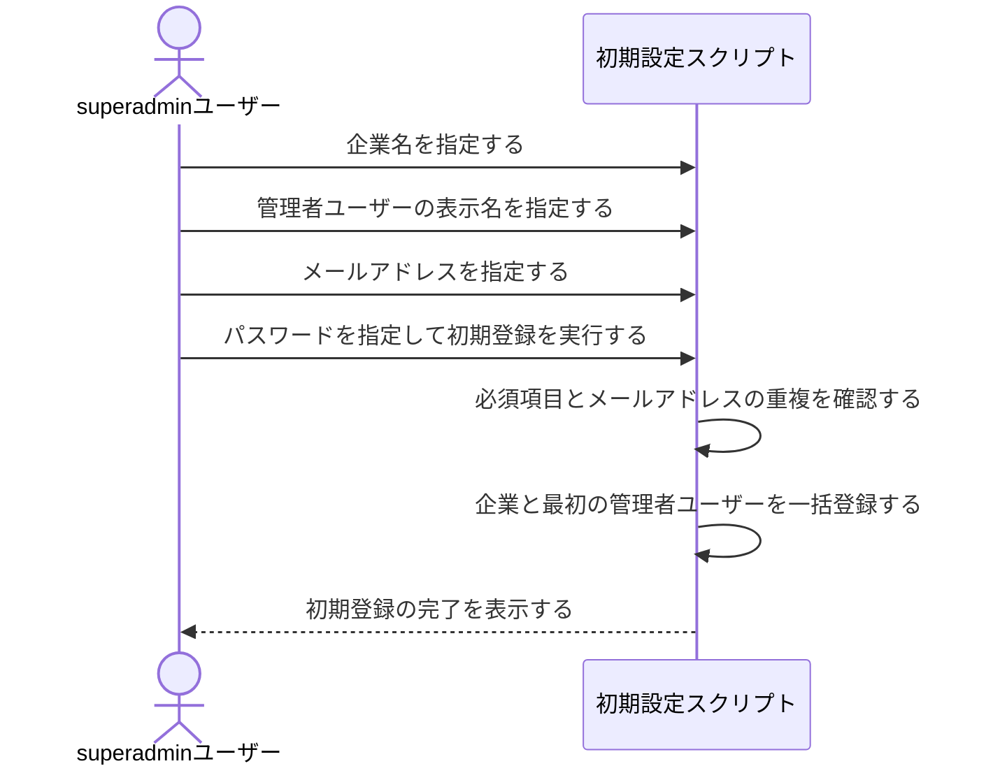

###### 処理仕様

| 条件 | 処理仕様 |
| --- | --- |
| 初期登録を実行する | superadminユーザーが初期設定スクリプトを実行し、企業と最初の管理者ユーザーを一括登録する。 |
| 入力内容を検証する | 企業名を必須とする。<br>管理者ユーザーの表示名を必須とする。<br>メールアドレスを必須とする。<br>パスワードを必須とする。 |
| メールアドレスの重複を判定する | 全企業の既存ユーザーを対象に照合する。 |
| 初期管理者を登録する | 最初の管理者ユーザーを、その企業の責任者として登録する。 |

##### 例外処理

| 発生箇所 | 発生条件 | システムの応答 | その後の流れ |
| --- | --- | --- | --- |
| 初期登録を実行する | 企業名が空欄または空白のみ | 企業名の入力を求め、登録を拒否する。 | 企業名を指定して再実行する。 |
| 初期登録を実行する | 管理者ユーザーの表示名が空欄または空白のみ | 表示名の入力を求め、登録を拒否する。 | 表示名を指定して再実行する。 |
| 初期登録を実行する | メールアドレスが空欄または空白のみ | メールアドレスの入力を求め、登録を拒否する。 | メールアドレスを指定して再実行する。 |
| 初期登録を実行する | パスワードが未入力 | パスワードの入力を求め、登録を拒否する。 | パスワードを指定して再実行する。 |
| 初期登録を実行する | 全企業の既存ユーザーとメールアドレスが重複する | 企業・初期管理者の両方の登録を中止し、メールアドレスの重複エラーを返す。 | 別のメールアドレスを指定して再実行する。 |
| 初期登録を実行する | システムエラーによる登録失敗 | 企業と初期管理者を登録前の状態に保ち、エラーを表示する。 | 原因を確認して再実行する。 |

#### 管理者・マーケターユーザーを招待する

##### 正常系

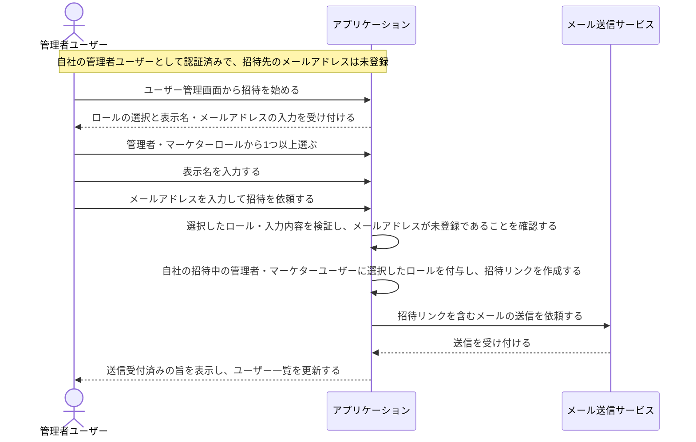

###### 処理仕様

| 条件 | 処理仕様 |
| --- | --- |
| 招待を開始する | 認証済みの管理者ユーザーが、自社のユーザー管理画面から招待する。 |
| ロールを選ぶ | 管理者ロール・マーケターロールから1つ以上を選ぶ。両方の選択を許容する。superadminロールは対象から除外する。 |
| 表示名を検証する | 前後の空白を除去し、必須・255文字以内として検証する。 |
| メールアドレスを検証する | 前後の空白を除去して小文字化し、必須・255文字以内・メールアドレスの形式を検証する。 |
| メールアドレスの重複を判定する | 招待中・登録済み・利用停止中を含む全企業の既存ユーザーと照合する。同じメールアドレスへの同時招待も重複として拒否する。 |
| 招待中の管理者・マーケターユーザーを登録する | 操作者の所属企業に、選択したロールだけを持つ利用者を招待中で登録する。1ユーザーの所属先は1企業とし、両ロールを付与する場合も同じ企業に所属させる。責任者の指定は対象から除外する。 |
| 招待メールを送信する | ユーザーと招待リンクを保存してから送信を依頼する。リンクの有効期限は発行から1時間とする。 |
| 送信が受け付けられる | メールの送信受付成功を表示し、ユーザー一覧を更新する。 |

##### 例外処理

| 発生箇所 | 発生条件 | システムの応答 | その後の流れ |
| --- | --- | --- | --- |
| 招待を依頼する | ロールが選択されていない | 入力内容を保持し、1つ以上のロールの選択を求める。 | ロールを選択して再送信する。 |
| 招待を依頼する | superadminロールなど対象外のロールが指定される | 入力内容を保持し、選択可能なロールを表示して招待を拒否する。 | 管理者ロール・マーケターロールを選択して再送信する。 |
| 招待を依頼する | 表示名が空欄または空白のみ | 入力内容を保持し、表示名の入力を求める。 | 表示名を入力して再送信する。 |
| 招待を依頼する | 前後の空白を除いた表示名が255文字を超える | 入力内容を保持し、表示名は255文字以内である旨を表示する。 | 表示名を修正して再送信する。 |
| 招待を依頼する | メールアドレスが空欄または空白のみ | 入力内容を保持し、メールアドレスの入力を求める。 | メールアドレスを入力して再送信する。 |
| 招待を依頼する | 前後の空白を除いたメールアドレスが255文字を超える | 入力内容を保持し、メールアドレスは255文字以内である旨を表示する。 | メールアドレスを修正して再送信する。 |
| 招待を依頼する | メールアドレスの形式が不正 | 入力内容を保持し、メールアドレスの形式の入力不備を表示する。 | メールアドレスを修正して再送信する。 |
| 招待を依頼する | 全企業の既存ユーザーとメールアドレスが重複する。同時招待による重複も含む | 入力内容を保持し、「このメールアドレスでは招待できません」と表示する。 | 別のメールアドレスを入力して再送信する。 |
| 招待メールを送信する | メール送信に失敗する | 作成済みユーザーと招待リンクを保持する。<br>ユーザーの作成は完了したがメールを送信できなかった旨を表示し、一覧を更新する。 | 一覧から招待メールを再送する。 |
| 招待メールを送信する | 送信結果を確認できない | 作成済みユーザーと招待リンクを保持する。<br>送信結果を確認できなかった旨を表示し、一覧を更新する。 | 招待メールが届いていない場合は、一覧から再送する。 |
| 招待を依頼する | 通信失敗・タイムアウト等で処理結果を確認できない | 処理結果を確認できなかった旨を表示し、ユーザー一覧を再取得する。 | 一覧の登録状態と送信結果を確認してから、次の操作を判断する。 |

#### 管理者・マーケターユーザーの招待を受諾する

##### 正常系

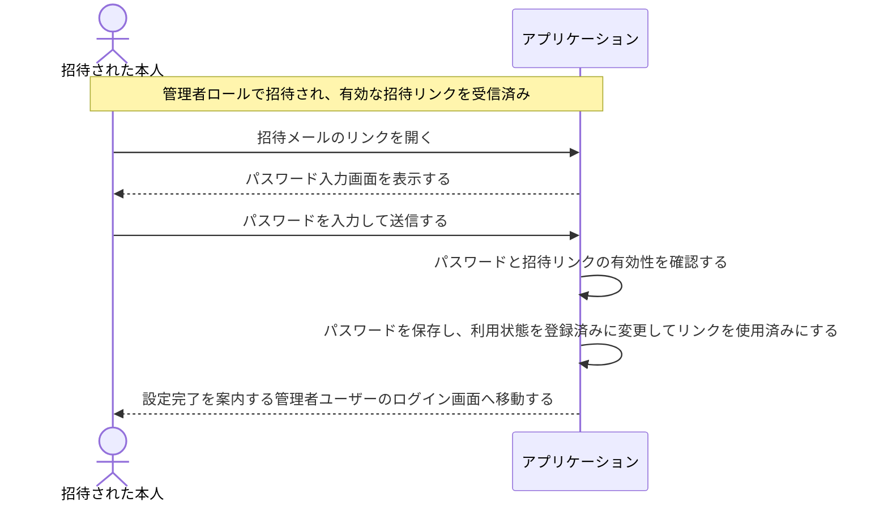

###### 処理仕様

| 条件 | 処理仕様 |
| --- | --- |
| 招待リンクを開く | 管理者・マーケターユーザーの新規招待と利用再開時のパスワード再設定を対象とし、superadminユーザーの招待は対象から除外する。トークン付きのリンクではパスワード入力画面を表示する。 |
| パスワードを検証する | 12〜128文字の、空白を除く半角英数字・記号を受け付ける。英大文字・英小文字・数字・記号をそれぞれ1文字以上必須とする。 |
| パスワードを送信する | 招待リンクが未使用・有効期限内・有効で、対象者が招待中であることを保存時に確認する。 |
| 受諾する | パスワードを保存して本人の利用状態を登録済みにし、招待リンクを使用済みにする。 |
| 管理者ロールのみで受諾が完了する | 管理者ユーザーのログイン画面へ移動し、パスワード設定の完了を案内する。 |
| マーケターロールのみで受諾が完了する | マーケターユーザーのログイン画面へ移動し、パスワード設定の完了を案内する。 |
| 両ロールで受諾が完了する | マーケターユーザーのログイン画面へ移動し、パスワード設定の完了を案内する。 |
| 有効なロールが0件で受諾が完了する | パスワード設定の完了を表示し、管理者への連絡を案内する。ログインへの導線は表示対象外とする。 |
| 無効リンクの案内を表示する | 「既にパスワードを設定した場合はログインしてください」と案内し、管理者ユーザー・マーケターユーザーの各ログイン画面への導線を提示する。 |

##### 例外処理

| 発生箇所 | 発生条件 | システムの応答 | その後の流れ |
| --- | --- | --- | --- |
| 招待リンクを開く | トークンがない | 「この招待リンクは利用できません。管理者に再送を依頼してください」と表示し、設定済みの場合のログイン案内を併記する。 | 設定済みならログインし、未設定なら管理者に再送を依頼する。 |
| パスワードを送信する | パスワードが未入力 | 入力欄にパスワードの入力を求める。 | パスワードを入力して再送信する。 |
| パスワードを送信する | パスワードが条件を満たさない | 入力内容を保持し、パスワードの条件を表示する。 | 条件に合わせて修正し、再送信する。 |
| パスワードを送信する | リンクが不正・期限切れ・使用済み・無効化済み、または対象者が登録済み・利用停止中 | フォームを無効リンクの表示に切り替え、「この招待リンクは利用できません。管理者に再送を依頼してください」と表示し、設定済みの場合のログイン案内を併記する。 | 設定済みならログインし、未設定なら管理者に再送を依頼する。利用停止中は管理者に利用再開を依頼する。 |
| パスワードを送信する | 安全性の検証失敗 | 入力内容を保持し、安全性を確認できなかった旨と再読み込みの案内を表示する。 | 画面を再読み込みする。 |
| パスワードを送信する | 通信失敗・タイムアウト・システムエラーで設定結果を確認できない | 入力内容を保持し、設定結果を確認できなかった旨を表示する。<br>再試行と、設定済みの場合のログインを案内し、各ユーザー種別のログイン画面への導線を提示する。 | 時間をおいて再送信するか、設定したパスワードでログインを試す。 |

#### 管理者・マーケターユーザーの招待メールを再送する

##### 正常系

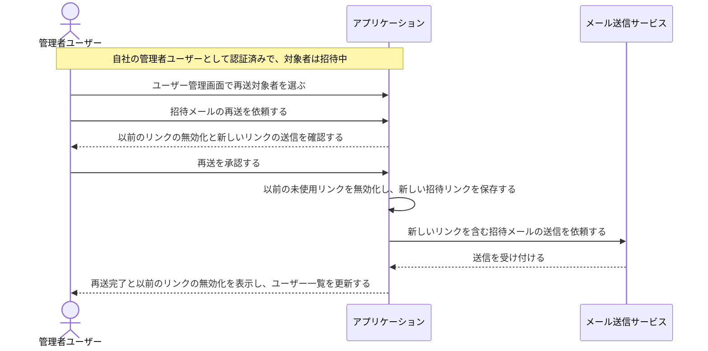

###### 処理仕様

| 条件 | 処理仕様 |
| --- | --- |
| 再送対象を選ぶ | 認証済みの管理者ユーザーが、自社の招待中の管理者ユーザー・マーケターユーザーを選ぶ。新規招待と利用再開によって招待中に戻ったユーザーの両方を対象とする。 |
| 対象範囲を判定する | superadminユーザーは対象から除外する。 |
| 再送を依頼する | 以前のリンクを無効化して新しいリンクを送ることを確認する。 |
| 確認を取り消す | 招待リンクと送信状態を維持する。 |
| 再送を承認する | 保存時に対象者の利用状態が招待中であることを確認し、以前の未使用リンクを無効化して新しいリンクを保存する。利用状態は招待中を維持する。 |
| 招待メールを送信する | 新しいリンクを保存してから送信を依頼する。有効期限は新たな発行から1時間とする。 |
| 送信が受け付けられる | 再送完了と以前のリンクの無効化を表示し、一覧を更新する。送信受付成功として扱う。 |

##### 例外処理

| 発生箇所 | 発生条件 | システムの応答 | その後の流れ |
| --- | --- | --- | --- |
| 再送を承認する | 対象者が存在しない、他社に属する、またはsuperadminユーザー | 対象が見つからない旨を表示し、一覧を更新する。 | 最新の一覧から対象を確認する。 |
| 再送を承認する | 対象者が登録済みまたは利用停止中 | 招待中のユーザーだけが再送対象である旨を表示し、一覧を更新する。 | 最新の利用状態を確認する。利用停止中は利用再開を行う。 |
| 再送を承認する | 操作者の管理権限がない | 操作権限がない旨を表示し、再送を拒否する。 | 管理権限を持つ利用者に操作を依頼する。 |
| 招待メールを送信する | メール送信に失敗する | 新しいリンクの発行と以前のリンクの無効化を保持する。<br>新しいリンクは発行済みだがメールを送信できなかった旨を表示し、一覧を更新する。 | 一覧から再送する。 |
| 招待メールを送信する | 送信結果を確認できない | 新しいリンクの発行と以前のリンクの無効化を保持する。<br>送信結果を確認できなかった旨を表示し、一覧を更新する。 | メールが届いていない場合は一覧から再送する。 |
| 再送を承認する | 通信失敗・タイムアウト・システムエラーで処理結果を確認できない | 処理結果を確認できなかった旨を表示し、一覧を再取得する。 | 一覧の利用状態と送信結果を確認し、必要な場合に再送する。 |

#### 管理者・マーケターユーザーの表示名を変更する

##### 正常系

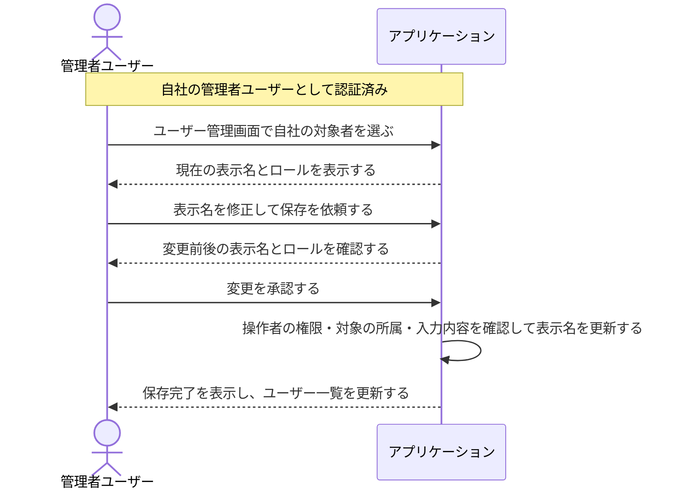

###### 処理仕様

| 条件 | 処理仕様 |
| --- | --- |
| 対象を選ぶ | 自社の招待中・登録済み・利用停止中のユーザーを対象とする。本人・責任者の表示名も編集できる。superadminユーザーは対象から除外する。 |
| 表示名を検証する | 前後の空白を除去し、必須・255文字以内として検証する。 |
| ロールも変更する | 同じ編集画面でロールも変更できる。「[ロールを変更する](#管理者マーケターユーザーのロールを変更する)」の条件を満たす場合、表示名とロールを一括更新する。片方の検証失敗時は両方の更新を取り消す。 |
| 確認を取り消す | 入力内容を保持して編集へ戻る。 |
| 保存する | API入口で操作者の権限を確認し、保存時には対象の所属を再確認する。本人のメールアドレス・利用状態・認証情報・企業所属・業務履歴を保持する。ロール未変更の場合は保有ロールも保持する。 |

##### 例外処理

| 発生箇所 | 発生条件 | システムの応答 | その後の流れ |
| --- | --- | --- | --- |
| 保存を依頼する | 表示名が空欄・空白のみ、または前後空白除去後255文字超 | 入力を保持し、該当する入力不備を表示する。 | 表示名を修正する。 |
| 変更を承認する | 同時に指定したロールが変更条件を満たさない | 表示名とロールの更新を取り消し、該当する理由を表示する。 | 入力を保持して編集へ戻る。 |
| 変更を承認する | 対象が存在しない、他社に属する、またはsuperadminユーザー | 対象が見つからない旨を表示し、一覧を更新する。 | 最新の一覧から対象を確認する。 |
| 変更を承認する | 操作者の管理権限がない | 操作権限がない旨を表示し、更新を拒否する。 | 管理者ロールを持つ利用者に操作を依頼する。 |
| 変更を承認する | 通信失敗・タイムアウト・システムエラーで結果を確認できない | 結果不明を表示し、ユーザー一覧を再取得する。 | 保存済みの表示名・ロールを確認して次の操作を判断する。 |

#### 管理者・マーケターユーザーのロールを変更する

##### 正常系

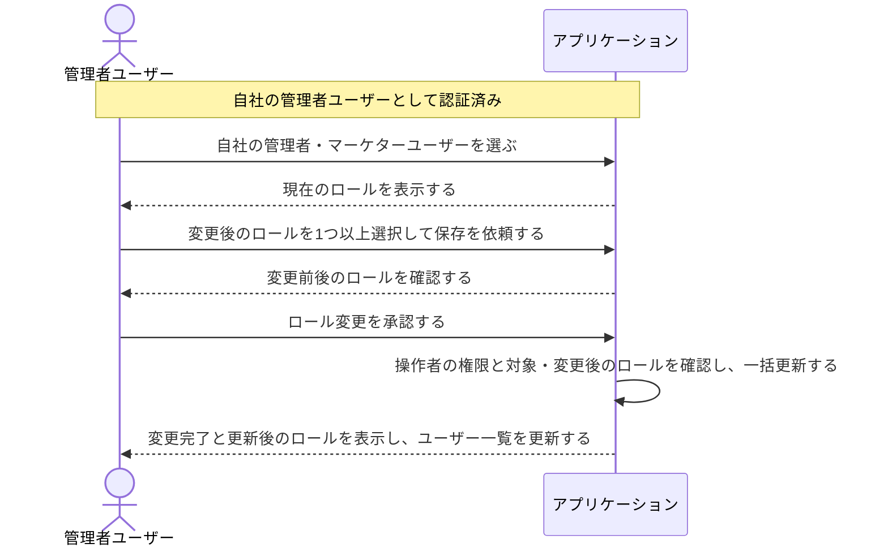

###### 処理仕様

| 条件 | 処理仕様 |
| --- | --- |
| 対象を選ぶ | 認証済みの管理者ユーザーが、自社の管理者・マーケターユーザーを対象とする。superadminユーザーは対象から除外する。 |
| 変更後のロールを選ぶ | 管理者ロール・マーケターロールから1つ以上を選ぶ。両方の選択を許容する。 |
| 自分自身のロールを変更する | 管理者ロールを保持したまま、マーケターロールの付与・解除を許容する。 |
| 責任者ユーザーのロールを変更する | 管理者ロールを保持したまま、マーケターロールの付与・解除を許容する。 |
| 確認を取り消す | 保存済みのロールを維持し、編集操作へ戻る。 |
| 表示名も変更する | 「[表示名を変更する](#管理者マーケターユーザーの表示名を変更する)」の条件を満たす場合、ロールと表示名を一括更新する。片方の検証失敗時は両方の更新を取り消す。 |
| ロール変更を承認する | API入口で操作者の管理者ロールを確認し、保存時には対象の所属・責任者指定を再確認する。条件を満たす場合、選択したロールの組み合わせへ一括更新する。両ロールを保有する場合も所属企業を一致させる。 |
| 変更後に操作する | 次の認証付きAPI要求から、更新後の保有ロールに基づき権限を判定する。 |
| ロールを変更する | 本人の識別情報・企業所属・利用状態・認証情報と既存の会話履歴・業務データを保持する。ロール変更による利用停止・再開は対象から除外する。 |

##### 例外処理

| 発生箇所 | 発生条件 | システムの応答 | その後の流れ |
| --- | --- | --- | --- |
| ロール変更を承認する | ロールが選択されていない | ロールを変更せず、1つ以上のロールの選択を求める。 | ロールを選択して再度保存する。 |
| ロール変更を承認する | superadminロールなど対象外のロールが指定される | ロールを変更せず、選択可能なロールを表示する。 | 管理者ロール・マーケターロールを選択して再度保存する。 |
| ロール変更を承認する | 対象が操作者本人または責任者で、管理者ロールの解除が指定される | ロールを変更せず、管理者ロールの保持が必要である旨を表示する。 | 管理者ロールを保持して再度保存する。 |
| ロール変更を承認する | 対象が存在しない、他社に属する、またはsuperadminユーザー | 対象が見つからない旨を表示し、一覧を更新する。 | 最新の一覧から対象を確認する。 |
| ロール変更を承認する | 操作者が管理者ロールを持たない | 操作権限がない旨を表示し、変更を拒否する。 | 管理者ロールを持つ利用者に操作を依頼する。 |
| ロール変更を承認する | 通信失敗・タイムアウト・システムエラーで変更結果を確認できない | 変更結果を確認できなかった旨を表示し、一覧を再取得する。 | 最新のロールを確認して次の操作を判断する。 |

#### 管理者・マーケターユーザーを無効化する

##### 正常系

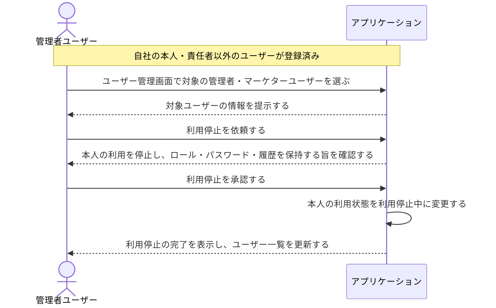

###### 処理仕様

| 条件 | 処理仕様 |
| --- | --- |
| 対象を選ぶ | 認証済みの管理者ユーザーが、自社の管理者・マーケターユーザーを選ぶ。superadminユーザーは対象から除外する。 |
| 利用停止を依頼する | 本人の利用を停止し、ロール・パスワード・履歴を保持することを確認する。 |
| 確認を取り消す | 本人の利用状態を維持する。 |
| 招待中・登録済みの対象について承認する | 自分自身と責任者を除く対象ユーザーの利用状態を利用停止中に変更する。 |
| 利用停止後に操作する | 次のAPI要求から既存ログインによるアクセスも拒否し、ログイン画面へ移動する。 |
| 本人情報と履歴を保持する | 本人の識別情報・企業所属・保有ロール・パスワード・招待リンクと既存の会話履歴・業務データを保持する。 |

##### 例外処理

| 発生箇所 | 発生条件 | システムの応答 | その後の流れ |
| --- | --- | --- | --- |
| 利用停止を承認する | 対象が操作者本人または責任者 | 自分自身と責任者の利用停止を禁止する旨を表示し、利用停止を拒否する。 | 別の対象を選ぶ。 |
| 利用停止を承認する | 対象が既に利用停止中 | 既に利用停止中である旨を表示し、現在の状態を保持する。 | 一覧を更新し、対象の利用状態を確認する。 |
| 利用停止を承認する | 対象が存在しない、他社に属する、またはsuperadminユーザー | 対象が見つからない旨を表示し、一覧を更新する。 | 最新の一覧から対象を確認する。 |
| 利用停止を承認する | 操作者の管理権限がない | 操作権限がない旨を表示し、利用停止を拒否する。 | 管理権限を持つ利用者に操作を依頼する。 |
| 利用停止を承認する | 通信失敗・タイムアウト・システムエラーで処理を完了できない | 処理を完了できなかった旨を表示し、ユーザー一覧を再取得する。 | 対象の最新の利用状態を確認し、必要な場合に再実行する。 |

#### 管理者・マーケターユーザーの利用を再開する

##### 正常系

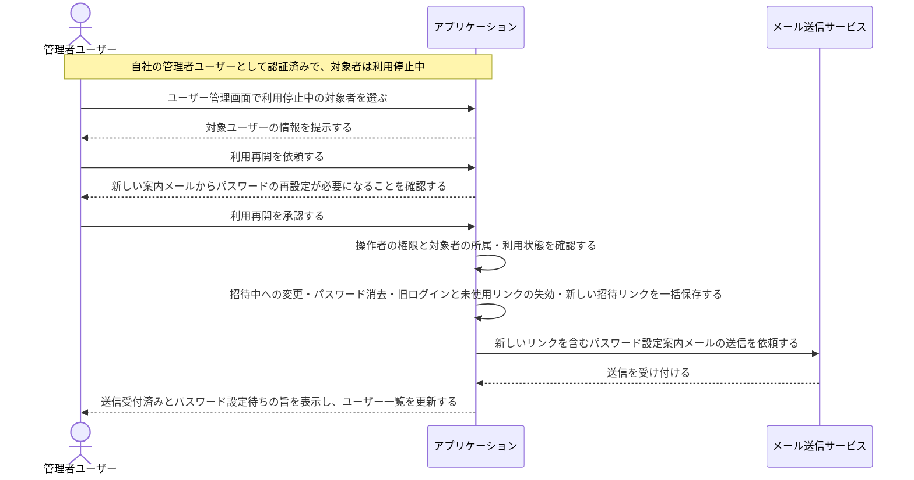

###### 処理仕様

| 条件 | 処理仕様 |
| --- | --- |
| 対象を選ぶ | 認証済みの管理者ユーザーが、自社の利用停止中の管理者・マーケターユーザーを選ぶ。superadminユーザーは対象から除外する。 |
| 利用再開を依頼する | 既存のパスワードを消去し、新しい案内メールからパスワードを設定する必要があることを確認する。 |
| 確認を取り消す | 利用停止中を維持する。 |
| 利用再開を承認する | API入口で操作者の管理者ロールを確認し、保存時には対象者の所属・利用停止中状態を再確認する。パスワード設定の有無にかかわらず、招待中への変更・既存パスワードハッシュの消去・旧ログインと未使用招待リンクの失効・新しい招待リンクの作成を一括保存する。 |
| 案内メールを送信する | 変更と新しい招待リンクを保存してから、パスワード設定案内メールを送信する。リンクの有効期限は発行から1時間とする。 |
| 送信が受け付けられる | メールの送信受付成功とパスワード設定待ちの旨を表示し、ユーザー一覧を更新する。 |
| 本人がパスワードを再設定する | 「[招待を受諾する](#管理者マーケターユーザーの招待を受諾する)」に従う。設定完了によって登録済みとなり、保有する有効なロールで利用できる。 |
| 再開時に保持する | 本人の識別情報・企業所属・保有ロールと既存の会話履歴・業務データを保持する。 |

##### 例外処理

| 発生箇所 | 発生条件 | システムの応答 | その後の流れ |
| --- | --- | --- | --- |
| 利用再開を承認する | 対象が存在しない、他社に属する、またはsuperadminユーザー | 対象が見つからない旨を表示し、一覧を更新する。 | 最新の一覧から対象を確認する。 |
| 利用再開を承認する | 対象が利用停止中以外 | 利用停止中のユーザーだけが対象である旨を表示し、利用状態を維持して一覧を更新する。 | 最新の利用状態を確認する。 |
| 利用再開を承認する | 操作者の管理権限がない | 操作権限がない旨を表示し、利用再開を拒否する。 | 管理権限を持つ利用者に操作を依頼する。 |
| 案内メールを送信する | メール送信に失敗する | 招待中への変更と新しい招待リンクを保持する。<br>パスワード設定待ちだがメールを送信できなかった旨を表示し、一覧を更新する。 | 一覧から招待メールを再送する。 |
| 案内メールを送信する | 送信結果を確認できない | 招待中への変更と新しい招待リンクを保持する。<br>送信結果を確認できなかった旨を表示し、一覧を更新する。 | メールが届いていない場合は、一覧から招待メールを再送する。 |
| 利用再開を承認する | 通信失敗・タイムアウト・システムエラーで処理結果を確認できない | 処理結果を確認できなかった旨を表示し、ユーザー一覧を再取得する。 | 最新の利用状態を確認して次の操作を判断する。 |

#### マーケターユーザーとしてログインする

##### 正常系

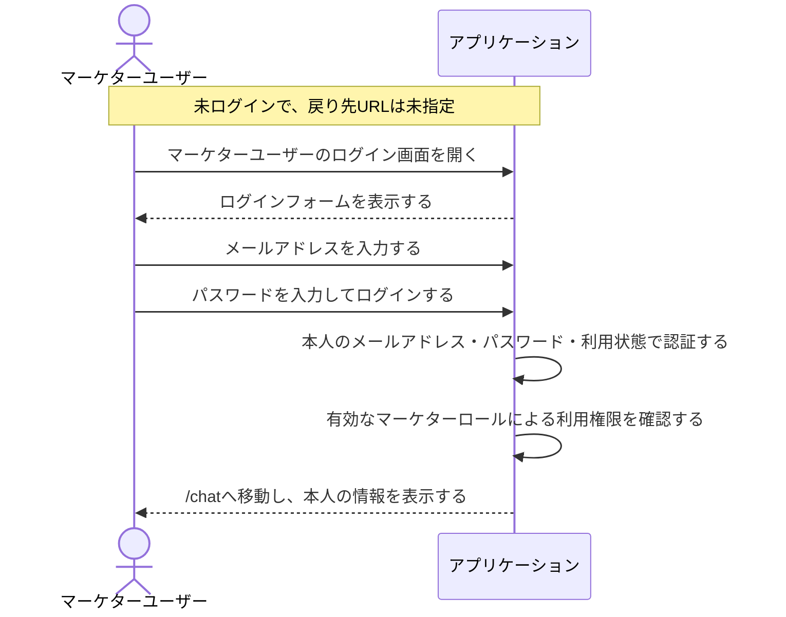

###### 処理仕様

| 条件 | 処理仕様 |
| --- | --- |
| 本人を認証する | 共通のユーザー情報のメールアドレス・パスワードと、利用状態が登録済みであることを確認する。 |
| 利用権限を確認する | 本人認証後、有効なマーケターロールを確認する。管理者ロールの有無は条件に含めず、両ロールを持つ場合も利用を許容する。 |
| ログインに成功する | チャット画面（`/chat`）へ移動し、本人の情報を表示する。 |
| 認証済みでログイン画面を開く | 本人の利用状態が登録済みで、本人情報APIの`is_marketer=true`の場合、チャット画面（`/chat`）へ移動する。 |
| 有効なマーケターロールなしでログイン画面を開く | 本人情報APIが`is_marketer=false`を返した場合はログインフォームを表示する。管理者ロールの有無はこの表示条件に含めない。 |
| 結果不明後にログインを再送する | 入力した認証情報で通常の認証を行い、成功したらチャット画面へ移動する。 |

##### 例外処理

| 発生箇所 | 発生条件 | システムの応答 | その後の流れ |
| --- | --- | --- | --- |
| ログインする | 入力不備 | 該当する入力欄にエラーを表示する。 | 入力を修正する。 |
| ログインする | 認証情報の不一致 | 入力を保持し、認証失敗を表示する。 | 認証情報を確認して再送信する。 |
| ログインする | 本人の利用状態が招待中 | 入力を保持し、認証情報の不一致と同じ認証失敗を表示する。 | 招待リンクからパスワードを設定する。 |
| ログインする | 本人の利用状態が利用停止中 | 入力を保持し、認証情報の不一致と同じ認証失敗を表示する。 | 管理者に利用再開を依頼する。 |
| ログインする | 本人が有効なマーケターロールを持たない | 入力を保持し、認証情報の不一致と同じ認証失敗を表示する。 | 有効な管理者ロールを持つ場合は管理者ユーザーのログイン画面を利用する。必要なロールは対象企業の管理者に付与を依頼する。 |
| ログインする | 安全性の検証失敗 | 再読み込みを案内する。 | 画面を再読み込みする。 |
| ログインする | 試行回数の上限超過 | 時間をおくよう案内する。 | 時間をおいて再送信する。 |
| ログインする | 通信失敗 | 入力を保持し、通信失敗を表示する。 | 通信環境を確認して再送信する。 |
| ログインする | タイムアウト | 入力を保持し、処理の失敗を表示する。 | 時間をおいて再送信する。 |
| ログインする | サーバー側の失敗 | 入力を保持し、処理の失敗を表示する。 | 時間をおいて再送信する。 |
| ログイン画面を開く | ログイン状態の確認失敗 | 再読み込みを案内する。 | 画面を再読み込みする。 |

#### 管理者ユーザーとしてログインする

##### 正常系

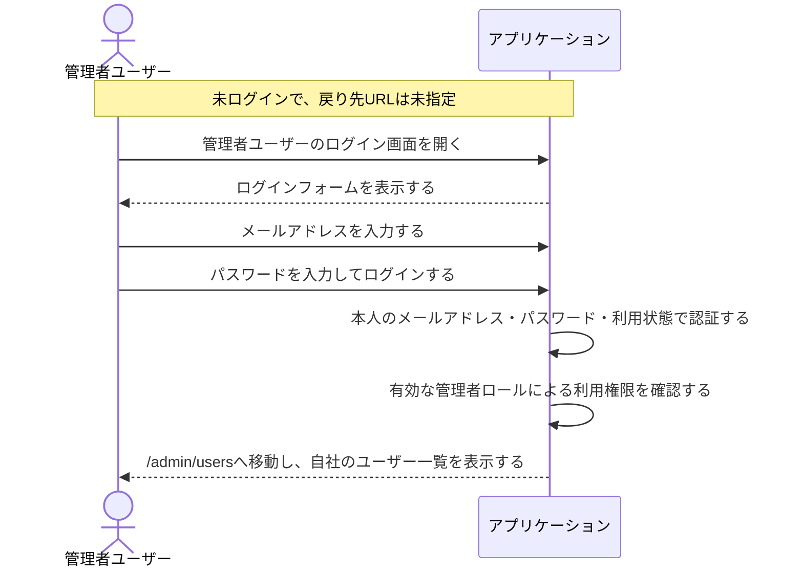

###### 処理仕様

| 条件 | 処理仕様 |
| --- | --- |
| 本人を認証する | 共通のユーザー情報のメールアドレス・パスワードと、利用状態が登録済みであることを確認する。 |
| 利用権限を確認する | 本人認証後、有効な管理者ロールを確認する。マーケターロールの有無は条件に含めず、両ロールを持つ場合も利用を許容する。 |
| ログインに成功する | ユーザー管理画面（`/admin/users`）へ移動し、自社のユーザー一覧を表示する。 |
| 認証済みでログイン画面を開く | 本人の利用状態が登録済みで、本人情報APIの`is_admin=true`の場合、ユーザー管理画面（`/admin/users`）へ移動する。 |
| 有効な管理者ロールなしでログイン画面を開く | 本人情報APIが`is_admin=false`を返した場合はログインフォームを表示する。マーケターロールの有無はこの表示条件に含めない。 |
| 結果不明後にログインを再送する | 入力した認証情報で通常の認証を行い、成功したらユーザー管理画面へ移動する。 |

##### 例外処理

| 発生箇所 | 発生条件 | システムの応答 | その後の流れ |
| --- | --- | --- | --- |
| ログインする | 入力不備 | 該当する入力欄にエラーを表示する。 | 入力を修正する。 |
| ログインする | 認証情報の不一致 | 入力を保持し、認証失敗を表示する。 | 認証情報を確認して再送信する。 |
| ログインする | 本人の利用状態が招待中 | 入力を保持し、認証情報の不一致と同じ認証失敗を表示する。 | 招待リンクからパスワードを設定する。 |
| ログインする | 本人の利用状態が利用停止中 | 入力を保持し、認証情報の不一致と同じ認証失敗を表示する。 | 管理者に利用再開を依頼する。 |
| ログインする | 本人が有効な管理者ロールを持たない | 入力を保持し、認証情報の不一致と同じ認証失敗を表示する。 | 有効なマーケターロールを持つ場合はマーケターユーザーのログイン画面を利用する。必要なロールは対象企業の管理者に付与を依頼する。 |
| ログインする | 安全性の検証失敗 | 再読み込みを案内する。 | 画面を再読み込みする。 |
| ログインする | 試行回数の上限超過 | 時間をおくよう案内する。 | 時間をおいて再送信する。 |
| ログインする | 通信失敗 | 入力を保持し、通信失敗を表示する。 | 通信環境を確認して再送信する。 |
| ログインする | タイムアウト | 入力を保持し、処理の失敗を表示する。 | 時間をおいて再送信する。 |
| ログインする | サーバー側の失敗 | 入力を保持し、処理の失敗を表示する。 | 時間をおいて再送信する。 |
| ログイン画面を開く | ログイン状態の確認失敗 | 再読み込みを案内する。 | 画面を再読み込みする。 |

#### 企業情報を登録・更新する

##### 正常系

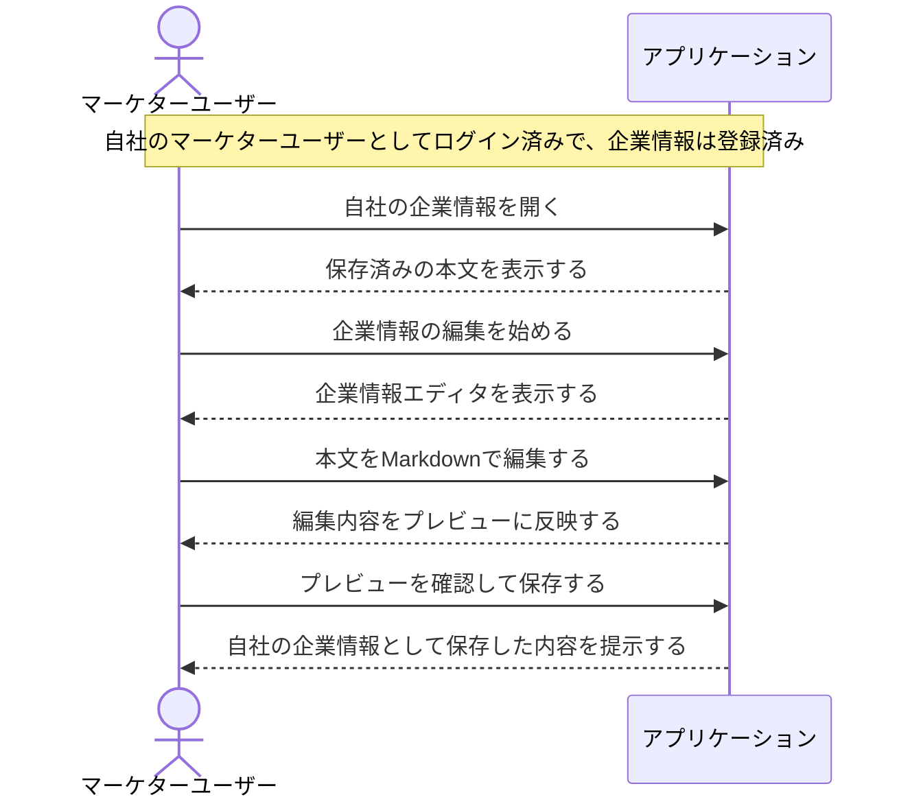

###### 処理仕様

| 条件 | 処理仕様 |
| --- | --- |
| 未登録 | 入力した本文で作成する。 |
| 登録済み | 入力した本文へ置き換える。 |
| 同時保存 | 後からの保存による上書きを許容する。 |
| 本文を編集する | 編集中のMarkdownをプレビューに反映する。 |
| 保存する | 本文はMarkdownの原文を保存する。 |
| 本文を変更せずに編集をキャンセルする | 破棄確認を挟まず、編集を始める前の閲覧状態に戻る。 |
| 本文を変更してから編集をキャンセルする | 破棄確認を表示する。編集を続ける場合は入力内容を保持する。破棄を選ぶ場合は保存せず、登録済みの本文または未登録の表示に戻る。 |

##### 例外処理

| 発生箇所 | 発生条件 | システムの応答 | その後の流れ |
| --- | --- | --- | --- |
| 保存する | 本文が空欄または空白のみ | 本文の入力を求め、保存を拒否する。 | 本文を入力して再保存する。 |
| 保存する | システムエラーによる保存失敗 | システムエラーの発生を通知し、サービス提供者への連絡を案内する。 | サービス提供者へ連絡する。 |

#### 求人情報を登録する

##### 正常系

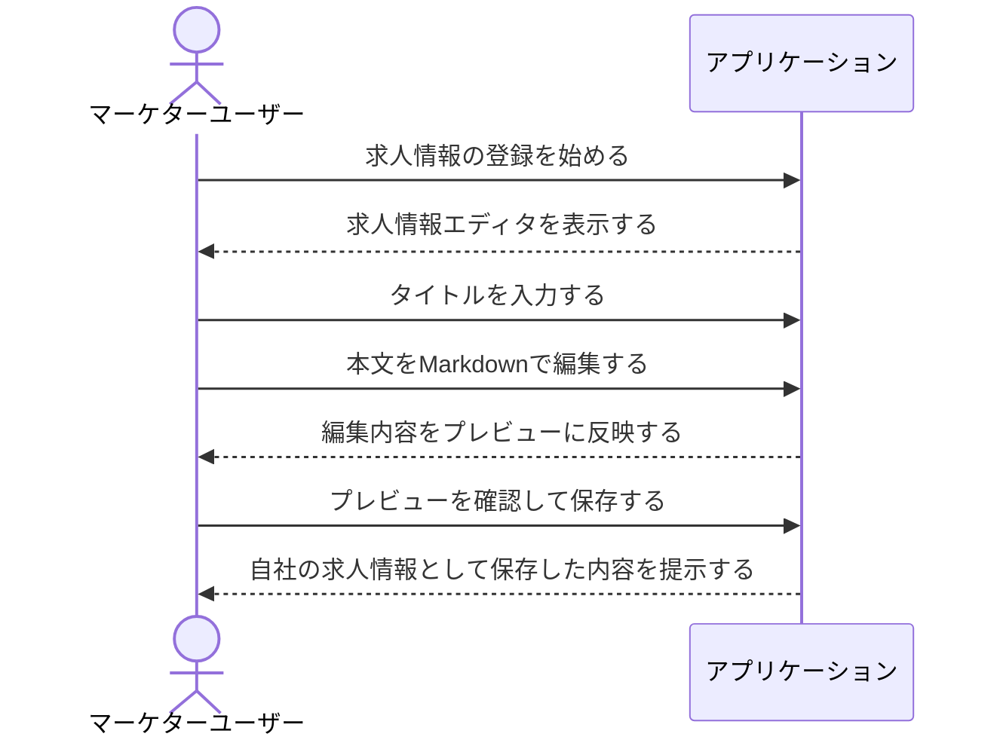

###### 処理仕様

| 条件 | 処理仕様 |
| --- | --- |
| 登録する | 自社の求人情報を新規作成する。 |
| タイトルの重複を判定する | 同じ企業内の求人情報と、タイトルの完全一致で照合する。 |
| 本文を編集する | 編集中のMarkdownをプレビューに反映する。 |
| 保存する | 本文はMarkdownの原文を保存する。 |

##### 例外処理

| 発生箇所 | 発生条件 | システムの応答 | その後の流れ |
| --- | --- | --- | --- |
| 保存する | 自社の求人情報とタイトルが重複する | タイトルの重複を表示し、登録を拒否する。 | タイトルを変更して再保存する。 |
| 保存する | タイトルが空欄または空白のみ | タイトルの入力を求め、登録を拒否する。 | タイトルを入力して再保存する。 |
| 保存する | 本文が空欄または空白のみ | 本文の入力を求め、登録を拒否する。 | 本文を入力して再保存する。 |
| 保存する | システムエラーによる保存失敗 | 入力内容を保持する。<br>エラーの発生を通知し、サービス提供者への連絡を案内する。 | サービス提供者へ連絡する。 |

#### 求人情報を更新する

##### 正常系

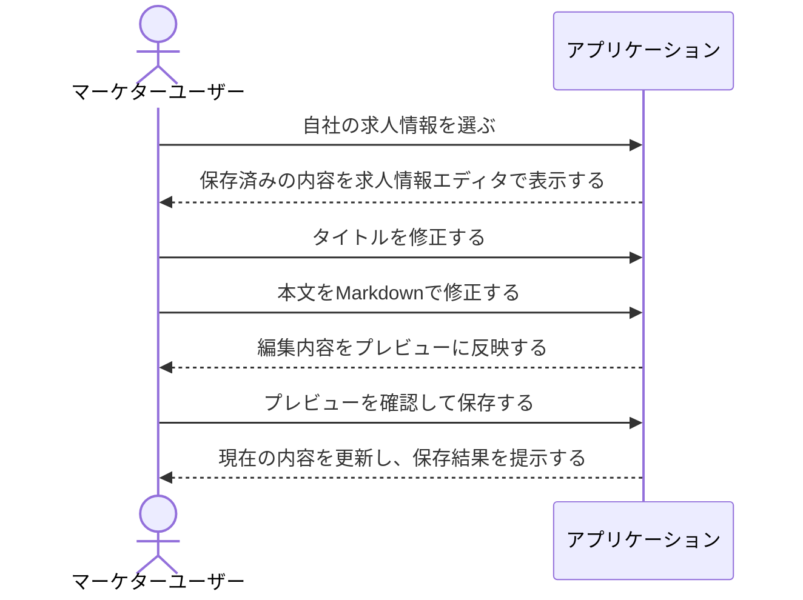

###### 処理仕様

| 条件 | 処理仕様 |
| --- | --- |
| 保存する | 選択した求人情報のタイトルと本文を更新する。 |
| タイトルの重複を判定する | 更新対象を除く自社の求人情報と、完全一致で照合する。 |
| 同時保存 | 後からの保存による上書きを許容する。 |
| 本文を編集する | 編集中のMarkdownをプレビューに反映する。 |
| 本文を保存する | Markdownの原文を保存する。 |

##### 例外処理

| 発生箇所 | 発生条件 | システムの応答 | その後の流れ |
| --- | --- | --- | --- |
| 求人情報を選ぶ | システムエラーによる読取失敗 | エラーの発生を通知し、サービス提供者への連絡を案内する。 | サービス提供者へ連絡する。 |
| 保存する | 他の自社求人とタイトルが重複する | タイトルの重複を表示し、更新を拒否する。 | タイトルを変更して再保存する。 |
| 保存する | タイトルが空欄または空白のみ | タイトルの入力を求め、更新を拒否する。 | タイトルを入力して再保存する。 |
| 保存する | 本文が空欄または空白のみ | 本文の入力を求め、更新を拒否する。 | 本文を入力して再保存する。 |
| 保存する | システムエラーによる保存失敗 | 入力内容を保持する。<br>エラーの発生を通知し、サービス提供者への連絡を案内する。 | サービス提供者へ連絡する。 |

#### 求人情報を掲載終了にする

##### 正常系

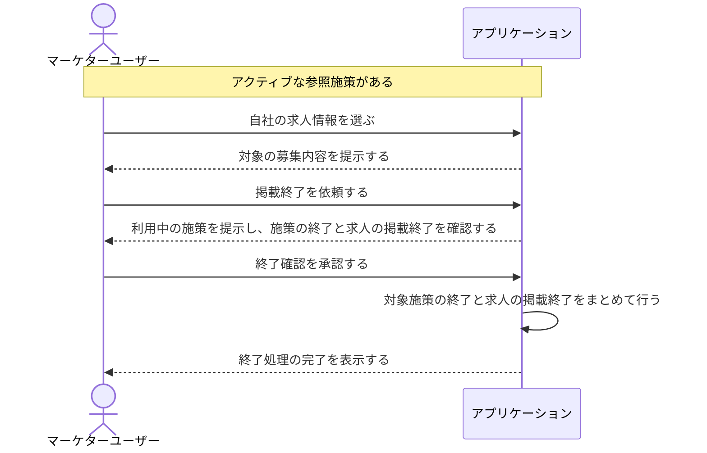

###### 処理仕様

| 条件 | 処理仕様 |
| --- | --- |
| アクティブな参照施策が0件 | 求人情報を掲載終了にする。 |
| アクティブな参照施策がある | 対象施策の終了と求人の掲載終了を確認する。 |
| 終了確認を承認する | 対象施策の終了と求人の掲載終了をまとめて行う。 |
| 掲載終了済みの求人情報を掲載終了にする | 掲載終了状態を維持し、成功として終了処理の完了を表示する。 |
| 終了済みの施策を終了する | 終了状態を維持し、成功として扱う。 |
| 終了処理を中断する | 現在の状態を保つ。 |

##### 例外処理

| 発生箇所 | 発生条件 | システムの応答 | その後の流れ |
| --- | --- | --- | --- |
| 求人情報を選ぶ | システムエラーによる読取失敗 | エラーを通知し、サービス提供者への連絡を案内する。 | サービス提供者へ連絡する。 |
| 終了処理を実行する | システムエラーによる処理失敗 | 施策と求人情報を処理前の状態に保つ。<br>エラーを通知し、サービス提供者への連絡を案内する。 | サービス提供者へ連絡する。 |

#### SNSアカウントを運用対象に追加する

※ 現在はXアカウントのみ対応

##### 正常系

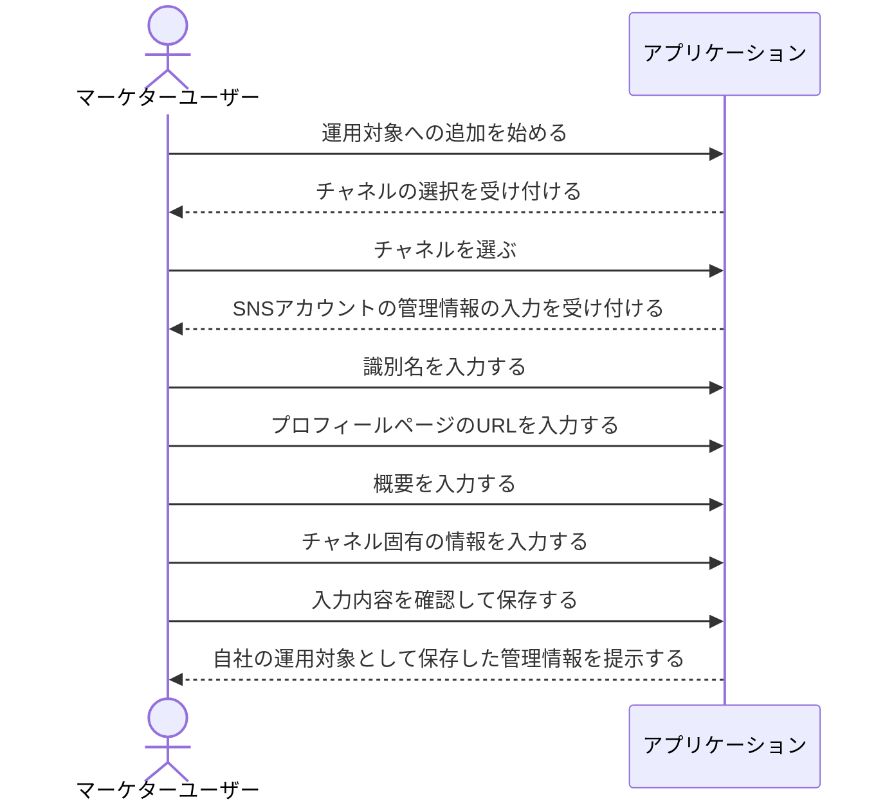

###### 処理仕様

| 条件 | 処理仕様 |
| --- | --- |
| 管理情報を入力する | 外部SNS上の既存アカウントの管理情報を手入力する。 |
| 共通項目を入力する | 識別名を必須とする。<br>URLを必須とする。<br>概要を必須とする。 |
| チャネル固有の情報を入力する | 入力項目と必須条件をチャネルごとに定義する。 |
| Xの情報を入力する | 表示名を必須とする。<br>ユーザー名を必須とする。 |
| URLの重複を判定する | 同じ企業内の保存済みSNSアカウントと照合する。チャネルをまたぐ重複も判定対象とする。 |
| 識別名の重複を判定する | 同じ企業内の保存済みSNSアカウントと照合する。チャネルをまたぐ重複も判定対象とする。 |
| 同じチャネルを選ぶ | 同じチャネルのSNSアカウントを複数追加できる。 |
| 保存する | 選択したチャネルに属するSNSアカウントの管理情報を新規保存し、運用状態を運用対象とする。 |
| チャネル固有の情報を保存する | contentに構造化JSONとして保存する。 |

##### 例外処理

| 発生箇所 | 発生条件 | システムの応答 | その後の流れ |
| --- | --- | --- | --- |
| 保存する | チャネルが未選択 | 入力内容を保持する。<br>チャネルの選択を求め、追加を拒否する。 | チャネルを選んで再保存する。 |
| 保存する | 識別名が空欄または空白のみ | 入力内容を保持する。<br>識別名の入力を求め、追加を拒否する。 | 識別名を入力して再保存する。 |
| 保存する | URLが空欄または空白のみ | 入力内容を保持する。<br>URLの入力を求め、追加を拒否する。 | URLを入力して再保存する。 |
| 保存する | 概要が空欄または空白のみ | 入力内容を保持する。<br>概要の入力を求め、追加を拒否する。 | 概要を入力して再保存する。 |
| 保存する | チャネルがXで、表示名が空欄または空白のみ | 入力内容を保持する。<br>表示名の入力を求め、追加を拒否する。 | 表示名を入力して再保存する。 |
| 保存する | チャネルがXで、ユーザー名が空欄または空白のみ | 入力内容を保持する。<br>ユーザー名の入力を求め、追加を拒否する。 | ユーザー名を入力して再保存する。 |
| 保存する | 自社のSNSアカウントとURLが重複する | 入力内容を保持する。<br>URLの重複を表示し、追加を拒否する。 | URLを確認・修正して再保存する。 |
| 保存する | 自社のSNSアカウントと識別名が重複する | 入力内容を保持する。<br>識別名の重複を表示し、追加を拒否する。 | 識別名を変更して再保存する。 |
| 保存する | システムエラーによる保存失敗 | 入力内容を保持する。<br>エラーを通知し、サービス提供者への連絡を案内する。 | サービス提供者へ連絡する。 |

#### SNSアカウントの管理情報を更新する

##### 正常系

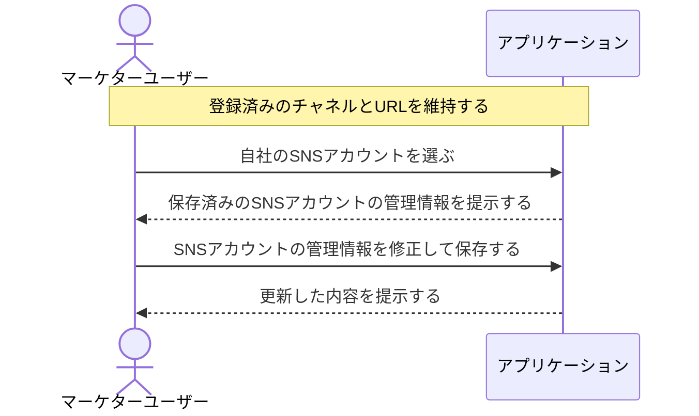

###### 処理仕様

| 条件 | 処理仕様 |
| --- | --- |
| 管理情報を編集する | 保存済みの管理情報を読み込み、手入力で修正する。 |
| 保存する | 選択した自社のSNSアカウントの識別名を更新する。<br>概要を更新する。<br>チャネル固有の情報を更新する。 |
| 共通項目を検証する | 識別名を必須とする。<br>URLを必須とする。<br>概要を必須とする。 |
| チャネル固有の情報を検証する | 入力項目と必須条件をチャネルごとに定義する。 |
| Xの情報を検証する | 表示名を必須とする。<br>ユーザー名を必須とする。 |
| 識別名の重複を判定する | 更新対象自身を除く、同じ企業内の保存済みSNSアカウントと照合する。チャネルをまたぐ重複も判定対象とする。 |
| 同時保存 | 後からの保存による上書きを許容する。 |
| チャネル固有の情報を保存する | contentに構造化JSONとして保存する。 |

##### 例外処理

| 発生箇所 | 発生条件 | システムの応答 | その後の流れ |
| --- | --- | --- | --- |
| SNSアカウントを選ぶ | システムエラーによる読取失敗 | エラーを通知し、サービス提供者への連絡を案内する。 | サービス提供者へ連絡する。 |
| 保存する | 識別名が空欄または空白のみ | 入力内容を保持する。<br>識別名の入力を求め、更新を拒否する。 | 識別名を入力して再保存する。 |
| 保存する | 概要が空欄または空白のみ | 入力内容を保持する。<br>概要の入力を求め、更新を拒否する。 | 概要を入力して再保存する。 |
| 保存する | チャネルがXで、表示名が空欄または空白のみ | 入力内容を保持する。<br>表示名の入力を求め、更新を拒否する。 | 表示名を入力して再保存する。 |
| 保存する | チャネルがXで、ユーザー名が空欄または空白のみ | 入力内容を保持する。<br>ユーザー名の入力を求め、更新を拒否する。 | ユーザー名を入力して再保存する。 |
| 保存する | 他の自社SNSアカウントと識別名が重複する | 入力内容を保持する。<br>識別名の重複を表示し、更新を拒否する。 | 識別名を変更して再保存する。 |
| 保存する | 保存済みのチャネルからの変更を要求する | チャネルの変更を拒否する。 | 保存済みのチャネルを維持して保存する。 |
| 保存する | 保存済みのURLからの変更を要求する | URLの変更を拒否する。 | 保存済みのURLを維持して保存する。 |
| 保存する | システムエラーによる保存失敗 | 入力内容を保持する。<br>エラーを通知し、サービス提供者への連絡を案内する。 | サービス提供者へ連絡する。 |

#### SNSアカウントを運用対象から外す

##### 正常系

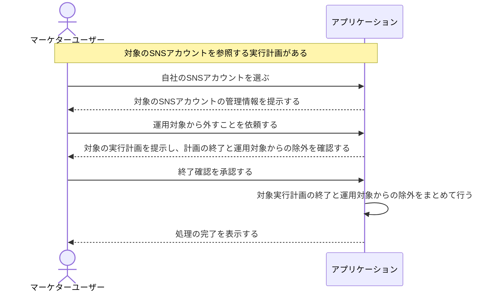

###### 処理仕様

| 条件 | 処理仕様 |
| --- | --- |
| 対象のSNSアカウントを参照する実行計画が0件 | SNSアカウントの運用状態を運用対象外へ変更する。 |
| 対象のSNSアカウントを参照する実行計画がある | 対象の実行計画を提示し、計画の終了と運用対象からの除外を確認する。 |
| 終了確認を承認する | 対象の実行計画を再確認し、確認時から増えていなければ対象実行計画を終了扱いにし、SNSアカウントの運用状態を運用対象外へまとめて変更する。 |
| 既に運用対象外のSNSアカウントを運用対象から外す | 運用対象外の状態を維持し、成功として処理の完了を表示する。 |
| 終了済みの実行計画を終了する | 終了状態を維持し、成功として扱う。 |
| 処理を中断する | 現在の状態を保つ。 |
| 運用対象から外す | SNSアカウントの管理情報を保持する。<br>実行計画を保持する。<br>過去の投稿を保持する。<br>過去の計測記録を保持する。 |

##### 例外処理

| 発生箇所 | 発生条件 | システムの応答 | その後の流れ |
| --- | --- | --- | --- |
| SNSアカウントを選ぶ | システムエラーによる読取失敗 | エラーを通知し、サービス提供者への連絡を案内する。 | サービス提供者へ連絡する。 |
| 実行計画を提示する | システムエラーによる読取失敗 | エラーを通知し、サービス提供者への連絡を案内する。 | サービス提供者へ連絡する。 |
| 終了確認を承認する | 確認表示後、承認までに対象のSNSアカウントを参照する実行計画が増えた | 終了処理を中断し、SNSアカウントと実行計画の状態を維持する。<br>最新の対象実行計画一覧を提示し、再承認を求める。 | 最新の一覧を確認して再承認するか、処理を取り消す。 |
| 運用対象から外す処理を実行する | システムエラーによる処理失敗 | SNSアカウントと実行計画を処理前の状態に保つ。<br>エラーを通知し、サービス提供者への連絡を案内する。 | サービス提供者へ連絡する。 |

#### SNSアカウント別実行計画を作成する

##### 正常系

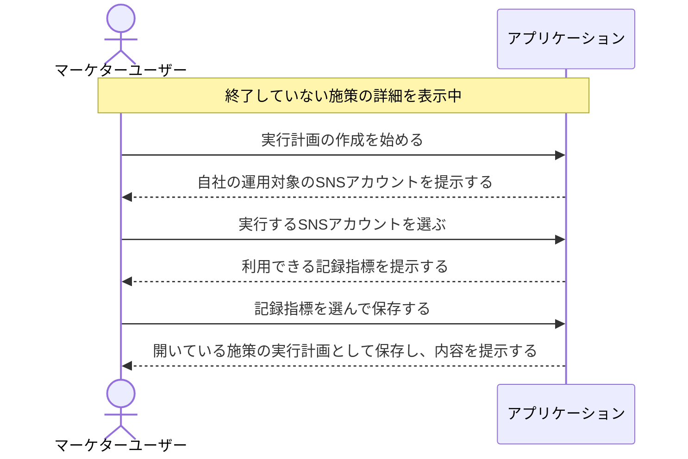

###### 処理仕様

| 条件 | 処理仕様 |
| --- | --- |
| SNSアカウントの候補を提示する | 自社の運用対象のSNSアカウントを候補とする。 |
| 記録指標の候補を提示する | 選択したSNSアカウントのチャネルと自社で利用できる指標を候補とする。 |
| 記録指標を選択する | 任意で複数選択できる。0件でも保存できる。 |
| 重複を判定する | 同じ施策とSNSアカウントの組み合わせの実行計画が登録済みか照合する。 |
| 保存する | 保存時に施策が未終了で、選択したSNSアカウントが運用対象であることを確認し、両者に紐づく実行計画を新規保存する。 |

##### 例外処理

| 発生箇所 | 発生条件 | システムの応答 | その後の流れ |
| --- | --- | --- | --- |
| 保存する | 同じ施策とSNSアカウントの計画が登録済み | 選択内容を保持する。<br>計画の重複を表示し、作成を拒否する。 | 別のSNSアカウントを選ぶ。 |
| 保存する | 保存時に施策が終了済み | 実行計画の作成を拒否し、施策が終了済みである旨を画面に表示する。 | 別の未終了の施策で作成を始める。 |
| 保存する | 保存時に選択したSNSアカウントが運用対象外 | 実行計画の作成を拒否し、SNSアカウントが運用対象外である旨を画面に表示する。 | 別の運用対象のSNSアカウントを選ぶ。 |
| 選択候補を提示する | システムエラーによる読取失敗 | エラーを通知し、サービス提供者への連絡を案内する。 | サービス提供者へ連絡する。 |
| 保存する | システムエラーによる保存失敗 | 選択内容を保持する。<br>エラーを通知し、サービス提供者への連絡を案内する。 | サービス提供者へ連絡する。 |

#### 実行計画の記録指標を変更する

##### 正常系

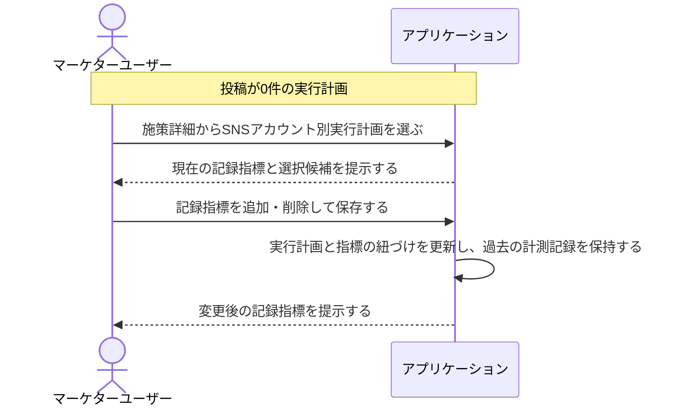

###### 処理仕様

| 条件 | 処理仕様 |
| --- | --- |
| 指標の候補を提示する | 紐づくSNSアカウントのチャネル、または自社で定義されている指標を候補とする。 |
| 投稿が0件 | 指標を追加・削除できる。選択数は0件でもよい。 |
| 投稿が1件以上 | 指標を追加できる。既存の選択は維持する。公開前の投稿も件数に含める。 |
| 保存する | 実行計画と指標の紐づけを更新する。<br>過去の計測記録を保持する。 |
| 同時保存 | 後からの保存による上書きを許容する。投稿が存在する場合は、既存の指標の選択を維持する。 |

##### 例外処理

| 発生箇所 | 発生条件 | システムの応答 | その後の流れ |
| --- | --- | --- | --- |
| 保存する | 指標の削除を含む変更で、実行計画に投稿が存在する | 選択内容を保持する。<br>投稿が存在することを表示し、指標の削除を拒否する。 | 既存の指標の選択を維持し、追加する指標を選び直して保存する。 |
| 実行計画を選ぶ | システムエラーによる読取失敗 | エラーを通知し、サービス提供者への連絡を案内する。 | サービス提供者へ連絡する。 |
| 保存する | システムエラーによる保存失敗 | 選択内容を保持する。<br>エラーを通知し、サービス提供者への連絡を案内する。 | サービス提供者へ連絡する。 |

#### SNSアカウント別実行計画を終了する

##### 正常系

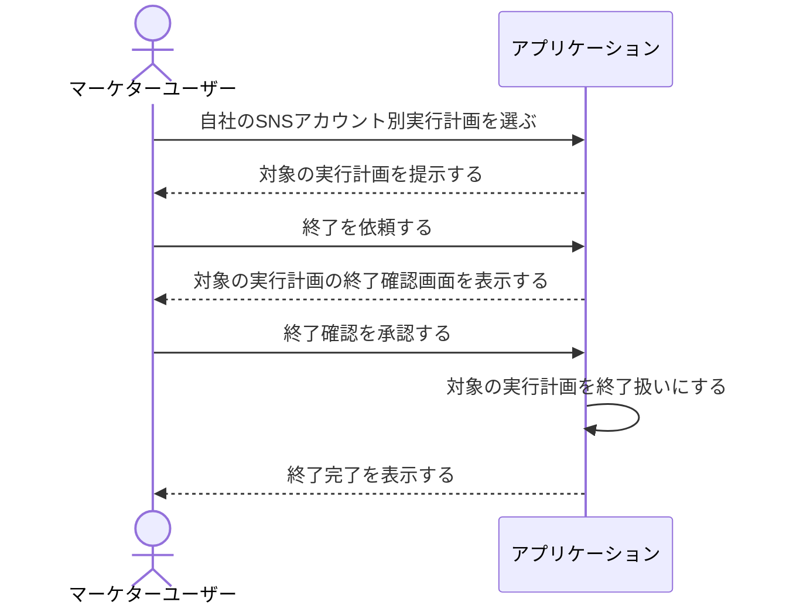

###### 処理仕様

| 条件 | 処理仕様 |
| --- | --- |
| 終了を依頼する | 対象の実行計画の終了確認画面を表示する。 |
| 終了確認を承認する | 対象の実行計画の終了処理を行う。 |
| 終了確認を取り消す | 現在の状態を保つ。 |
| 未終了の実行計画を終了する | 対象の実行計画を終了扱いにする。 |
| 終了済みの実行計画を終了する | 終了状態を維持し、成功として終了完了を表示する。 |
| 履歴を保持する | 実行計画を保持する。<br>過去の投稿を保持する。<br>過去の計測記録を保持する。 |

##### 例外処理

| 発生箇所 | 発生条件 | システムの応答 | その後の流れ |
| --- | --- | --- | --- |
| 実行計画を選ぶ | システムエラーによる読取失敗 | エラーを通知し、サービス提供者への連絡を案内する。 | サービス提供者へ連絡する。 |
| 終了処理を実行する | システムエラーによる終了処理失敗 | 実行計画を処理前の状態に保つ。<br>エラーを通知し、サービス提供者への連絡を案内する。 | サービス提供者へ連絡する。 |

#### 公開前の投稿を修正する

##### 正常系

```mermaid
sequenceDiagram
    actor User as マーケターユーザー
    participant App as アプリケーション
    User->>App: 公開前の投稿を選ぶ
    App-->>User: 保存済みの本文を提示する
    User->>App: 本文を修正して保存する
    App-->>User: 更新した投稿を提示する
```

###### 処理仕様

| 条件 | 処理仕様 |
| --- | --- |
| 投稿を編集する | 保存済みの投稿内容を読み込み、本文を編集する。 |
| 公開状況を判定する | ユーザーが明示的に公開済み登録した投稿を公開済みとして扱う。Web Intentを開いた後も、公開済み登録前は本文を編集できる。 |
| 保存する | 保存時点の公開状況を確認し、公開前の投稿の本文を入力した内容へ更新する。 |
| 公開前の投稿に同じ内容を再保存する | 保存済みの本文を維持し、保存完了を応答する。 |
| 同時保存 | 後からの保存による上書きを許容する。保存時点で公開済みの場合は本文更新を拒否する。 |
| 本文を検証する | 本文を必須とする。 |

##### 例外処理

| 発生箇所 | 発生条件 | システムの応答 | その後の流れ |
| --- | --- | --- | --- |
| 保存する | 保存時点で投稿が公開済み | 保存済みの本文を維持し、「この投稿は既に公開済みです」と応答する。 | 編集を終了する。 |
| 投稿を選ぶ | システムエラーによる読取失敗 | エラーを通知し、サービス提供者への連絡を案内する。 | サービス提供者へ連絡する。 |
| 保存する | 本文が空欄または空白のみ | 入力内容を保持する。<br>本文の入力を求め、更新を拒否する。 | 本文を入力して再保存する。 |
| 保存する | システムエラーによる保存失敗 | 入力内容を保持する。<br>エラーを通知し、サービス提供者への連絡を案内する。 | サービス提供者へ連絡する。 |

#### Xで投稿する

##### 正常系

```mermaid
sequenceDiagram
    actor User as マーケターユーザー
    participant App as アプリケーション
    participant X as X
    User->>App: X向けの投稿を選ぶ
    App-->>User: 保存済みの本文を提示する
    User->>App: Xでの投稿を開始する
    App-->>User: 本文を設定したWeb Intentのリンクを開く
    User->>X: 投稿画面で発信内容を確認する
    User->>X: 計画の対象SNSアカウントから投稿する
    X-->>User: 公開した投稿を表示する
```

###### 処理仕様

| 条件 | 処理仕様 |
| --- | --- |
| Xでの投稿を開始する | 処理開始時点の公開状況を確認し、公開前の場合は保存済みの本文を設定したWeb Intentのリンクを開く。 |
| Xの投稿画面を確認する | 利用者が、実行計画の対象SNSアカウントで投稿することを確認する。 |
| 利用停止後にWeb Intentから投稿する | X側での投稿を許容する。 |
| 発信内容を扱う | アプリ内の本文と実際の投稿文は一致しているものとして扱う。 |
| Xで公開した後 | 利用者が投稿URLと実際の公開日時を確認し、「投稿を公開済みにする」で記録する。 |
| 同じアプリ内投稿から複数のX投稿を公開した場合 | 重複公開への対応は利用者の責務とする。 |

##### 例外処理

| 発生箇所 | 発生条件 | システムの応答 | その後の流れ |
| --- | --- | --- | --- |
| 投稿を選ぶ | システムエラーによる読取失敗 | エラーを通知し、サービス提供者への連絡を案内する。 | サービス提供者へ連絡する。 |
| Xでの投稿を開始する | 投稿が既に公開済み | 「この投稿は既に公開済みです」とエラーを返し、Web Intentを開く処理を中断する。 | 投稿操作を終了する。 |
| Xで公開する | X側で投稿失敗 | Xの画面にエラーが表示される。 | 利用者がX側の案内に従って内容を確認し、再投稿する。 |

#### 投稿を公開済みにする

##### 正常系

```mermaid
sequenceDiagram
    actor User as マーケターユーザー
    participant App as アプリケーション
    Note over User,App: X上で公開済みで、求人は掲載中・SNSアカウントは運用対象・実行計画は未終了
    User->>App: 対象の投稿を開く
    User->>App: 投稿URLを入力する
    User->>App: 実際の公開日時を選択して公開済みにする
    App-->>User: 公開情報を保存し、公開済みの投稿として提示する
```

###### 処理仕様

| 条件 | 処理仕様 |
| --- | --- |
| 公開情報を入力する | Xで公開した投稿URLを手入力する。<br>実際の公開日時をウィジェットで選択する。 |
| 公開情報を検証する | 投稿URLを必須とする。<br>公開日時を必須とする。 |
| 保存する | 保存時点で求人が掲載中・SNSアカウントが運用対象・実行計画が未終了であることと、投稿の公開状況を確認する。公開前なら投稿URLと公開日時を保存して公開済みにする。 |
| 公開状況を変更する | ユーザーが明示的に公開済み登録した時点で、アプリ内の投稿を公開済みとして扱う。 |

##### 例外処理

| 発生箇所 | 発生条件 | システムの応答 | その後の流れ |
| --- | --- | --- | --- |
| 公開済みにする | 投稿URLが空欄または空白のみ | 入力内容を保持する。<br>投稿URLの入力を求め、保存を拒否する。 | 投稿URLを入力して再保存する。 |
| 公開済みにする | 公開日時が未選択 | 入力内容を保持する。<br>公開日時の選択を求め、保存を拒否する。 | 公開日時を選択して再保存する。 |
| 公開済みにする | 保存時点で投稿が既に公開済み | 保存済みの公開情報を維持する。<br>「この投稿は既に公開済みです」と表示し、保存済みの最新情報を取得して画面に反映する。 | 最新の公開情報を確認する。 |
| 公開済みにする | 保存時点で紐づく求人が掲載終了済み | 公開情報を保存する前の状態を維持し、求人が掲載終了済みである旨を表示して登録を拒否する。 | 公開済み登録を終了する。 |
| 公開済みにする | 保存時点で対象SNSアカウントが運用対象外 | 公開情報を保存する前の状態を維持し、SNSアカウントが運用対象外である旨を表示して登録を拒否する。 | 公開済み登録を終了する。 |
| 公開済みにする | 保存時点で実行計画が終了済み | 公開情報を保存する前の状態を維持し、実行計画が終了済みである旨を表示して登録を拒否する。 | 公開済み登録を終了する。 |
| 対象の投稿を開く | システムエラーによる読取失敗 | エラーを通知し、サービス提供者への連絡を案内する。 | サービス提供者へ連絡する。 |
| 公開済みにする | システムエラーによる保存失敗 | 入力内容を保持する。<br>エラーを通知し、サービス提供者への連絡を案内する。 | サービス提供者へ連絡する。 |

#### 投稿の反応を記録する

##### 正常系

```mermaid
sequenceDiagram
    actor User as マーケターユーザー
    participant App as アプリケーション
    participant X as X
    Note over User,App: 投稿は公開済みで、計画の記録指標は表示回数
    User->>X: 投稿のViewsを確認する
    X-->>User: 現在の表示数を提示する
    User->>App: 対象の投稿を選ぶ
    App-->>User: 計画で選択中の記録指標を提示する
    User->>App: 指標の値を入力する
    User->>App: 計測日時を選択して保存する
    App->>App: 指標の内容に応じて計測内容を検証する
    App-->>User: 計測記録を追加して提示する
```

###### 処理仕様

| 条件 | 処理仕様 |
| --- | --- |
| 対象の投稿を選ぶ | 公開済みの投稿を対象とする。 |
| 記録指標を提示する | 投稿が属する実行計画で選択中の指標を提示する。 |
| 計測内容を入力する | 指標の値を入力する。<br>計測日時をウィジェットで選択する。 |
| 計測内容を検証する | 指標の値を必須とする。<br>計測日時を必須とする。<br>指標の内容に応じて、入力した値を検証する。 |
| 重複を判定する | 同じ投稿・指標・計測日時・値の計測記録が保存済みか照合する。 |
| 保存する | 投稿と指標に紐づく計測記録を追加し、過去の計測記録を保持する。 |

##### 例外処理

| 発生箇所 | 発生条件 | システムの応答 | その後の流れ |
| --- | --- | --- | --- |
| 保存する | 投稿が公開前 | 公開情報の記録を案内し、計測記録の保存を拒否する。 | 投稿を公開済みにしてから記録する。 |
| 保存する | 同じ投稿・指標・計測日時・値の計測記録が保存済み | 保存済みの記録を維持し、計測記録の重複を表示して保存を拒否する。 | 保存済みの記録を確認する。 |
| 記録指標を提示する | 実行計画の記録指標が0件 | 実行計画への指標の追加を案内する。 | 実行計画で指標を追加してから記録する。 |
| 保存する | 指標の値が未入力 | 入力内容を保持する。<br>値の入力を求め、保存を拒否する。 | 値を入力して再保存する。 |
| 保存する | 入力した値が指標の検証条件を満たさない | 入力内容を保持する。<br>該当する指標の入力不備を表示し、保存を拒否する。 | 値を修正して再保存する。 |
| 保存する | 計測日時が未選択 | 入力内容を保持する。<br>計測日時の選択を求め、保存を拒否する。 | 計測日時を選択して再保存する。 |
| 対象の投稿と指標を提示する | システムエラーによる読取失敗 | エラーを通知し、サービス提供者への連絡を案内する。 | サービス提供者へ連絡する。 |
| 保存する | システムエラーによる保存失敗 | 入力内容を保持する。<br>エラーを通知し、サービス提供者への連絡を案内する。 | サービス提供者へ連絡する。 |
