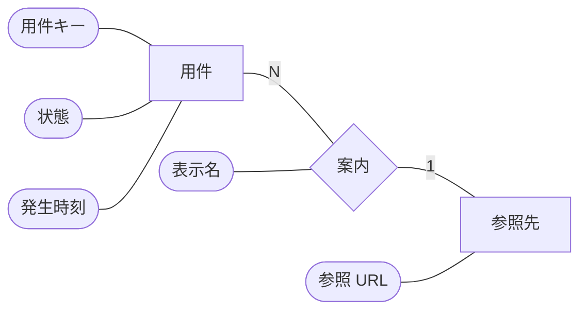

# ドメイン用語定義書

## 主要ドメイン用語一覧

| 主要ドメイン | 責務と周辺との境界 | 図 |
| --- | --- | --- |
| 用件 | 返信を待つ対象を表す。呼び出し側が、その対象の識別と状態変更の根拠を受け持つ。 | [概念図](#用件と参照先) |

## 主要ドメインのER図

### 用件と参照先

## ドメイン用語詳細

### 用件

ひとつの返信待ちを識別する単位。**返信待ち**は一覧で返信を促す状態、**完了**はその待ちが解消した状態で、元の依頼自体の解決とは区別する。

| 属性 | 意味 |
| --- | --- |
| 用件キー | 呼び出し側が同じ対象に使い続ける識別子 |
| 状態 | 返信待ち（`pending`）または完了（`done`） |
| 発生時刻 | 呼び出し側でその状態変更の根拠が生じた時刻 |

### 案内

返信待ちの用件から1つの参照先への対応。完了した用件には案内がない。表示名は、一覧でその参照先を示すラベルである。

### 参照先

用件の内容を確認できる場所。参照 URL はその場所を開くための HTTPS URL である。
