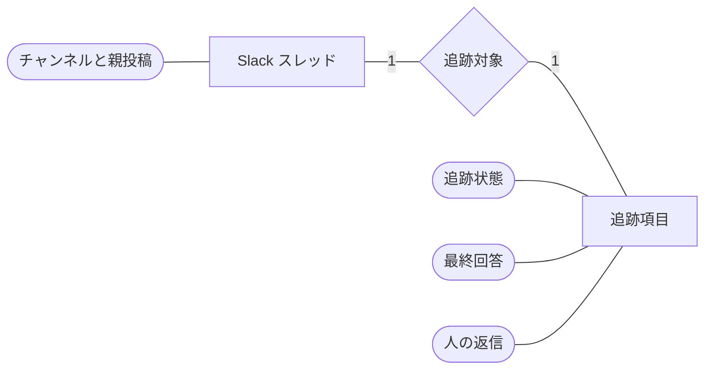

# ドメイン用語定義書

## 主要ドメイン用語一覧

| 主要ドメイン | 責務と周辺との境界 | 図 |
| --- | --- | --- |
| 追跡項目 | ひとつの会話で人からの返信を待っているかを表す。元の依頼の進捗は別の概念である。 | [追跡項目](#追跡項目) |

## 主要ドメインのER図

### 追跡項目

## ドメイン用語詳細

### Slack スレッド

#### 定義
Slack の親投稿と、その配下の返信からなる会話。

| 属性 | 意味 |
| --- | --- |
| チャンネルと親投稿 | 会話を特定する組み合わせ。表示名が同じチャンネルでも別の会話になりうる。 |

### 追跡対象

#### 定義
受理された Bot 宛てメンションの会話と追跡項目の対応。スレッドに対応する追跡項目は最大1件であり、初回の最終回答が成立する前は0件である。

属性：該当なし。

### 追跡項目の内容

#### 定義
最終回答に対する連絡の有無を示す、一覧の単位。

| 属性 | 意味 |
| --- | --- |
| 最終回答 | 対象の会話に Bot が投稿し終えた回答。最新の回答が一覧リンクの参照先となる。 |
| 人の返信 | そのスレッドに人が新しく投稿した返信。依頼者以外からの返信も含む。 |
| 追跡状態 | **返信待ち**は最新の最終回答より後に人の返信がない状態。**完了**はそれより後に人の返信がある状態で、元の依頼の解決を意味しない。 |
