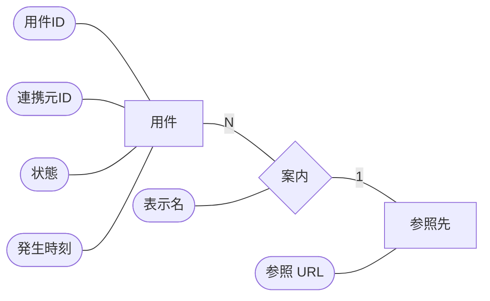

# ドメイン用語定義書

## 主要ドメイン用語一覧

| 主要ドメイン | 責務と周辺との境界 | 図 |
| --- | --- | --- |
| 用件 | 返信を待つ対象を表す。呼び出し側が、その対象の識別と状態変更の根拠を受け持つ。 | [概念図](#用件と参照先) |

## 主要ドメインのER図

### 用件と参照先

## ドメイン用語詳細

### 用件

#### 定義

人からの返信を待つ対象。

#### アトリビュート一覧

| アトリビュート | 説明 |
| --- | --- |
| 用件ID | reply-watch 内で用件を一意に識別する値 |
| 連携元ID | 呼び出し側で対象を一意に識別する値 |
| 状態 | 返信待ち、または完了。完了は返信待ちの解消を指し、元の依頼の解決とは区別する。 |
| 発生時刻 | 呼び出し側でその状態変更の根拠が生じた時刻 |

### 案内

#### 定義

返信待ちの用件とその参照先の関係。完了した用件はこの関係に参加しない。

#### アトリビュート一覧

| アトリビュート | 説明 |
| --- | --- |
| 表示名 | 一覧で参照先を示すラベル |

### 参照先

#### 定義

用件の内容を確認できる場所。

#### アトリビュート一覧

| アトリビュート | 説明 |
| --- | --- |
| 参照 URL | 参照先を開くための URL |
