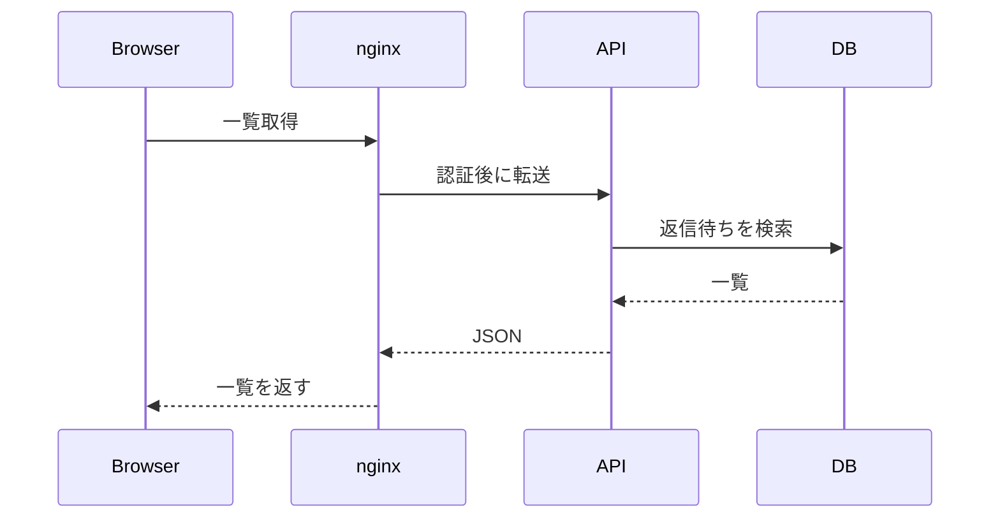
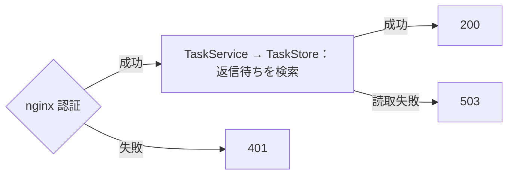
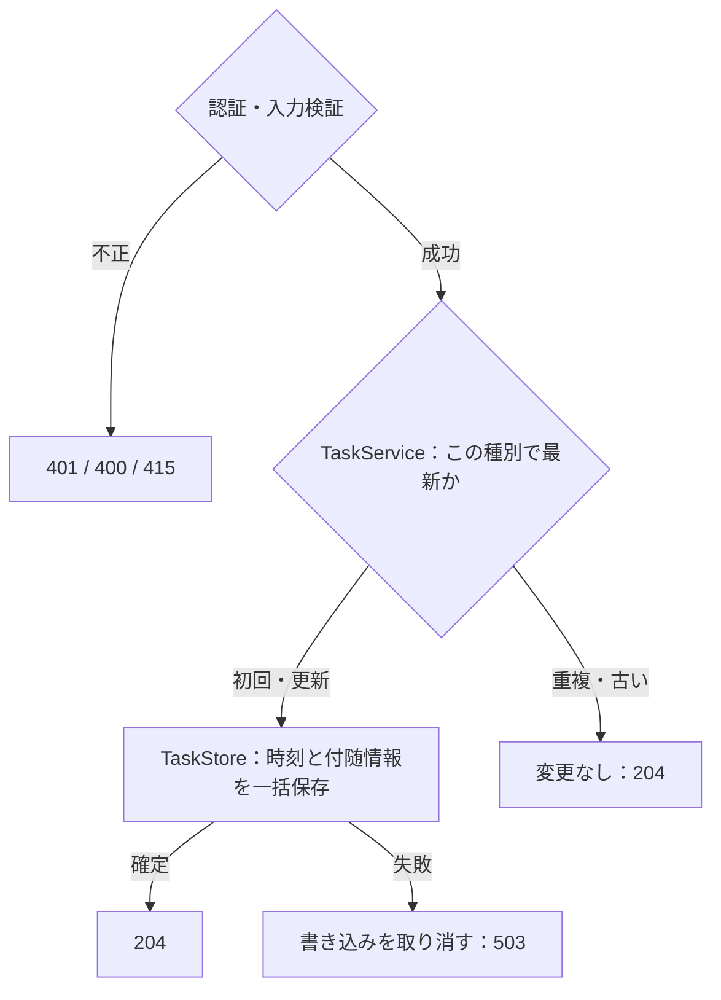

# API設計：返信待ちの管理

## API一覧

| メソッド | パス | 処理概要 |
| --- | --- | --- |
| GET | [`/task/api/pending`](#get-taskapipending) | 返信待ち一覧を取得 |
| POST | [`/internal/slack-events`](#post-internalslack-events) | 対象の会話で起きた投稿を通知 |

## GET `/task/api/pending`

### 処理概要
最新の最終回答時刻の降順で返信待ちだけを返す。

### 関連ユースケース

| ケース | 条件 | 入力 | 結果 |
| --- | --- | --- | --- |
| [回答を開く](USECASE.md#回答を開く) | 認証済み | 一覧取得 | チャンネル名と回答リンクの配列。0件なら空配列 |

### 認可
[外部 API の認証方式](../../EXTERNAL_API_INDEX.md)に従う。一覧閲覧者にはすべての返信待ち項目が見える。

### シーケンス図


### 処理フロー図


### リクエスト
パス・クエリ引数とボディは使用しない。

```http
GET /task/api/pending HTTP/1.1
Authorization: Basic <credentials>
```

### レスポンス
`200 OK`。`items` は必須の配列。各要素の `channel_name` は `#` を含まない名前、`reply_url` は最新の最終回答を指す HTTPS URL（いずれも必須の文字列）。

```http
HTTP/1.1 200 OK
Content-Type: application/json
Cache-Control: no-store

{"items":[{"channel_name":"butler","reply_url":"https://example.slack.com/archives/C123/p1800000001123456"}]}
```

### エラー

| HTTP | コード | 条件 | 応答 |
| --- | --- | --- | --- |
| 401 | — | 閲覧認証に失敗 | nginx が Basic 認証を要求 |
| 503 | `unavailable` | DB を読み取れない | `{"error":"unavailable"}` |

## POST `/internal/slack-events`

### 処理概要
ブリッジが通知した投稿を反映し、そのスレッドの追跡状態を確定する。

### 関連ユースケース

| ケース | 条件 | 入力 | 結果 |
| --- | --- | --- | --- |
| [追跡を開始する](USECASE.md#追跡を開始する) | 受理したメンションの会話 | 初回の最終回答 | 最新投稿が最終回答なら返信待ち |
| [返信待ちを完了する](USECASE.md#返信待ちを完了する) | 最終回答より後の投稿 | 人の返信 | 完了 |
| [追跡を再開する](USECASE.md#追跡を再開する) | 人の返信より後の投稿 | 新しい最終回答 | 最新リンクで返信待ち |

### 認可
[内部 API の認証方式](../../INTERNAL_API_INDEX.md)に従う。対象会話か、最終回答か、人の新規投稿かの識別はブリッジが保証する。

### シーケンス図


### 処理フロー図


### リクエスト

| 場所 | 項目 | 型 | 必須 | 意味・制約 |
| --- | --- | --- | --- | --- |
| Header | Authorization | string | 〇 | `Bearer <token>` |
| Body | type | string | 〇 | `bot_final` または `human_reply` |
| Body | channel_id | string | 〇 | 空でない Slack チャンネル ID |
| Body | thread_ts | string | 〇 | 親投稿の Slack 時刻。秒と小数6桁をピリオドで連結 |
| Body | message_ts | string | 〇 | 当該投稿の Slack 時刻。同形式、親より後。比較時は整数マイクロ秒に変換 |
| Body | channel_name | string | 条件付き | `bot_final` のみ必須。`#` を除く非空の名前 |
| Body | reply_url | string | 条件付き | `bot_final` のみ必須。対象ワークスペースの当該回答への Slack HTTPS パーマリンク |

```http
POST /internal/slack-events HTTP/1.1
Authorization: Bearer <token>
Content-Type: application/json

{"type":"bot_final","channel_id":"C123","thread_ts":"1800000000.000001","message_ts":"1800000001.123456","channel_name":"butler","reply_url":"https://example.slack.com/archives/C123/p1800000001123456"}
```

同じスレッドの人の返信では、次のボディを送る。

```json
{"type":"human_reply","channel_id":"C123","thread_ts":"1800000000.000001","message_ts":"1800000002.000003"}
```

### レスポンス
初回・更新・再送とも `204 No Content`。ボディは空。到着順が逆転した場合も[状態の決定](../../ARCHITECTURE.md#状態の決定)に従う。

```http
HTTP/1.1 204 No Content
```

### エラー
エラー本文は `{"error":"コード"}`。通信失敗・503 は同一通知を再送する。

| HTTP | コード | 条件 | 応答 |
| --- | --- | --- | --- |
| 400 | `invalid_event` | JSON・種別・必須項目・値の制約違反 | 入力を拒否 |
| 401 | `unauthorized` | トークンなし・不一致 | 受付を拒否 |
| 415 | `unsupported_media_type` | JSON 以外 | 入力を拒否 |
| 503 | `unavailable` | DB 処理失敗 | 未確定で終了 |
