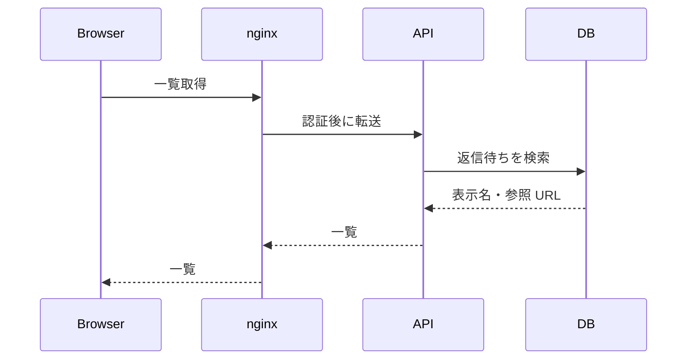
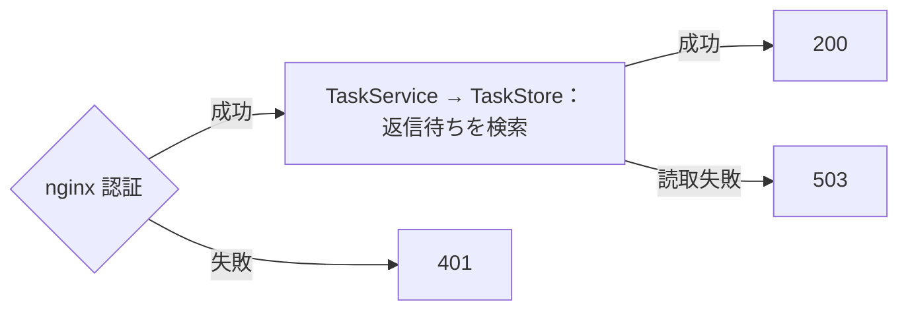
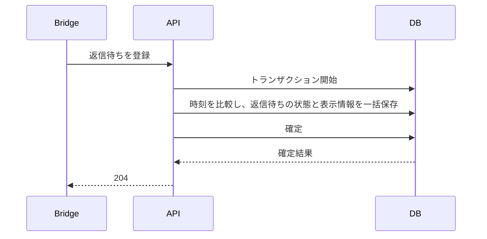
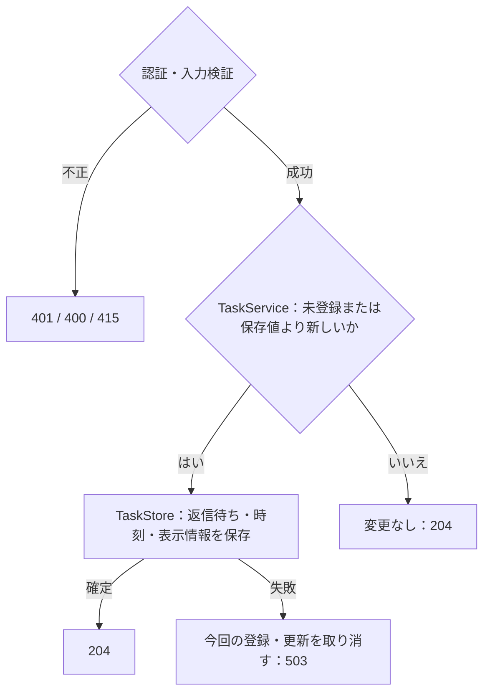
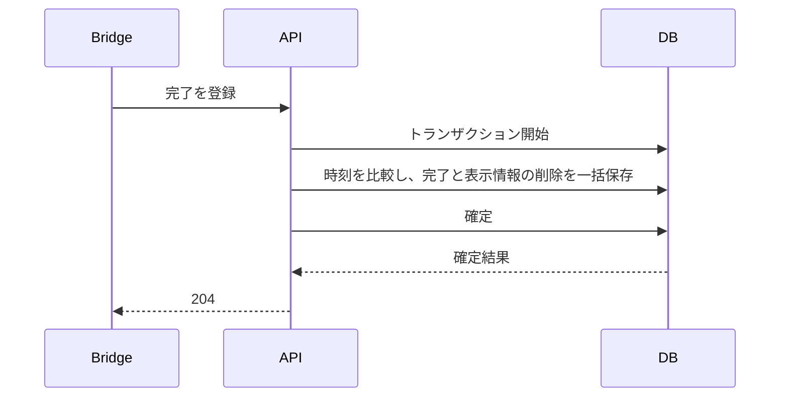
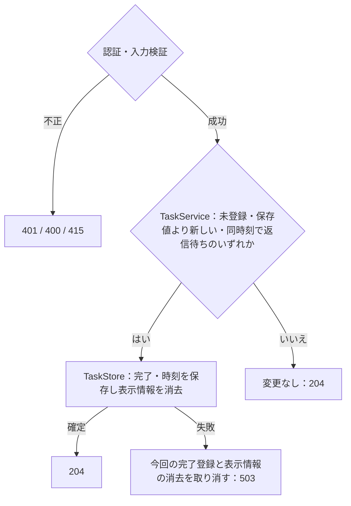

# API設計: 用件管理

## API一覧

| メソッド | パス | 処理概要 |
| --- | --- | --- |
| GET | [`/task/api/pending`](#get-taskapipending) | 返信待ち一覧の取得 |
| PUT | [`/internal/reply/{source_id}/pending`](#put-internalreplysource_idpending) | 用件の登録・再開 |
| PUT | [`/internal/reply/{source_id}/done`](#put-internalreplysource_iddone) | 用件の完了 |

## GET `/task/api/pending`

### 処理概要
返信待ちの用件を発生時刻の降順（同時刻は用件IDの昇順）で返す。

### 関連ユースケース

| ケース名 | 呼び出し条件 | リクエストの内容 | 期待する結果 |
| --- | --- | --- | --- |
| [回答を開く](USECASE.md#回答を開く) | 一覧の表示・更新 | 一覧取得 | 返信待ちの用件の表示名と参照 URL が返る |

### 認可

| 項目 | 内容 |
| --- | --- |
| 操作可能権限 | [一覧閲覧者](../../EXTERNAL_API_INDEX.md) |
| 操作対象の条件 | 返信待ちの用件 |

### シーケンス図



### 処理フロー図



### リクエスト

| 場所 | 項目名 | 型 | 必須 | 意味 | 制約 |
| --- | --- | --- | --- | --- | --- |
| Header | Authorization | string | 〇 | 閲覧認証 | Basic |

#### リクエスト例

```http
GET /task/api/pending HTTP/1.1
Authorization: Basic <credentials>
```

### レスポンス

#### HTTPステータスコード
200 OK

#### 返却項目

| 項目名 | 型 | 意味 | 制約 |
| --- | --- | --- | --- |
| items | array | 返信待ち一覧 | 0件は空配列 |
| items[].display_name | string | 表示名 | 必須 |
| items[].reference_url | string | 参照 URL | 絶対 HTTPS URL |

#### レスポンス例

```http
HTTP/1.1 200 OK
Content-Type: application/json
Cache-Control: no-store

{"items":[{"display_name":"連絡窓口","reference_url":"https://example.org/messages/123"}]}
```

### エラー

| HTTPステータス | 返却エラーコード | 発生条件 | 応答内容 |
| --- | --- | --- | --- |
| 401 | — | 閲覧認証失敗 | nginx が Basic 認証を要求 |
| 503 | unavailable | DB 読取失敗 | `{"error":"unavailable"}` |

## PUT `/internal/reply/{source_id}/pending`

### 処理概要
指定の連携元IDに対応する用件を返信待ちにする。

### 関連ユースケース

| ケース名 | 呼び出し条件 | リクエストの内容 | 期待する結果 |
| --- | --- | --- | --- |
| [用件を登録する](USECASE.md#用件を登録する) | 初回の最終回答 | 連携元ID・発生時刻・表示名・参照 URL | 返信待ちとして登録 |
| [返信待ちを再開する](USECASE.md#返信待ちを再開する) | 完了後の再回答 | 同じ連携元ID・新しい発生時刻と表示情報 | 同じ用件が新しい参照 URL で再表示される |

### 認可

| 項目 | 内容 |
| --- | --- |
| 操作可能権限 | [ブリッジ](../../INTERNAL_API_INDEX.md) |
| 操作対象の条件 | 指定の連携元IDの用件（未登録を含む） |

### シーケンス図



### 処理フロー図



### リクエスト

| 場所 | 項目名 | 型 | 必須 | 意味 | 制約 |
| --- | --- | --- | --- | --- | --- |
| Header | Authorization | string | 〇 | 内部認証 | Bearer |
| Path | source_id | string | 〇 | 連携元ID | 英数字・`_`・`-` の1～255文字 |
| Body | occurred_us_at | integer | 〇 | 発生時刻（Unix マイクロ秒） | 0～9007199254740991 |
| Body | display_name | string | 〇 | 表示名 | 空文字・空白のみは不可 |
| Body | reference_url | string | 〇 | 参照 URL | 絶対 HTTPS URL |

#### リクエスト例

```http
PUT /internal/reply/slack_T123_C456_1800000000_000001/pending HTTP/1.1
Authorization: Bearer <token>
Content-Type: application/json

{"display_name":"連絡窓口","reference_url":"https://example.org/messages/123","occurred_us_at":1800000001123456}
```

### レスポンス

#### HTTPステータスコード
204 No Content

#### 返却項目
該当なし。

#### レスポンス例

```http
HTTP/1.1 204 No Content
```

### エラー

| HTTPステータス | 返却エラーコード | 発生条件 | 応答内容 |
| --- | --- | --- | --- |
| 400 | invalid_request | 入力の形式・制約違反 | `{"error":"invalid_request"}` |
| 401 | unauthorized | トークンなし・不一致 | `{"error":"unauthorized"}` |
| 415 | unsupported_media_type | JSON 以外 | `{"error":"unsupported_media_type"}` |
| 503 | unavailable | DB 処理失敗 | `{"error":"unavailable"}` |

## PUT `/internal/reply/{source_id}/done`

### 処理概要
指定の連携元IDに対応する用件を完了にする。

### 関連ユースケース

| ケース名 | 呼び出し条件 | リクエストの内容 | 期待する結果 |
| --- | --- | --- | --- |
| [返信待ちを完了する](USECASE.md#返信待ちを完了する) | 最終回答後の返信 | 同じ連携元IDと返信の発生時刻 | 完了として記録され、一覧から外れる |
| [スレッドの追跡を終了する](USECASE.md#スレッドの追跡を終了する) | ブリッジが終了コマンドを受理 | 同じ連携元IDとコマンドの発生時刻 | 通常の完了と同じく一覧から外れる |

### 認可

| 項目 | 内容 |
| --- | --- |
| 操作可能権限 | [ブリッジ](../../INTERNAL_API_INDEX.md) |
| 操作対象の条件 | 指定の連携元IDの用件（未登録を含む） |

### シーケンス図



### 処理フロー図



### リクエスト

| 場所 | 項目名 | 型 | 必須 | 意味 | 制約 |
| --- | --- | --- | --- | --- | --- |
| Header | Authorization | string | 〇 | 内部認証 | Bearer |
| Path | source_id | string | 〇 | 連携元ID | 英数字・`_`・`-` の1～255文字 |
| Body | occurred_us_at | integer | 〇 | 発生時刻（Unix マイクロ秒） | 0～9007199254740991 |

#### リクエスト例

```http
PUT /internal/reply/slack_T123_C456_1800000000_000001/done HTTP/1.1
Authorization: Bearer <token>
Content-Type: application/json

{"occurred_us_at":1800000002000003}
```

### レスポンス

#### HTTPステータスコード
204 No Content

#### 返却項目
該当なし。

#### レスポンス例

```http
HTTP/1.1 204 No Content
```

### エラー

| HTTPステータス | 返却エラーコード | 発生条件 | 応答内容 |
| --- | --- | --- | --- |
| 400 | invalid_request | 入力の形式・制約違反 | `{"error":"invalid_request"}` |
| 401 | unauthorized | トークンなし・不一致 | `{"error":"unauthorized"}` |
| 415 | unsupported_media_type | JSON 以外 | `{"error":"unsupported_media_type"}` |
| 503 | unavailable | DB 処理失敗 | `{"error":"unavailable"}` |
