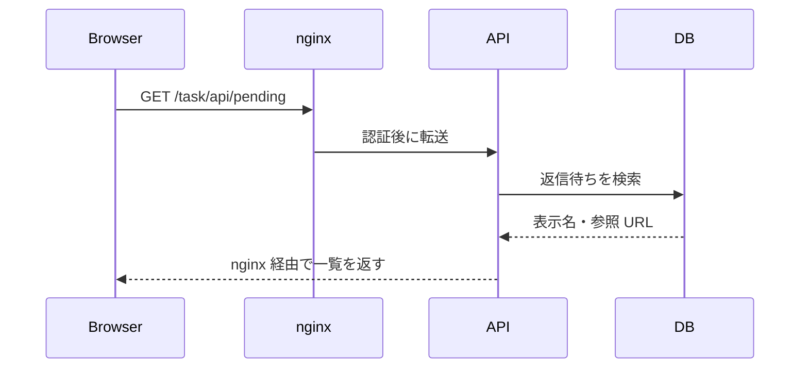
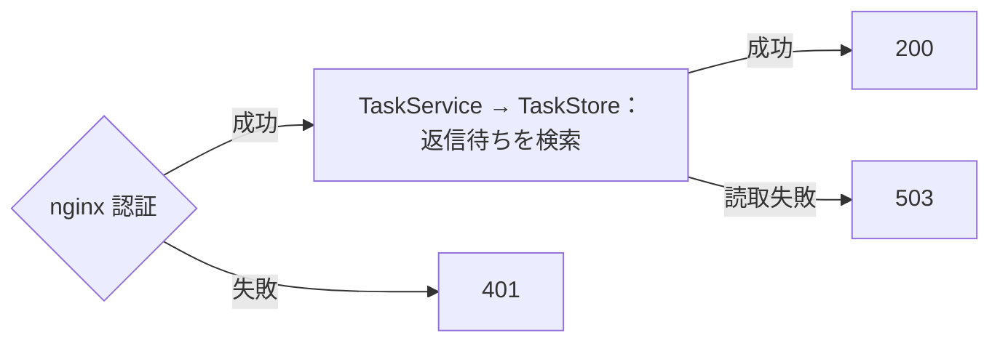
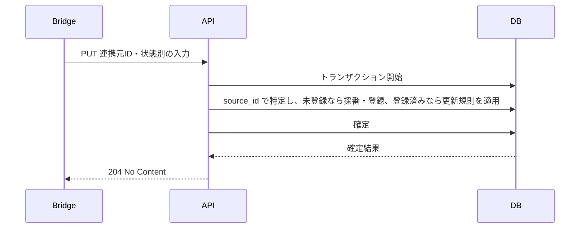
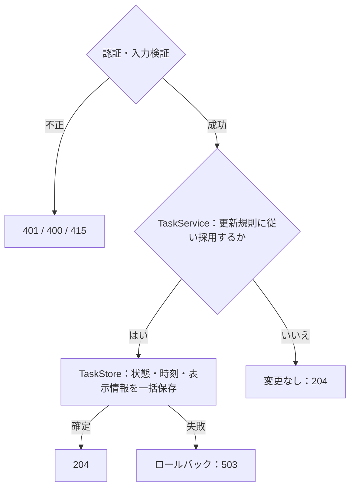

# API設計：用件管理

## API一覧

| メソッド | パス | 処理概要 |
| --- | --- | --- |
| GET | [`/task/api/pending`](#返信待ち一覧の取得) | 返信待ち一覧の取得 |
| PUT | [`/internal/reply/{source_id}/pending`](#返信待ちの登録) | 用件の登録・再開 |
| PUT | [`/internal/reply/{source_id}/done`](#完了の登録) | 用件の完了 |

## 返信待ち一覧の取得

### 処理概要・関連ユースケース
[回答を開く](USECASE.md#回答を開く)。[閲覧認証](../../EXTERNAL_API_INDEX.md)を通過した利用者に、返信待ちの用件を発生時刻の降順（同時刻は用件IDの昇順）で返す。

### シーケンス図


### 処理フロー図


### リクエスト・レスポンス
クエリ・ボディなし。`items` は必須の配列で、0件なら空配列。各要素の `display_name` と `reference_url` は必須の文字列。

```http
GET /task/api/pending HTTP/1.1
Authorization: Basic <credentials>
```

```http
HTTP/1.1 200 OK
Content-Type: application/json
Cache-Control: no-store

{"items":[{"display_name":"連絡窓口","reference_url":"https://example.org/messages/123"}]}
```

### エラー
認証失敗は nginx の `401`（Basic 認証要求）。DB を読み取れない場合は `503` と `{"error":"unavailable"}` を返す。

## 返信待ちの登録

### 処理概要・関連ユースケース
[用件を登録する](USECASE.md#用件を登録する)・[返信待ちを再開する](USECASE.md#返信待ちを再開する)。指定の `source_id` に対応する用件に表示名・参照 URL を設定して返信待ちにする。

### リクエスト

```http
PUT /internal/reply/slack_T123_C456_1800000000_000001/pending HTTP/1.1
Authorization: Bearer <token>
Content-Type: application/json

{"display_name":"連絡窓口","reference_url":"https://example.org/messages/123","occurred_us_at":1800000001123456}
```

| Body 項目 | 型 | 制約 |
| --- | --- | --- |
| `display_name` | string | 必須、空白のみは不可 |
| `reference_url` | string | 必須、絶対 HTTPS URL |
| `occurred_us_at` | integer | 必須、[共通契約](#内部-api-の共通契約)参照 |

## 完了の登録

### 処理概要・関連ユースケース
[返信待ちを完了する](USECASE.md#返信待ちを完了する)。指定の `source_id` に対応する用件の完了を記録し、一覧から外す。未登録でも用件IDを自動採番し、完了時刻を保存する。

### リクエスト

```http
PUT /internal/reply/slack_T123_C456_1800000000_000001/done HTTP/1.1
Authorization: Bearer <token>
Content-Type: application/json

{"occurred_us_at":1800000002000003}
```

ボディ項目は `occurred_us_at` のみ必須。型・認可・応答は以下に従う。

## 内部 API の共通契約

[内部認証](../../INTERNAL_API_INDEX.md)を通過したブリッジのみ呼び出せる。パスの `source_id` は呼び出し側が一意に割り当てる不透明な文字列（英数字・`_`・`-` の1～255文字）。ブリッジは用件IDの取得・指定を必要としない。`occurred_us_at` は Unix マイクロ秒を表す非負の JSON 整数で、Node.js の安全な整数範囲内とする。同じ操作の再送には同じ `source_id`・時刻・ボディを使う。

### シーケンス図


### 処理フロー図


### レスポンス
[用件の更新規則](../../ARCHITECTURE.md#用件の更新規則)を適用し、初回・更新・古い操作・再送ともにボディなしで応答する。

```http
HTTP/1.1 204 No Content
```

### エラー
本文は `{"error":"コード"}`。呼び出し側は通信失敗・503 の場合に同じ操作を再送する。

| HTTP | コード | 発生条件 | 応答 |
| --- | --- | --- | --- |
| 400 | `invalid_request` | JSON・連携元ID・ボディ項目の制約違反 | 変更なし |
| 401 | `unauthorized` | トークンなし・不一致 | 変更なし |
| 415 | `unsupported_media_type` | JSON 以外 | 変更なし |
| 503 | `unavailable` | DB 処理失敗 | 未確定で終了 |
