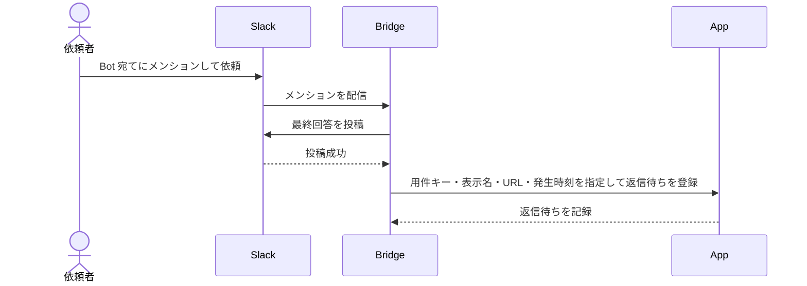
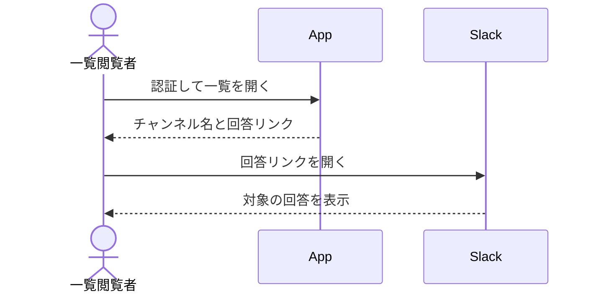
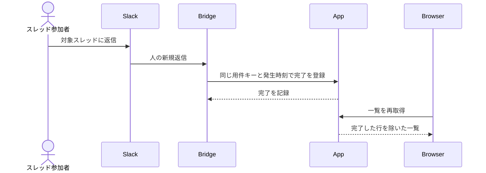
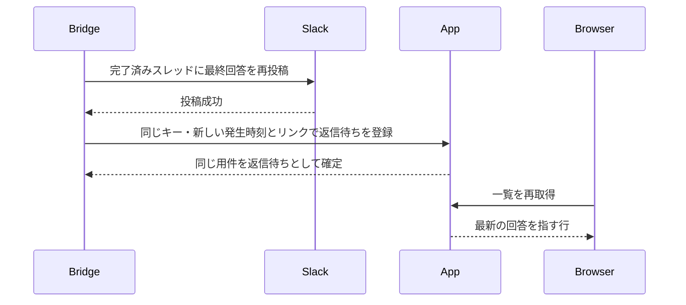

# ユースケース設計書：返信待ちの管理

## ユースケース一覧

| ユースケース名 | 操作対象ドメイン | 操作者 | 利用目的 |
| --- | --- | --- | --- |
| [用件を登録する](#用件を登録する) | 用件 | ブリッジ | Bot が回答した会話を一覧に載せる |
| [回答を開く](#回答を開く) | 用件 | 一覧閲覧者 | 返信先の回答を確認する |
| [返信待ちを完了する](#返信待ちを完了する) | 用件 | スレッド参加者 | 返信済みの会話を一覧から外す |
| [返信待ちを再開する](#返信待ちを再開する) | 用件 | ブリッジ | 再回答した会話を再び一覧に載せる |

## ユースケース詳細

### 用件を登録する

#### 正常系

#### 例外処理
| 発生箇所 | 発生条件 | システムの応答 | その後の流れ |
| --- | --- | --- | --- |
| 回答投稿 | 投稿失敗、または進捗通知だけ | ブリッジは用件を登録しない | 最終回答の投稿成功を待つ |

### 回答を開く

#### 正常系

#### 例外処理
| 発生箇所 | 発生条件 | システムの応答 | その後の流れ |
| --- | --- | --- | --- |
| 一覧更新 | 取得失敗 | 更新エラーを表示 | 次の更新で再取得する |
| リンクを開く | Slack 側の閲覧権限不足 | Slack 側で閲覧が制限される | 利用者が参加権限を確認する |

### 返信待ちを完了する

#### 正常系

#### 例外処理
| 発生箇所 | 発生条件 | システムの応答 | その後の流れ |
| --- | --- | --- | --- |
| 返信の識別 | 別スレッドの投稿または編集 | 元スレッドの状態を維持 | 同じスレッドへの新規返信を待つ |

### 返信待ちを再開する

#### 正常系

#### 例外処理
| 発生箇所 | 発生条件 | システムの応答 | その後の流れ |
| --- | --- | --- | --- |
| 返信待ちの登録 | 完了より古い操作が遅れて届く | 完了のまま非表示 | 新しい返信待ちの登録で再開する |
